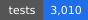

# Megi — Progress

<!-- Generated by tools/update_progress.py — do not edit by hand. -->

    

**Snapshot** — commit `429c7a4a` (2026-11-25) · hitos cerrados **4/13** · criterios verificados **40/64** (**62%**) · **3,474** tests · conformance **PASS** · **18** crates · **258,154** lines of Rust

> Generated from `docs/status/progress.toml` plus measured repository data (git HEAD/date, `cargo test --workspace -- --list`, `test_harness --summary`, crate list and `#![forbid(unsafe_code)]` scan). Each bar counts acceptance criteria with cited evidence; no phase estimate is involved.

[Progress map SVG](docs/status/progress.svg) · [Capability coverage report](docs/status/coverage.html) (76/76 implemented; separate, self-referential report) · [Real-site render check](docs/status/real-sites.html).

## Hitos M0–M12 — criterios verificados

> A milestone closes only when every acceptance criterion is verified. See the approved roadmap: [spec v2 §4.1](docs/superpowers/specs/2026-11-24-megi-ambition-design.md) and [master plan](docs/superpowers/plans/2026-11-24-megi-ambition-master-plan.md).

| Hito | Objetivo | Criterios verificados | % |
|---|---|---|---|
| **M0** | Verdad y cimiento | `████████████████████` 7/7 | 100% |
| **M1** | Interactividad | `████████████████████` 4/4 | 100% |
| **M2** | Profundidad declarativa | `████████████████░░░░` 4/5 | 80% |
| **M3** | Frontera de seguridad | `████████████████████` 5/5 | 100% |
| **M4** | Componentes y persistencia | `████████████████░░░░` 5/6 | 83% |
| **M5** | Plataforma nativa | `█████████████░░░░░░░` 4/6 | 66% |
| **M6** | Gráficos y media | `██████░░░░░░░░░░░░░░` 2/6 | 33% |
| **M7** | Herramientas de desarrollador | `████████░░░░░░░░░░░░` 2/5 | 40% |
| **M8** | Motor ofensivo | `████████████░░░░░░░░` 3/5 | 60% |
| **M9** | Producción | `████████░░░░░░░░░░░░` 2/5 | 40% |
| **M10** | Plataforma extendida | `░░░░░░░░░░░░░░░░░░░░` 0/5 | 0% |
| **M11** | Integración nativa | `░░░░░░░░░░░░░░░░░░░░` 0/3 | 0% |
| **M12** | Cobertura media/legal | `████████████████████` 2/2 | 100% |
| | **Roadmap** | `████████████░░░░░░░░` 40/64 | **62%** |

## Detalle de criterios por hito

### M0 — Verdad y cimiento (100%)

**Verificado**

- Gate de conformidad PASS en 4 suites — `cargo run --release -p megi-test-harness -- --summary`
- 17/17 crates con `#![forbid(unsafe_code)]` — `python3 tools/check_arch.py`
- Progreso publicado sin estimaciones de fase — `PROGRESS.md` derivado de criterios
- Informe WPT con `P/T` y SHA de la época — `docs/status/wpt.md`: ab2ef95, 30/30, allowlist 0; gate `python3 tools/wpt_gate.py --check`
- Release con verify + firma — `.github/workflows/release.yml`: job `verify` comprueba sha256 y firma con cosign keyless; `python3 -m unittest tools.test_release_workflow`
- F0: cookies same-site y no HttpOnly en el IPC; el renderer ya no devuelve cookies al parent — `cargo test -p megi-browser --test ipc_semantic_tests`
- 0 fugas T1/T2/T3/T5/T9 auditadas (F0) — `docs/ISOLATION-STRATEGY.md` (Auditoría F0) + `cargo test -p megi-browser --test ipc_semantic_tests --test file_grant_tests --test spawn_hardening_tests --test watchdog_tests` + `python3 -m unittest tools.test_docs_consistency`

### M1 — Interactividad (100%)

**Verificado**

- Shell con pestañas, historial, zoom, formularios y descargas — `crates/browser/src/{chrome,forms,download}.rs`
- Render en hilo de trabajo con generación cancelable — `crates/browser/src/worker.rs`
- 10 fixtures E2E de tarea de usuario — `cargo test -p megi-render --test e2e_task_fixtures` (10/10 PASS, 0 `console_errors`)
- Corpus sin console_errors — `docs/status/real-sites.json` (4/4 sitios con `console_errors = 0`)

### M2 — Profundidad declarativa (80%)

**Verificado**

- Animaciones CSS `@keyframes`/`transition` en runtime — `crates/css/src/animation_runtime.rs`
- SVG con texto, gradientes y patterns — `crates/svg/src/`
- Canvas 2D utilizable (rutas, ángulos `arc`, Bézier, transformaciones, `save`/`restore`, gradientes lineales y `drawImage`) — `crates/js/src/canvas/{path.rs,state.rs}`, `tests/fixtures/render/canvas_paths.html`; `cargo test -p megi-js --test canvas_paths_tests && cargo test -p megi-render --test canvas_tests`
- Bidi y CJK completos — `cargo +1.99.1 test -p megi-layout --test bidi_tests --locked -- --test-threads=1` (7 passed), `cargo +1.99.1 test -p megi-layout --lib bidi --locked -- --test-threads=1` (8 passed), `cargo +1.99.1 test -p megi-fonts --test font_engine shaping --locked -- --test-threads=1` (12 passed); `crates/layout/src/bidi.rs:346-428`, `crates/layout/src/bidi/bidi_tests.rs:8-124`, `crates/layout/tests/bidi_tests.rs:47-145`, `crates/layout/src/inline/tokens.rs:297-392`; commits `188b8e53`, `6f812d65`

**Pendiente**

- Fixtures con md5 estable tras completar los solapes conocidos

### M3 — Frontera de seguridad (100%)

**Verificado**

- 31+ targets de fuzz compilados (34 en `fuzz/fuzz_targets/`, incluyendo `ipc_wire`, `ipc_response`, `net_file_url`) — `find fuzz/fuzz_targets -name '*.rs' | wc -l`
- Cookies SameSite con PSL vendored — `crates/net/src/`
- F1: sobre IPC versionado (`MEGI` v1) y validación semántica `Validated<IpcRenderResponse>` — `cargo test -p megi-browser --test ipc_validation_tests --test process_e2e_tests`
- Sandbox enforced con selector por SO — `cargo test -p megi-browser --test sandbox_e2e_tests` (13/13: 12 negativas + 1 humo; 14/14 con el probe inerte); `render_security_matrix()` = `linux: enforced; macos: unsupported; windows: unsupported`; `python3 tools/check_milestone.py M3 4` PASS
- 0 fugas cross-site y 12 pruebas negativas por SO — `docs/audit/negative-matrix.toml`: linux 12/12 pass, macos/windows 12/12 unsupported; `python3 tools/audit_negative_matrix.py --check` PASS

### M4 — Componentes y persistencia (83%)

**Verificado**

- Shadow roots declarativos — `crates/render/src/shadow_dom.rs`
- Web Storage expuesto a JS — `crates/js/src/host/types.rs`
- 100+ subtests WPT de componentes — `docs/status/wpt.md`: 592/592 subtests WPT PASS con allowlist 0; 114 subtests reales de shadow-dom/custom-elements (75 shadow-dom + 39 custom-elements) ejecutados con el runner offline de Boa y shim `testharness`; fixtures adoptados íntegramente `shadow-dom/HTMLSlotElement-interface.html` 18/18, `shadow-dom/Slotable-interface.html` 4/4, `shadow-dom/slots.html` 26/26; implementación WHATWG DOM §4.9.1/§4.9.3 en `crates/js/src/runtime/{node_wrappers.rs,tla/accessors.rs,document/query.rs,globals/features.rs,node_accessors.rs}`; `cargo test -p megi-js` y `cargo test -p megi-test-harness` EXIT=0; `python3 tools/wpt_gate.py --check` PASS y `python3 tools/check_milestone.py M4 3` PASS
- Service Worker fase 1 en memoria — `crates/js/src/runtime/service_worker/{ops.rs,natives.rs,sw_prelude.js}` y `try_fetch` en `runtime/service_worker.rs`/`network.rs`: register → activate → fetch('/data.txt') servido desde caché sin llamar al provider; cross-origin y `/app` vs `/application` no interceptados (WHATWG SW Appendix A «Match Service Worker Registration»); `Cache.put` agotado lanza `QuotaExceededError` (W3C Cache API §5.4); TDD rojo `cargo test -p megi-js --test service_worker_tests` EXIT=101 (4/6: scope devolvió FROM-SW-CACHE en vez de FROM-NETWORK; quota devolvió ReferenceError), verde EXIT=0 (6/6); relacionados fetch_abort 11/11 + fetch 16/16 + workers 26/26 EXIT=0; `cargo fmt -p megi-js -- --check` y `cargo clippy -p megi-js --all-targets -- -D warnings` EXIT=0; rama rebaseada sobre 5755a816 conservando WebGL; harness `cargo run -p megi-test-harness -- --summary` PASS; gates M4 --match, update_progress --check --no-gate --no-count, update_coverage --check, audit_coverage --check --strict, check_arch, check_docs_links, deslop-please y unittests de tools EXIT=0; límites: fase 1 en memoria, bodies UTF-8, sin versioning completo, cancelación solo pre-abort en fetch (sin AbortSignal en el despacho SW), sin demo offline de documento (M4#6)
- Demo offline con red cortada — `tests/fixtures/render/sw_offline.html` (846 B, autocontenido) registrado por un SW, proveedor de red cortado, `fetch('/not-cached.html')` verificado como fallido y recarga real servida desde la caché del SW; `crates/js/src/runtime/service_worker.rs`: `SwNavigationResponse` + `try_navigation` sobre `try_fetch`; `crates/render/src/pipeline/options.rs`: `CachedDocument` + `RenderOptions::offline_document`; `crates/render/src/offline_demo.rs` (183 líneas) y flag `--sw-offline` en `crates/render/src/main.rs`; RED `cargo test -p megi-render --test sw_offline_tests sw_offline_renders_after_network_cut` → `error[E0432]: unresolved import megi_render::offline_demo` EXIT=101, verde 1/1 EXIT=0; CLI JSON: mode=sw-offline, png_bytes=32612, cached_bytes=846, provider_calls_after_cut=0, network_cut_verified=true; PNG md5 `0cdbc49a7187cf4a1ff48b635605967f`, idéntico en dos recargas y al render online del fixture; harness PASS; `python3 tools/check_milestone.py M4 5` PASS; límites: SW en memoria, bodies UTF-8, sin versioning completo de caché, demo solo para el documento cacheado (sin subrecursos ni navegación cross-origin)

**Pendiente**

- WASM — sin soporte en el motor

### M5 — Plataforma nativa (66%)

**Verificado**

- Accesibilidad progresiva (aria-describedby expuesto a AT) — `crates/browser/src/a11y/`
- Descargas PNG/HTML — `crates/browser/src/download.rs`
- Auditoría de accesibilidad completa y publicada — `docs/A11Y-LIVE-VERIFICATION.md:1-54`: verificación en vivo con bus AT-SPI real (`NO_AT_BRIDGE` desactivado, bus des-enmascarado, `org.a11y.Status.IsEnabled=true`), cliente `Atspi` real leyó roles/nombres/`CHECKED` e invocó `do_action(0)` que navegó a la página objetivo; bug real de `build_tree_update` corregido con test RED→GREEN `crates/browser/src/a11y_backend_orphan_tests.rs::snapshot_nodes_without_an_exposed_parent_mount_under_the_root`; `docs/ACCESSIBILITY-STRATEGY.md:3-4` ADR-002 aceptado e implementado (backend `accesskit` 0.25); tests deterministas `crates/browser/src/a11y_live_tests.rs`, `a11y_aria_tests.rs`, `a11y_at_bus.rs`, `a11y_backend_orphan_tests.rs` y `crates/browser/src/a11y/{nodes,snapshot,tests}.rs`; límites explícitos (`docs/A11Y-LIVE-VERIFICATION.md:47-52`): sin captura de voz de Orca, sin verificación determinista en CI del rasterizado de widgets nativos del SO, paseo en vivo manual (CI cubre el test determinista del árbol y el paseo con `accesskit_consumer`); `python3 tools/check_milestone.py M5 3` PASS
- Impresión/PDF headless E2E con evidencia real — `crates/browser/tests/print_pdf_e2e.rs::headless_print_to_pdf_writes_a_deterministic_pdf_1_4` ejecuta el binario real (`env!("CARGO_BIN_EXE_megi")`) con `data:text/html,<h1>Megi PDF</h1>` y `--width 800 --height 600 --print-to-pdf <tmp>` bajo `/var/tmp`; comprueba stdout `wrote … (800x600, N bytes)`, `%PDF-1.4`, `/MediaBox [0 0 800 600]`, `xref` (ISO 32000-1 §7.5.8), `startxref` con offset real y `%%EOF`, y dos ejecuciones byte-idénticas; `nice -n 19 ionice -c3 env CARGO_BUILD_JOBS=2 cargo test -p megi-browser --lib --test print_pdf_e2e --locked pdf -- --test-threads=1` (3 tests de lib + 1 E2E passed, EXIT=0) y RED→GREEN con `pdf::tests::pdf_text_layer_is_selectable_and_paginates_lines`; reproducción manual con el binario debug `megi data:text/html,<h1>Megi PDF</h1> --width 800 --height 600 --print-to-pdf /var/tmp/megi-pdf-evidence-new.pdf`: stdout `wrote … (800x600, 11814 bytes)`, sha256 `f9b6136aae34331fd265bc915f7588040aeeb595666eeb7565d2ad1177af9812`, `pdftotext` extrae `Megi PDF` y `pdfinfo` dice Pages: 1; caso alto (6 párrafos, 300x70) `pdftotext` reparte alpha..zeta y `pdfinfo` dice Pages: 3; `gs -sDEVICE=nullpage` EXIT=0; motor `crates/browser/src/pdf.rs` y submódulos `pdf/objects.rs`, `pdf/text.rs`: imagen Flate en la página 1 más capa de texto seleccionable con Helvetica base-14 / WinAnsi sin `/ToUnicode` (ISO 32000-1 §9.4/§7.3.4); límite explícito: paginación simple por línea, sin `@media print`, `@page`, márgenes, reglas de salto ni headers/footers; `window.print()` y el diálogo nativo pertenecen a M11#3; `python3 tools/check_milestone.py M5 4` y `python3 tools/check_milestone.py M5 --match 'Impresión/PDF'` PASS

**Pendiente**

- Diálogos y portapapeles nativos — sin implementación
- Sandbox enforced en Linux, macOS y Windows

### M6 — Gráficos y media (33%)

**Verificado**

- PNG/JPEG/GIF/WebP propios y deterministas — `crates/image/src/`
- SVG con shapes, paths, texto y filtros — `crates/svg/src/`

**Pendiente**

- Canvas 2D completo — `crates/js/tests/canvas_tests.rs` cubre sólo la API mínima
- WebGL 1 por software — sin implementación
- AVIF/JPEG XL — sin decodificadores
- Audio y vídeo con códecs libres — sin implementación

### M7 — Herramientas de desarrollador (40%)

**Verificado**

- Consola JS y diagnóstico básico — `crates/js/src/host.rs`, `crates/browser/src/find/`
- Páginas `about:` de diagnóstico — `crates/browser/src/pages/about.rs`; seis URLs (`about:megi`, `about:history`, `about:config`, `about:memory`, `about:performance`, `about:crashes`) renderizadas por el motor; `cargo test -p megi-browser --lib about` (10 passed) y `cargo test -p megi-browser --test shell_tests about` (3 passed); `python3 tools/check_milestone.py M7 --match 'Páginas `about:` de diagnóstico'` PASS

**Pendiente**

- DevTools vía protocolo Firefox
- WebDriver BiDi
- Perfilador usable

### M8 — Motor ofensivo (60%)

**Verificado**

- HTTP/2 multiplexado y control de flujo — `crates/net/src/http/`
- Web Workers cooperativos — `crates/js/src/`
- JIT o migración de motor decidida por datos — decisión (a) «contribuir/actualizar Boa mientras sirva» publicada en `docs/adr/2026-11-24-js-jit-decision.md:1-73` (commit `9dd4eb22`, derivada de spec v2 §4.2 en `docs/superpowers/specs/2026-11-24-megi-ambition-design.md:88` y barra M8 en `docs/superpowers/plans/2026-11-24-megi-ambition-master-plan.md:97`); datos reales de `crates/bench/src/benches/js_hot.rs`: `js/hot-engine` 5,229 ms frente a `js/hot-bindings` 9,458 ms (Δ 4,229 ms, 1,809×, 0,211 µs por `getAttribute`), corpus real 0,136 ms, publicados en `docs/status/bench-baseline.json` (`addenda.js-r37`) y `docs/PERFORMANCE.md:420`; comando canónico `cargo +1.99.1 run --release -p megi-bench -- --filter js --iterations 5 --warmup 1 --json` ×7 pasadas a HEAD `76d3be52` con load 1 min 2,33-5,64; `cargo +1.99.1 test --release -p megi-bench js_hot` 6 passed/0 failed; `python3 tools/check_milestone.py M8 3` y `python3 tools/check_milestone.py M8 --match 'JIT o migración'` PASS; límites explícitos en el ADR: sin JIT propio, sin migración a rquickjs, sin Test262 local, sin SLA; M8#2 y M8#3 siguen pending

**Pendiente**

- HTTP/3/QUIC — sin implementación
- Paralelismo real de estilo/layout/paint — sin benchmarks publicados

### M9 — Producción (40%)

**Verificado**

- Corpus de 4 sitios con snapshots versionados — `tests/fixtures/real-sites/`
- Distribución multiplataforma firmada (sólo sha256 en release) — `.github/workflows/release.yml:17-33` matriz ubuntu-24.04/x86_64-unknown-linux-gnu (.tar.gz), macos-latest/aarch64-apple-darwin (.tar.gz), windows-latest/x86_64-pc-windows-msvc (.zip); `:147-190` job `verify` valida sha256 en todas las plataformas y firma con `cosign sign-blob --yes --bundle signatures/$name.bundle --output-signature signatures/$name.sig` (cosign-installer@398d4b0, v3.9.1); `:198-201` `publish.needs=[build, sbom, verify]`, `:220-224` descarga firmas, `:253-262` publica `*.sig`/`*.bundle`; `python3 -m unittest tools.test_release_workflow -v` (Ran 5 OK); `python3 tools/check_milestone.py M9 --match "Distribución multiplataforma firmada"` PASS; commit `104da7f2`

**Pendiente**

- 100/100 sitios PASS sin warnings — `docs/status/real-sites.json`: 1/4 PASS hoy
- Allowlists WPT/Test262 a 0 — sin informes publicados
- Auditoría externa y bus factor > 1

### M10 — Plataforma extendida (0%)

**Verificado**


**Pendiente**

- WebGPU sobre perfil `performance`
- WebXR con adaptadores por dispositivo
- WebRTC completo (señalización, STUN/TURN, media)
- Extensiones con permisos y sync E2E
- Mobile publicado en Android e iOS

### M11 — Integración nativa (0%)

**Verificado**


**Pendiente**

- Selectores de archivo y gestores de credenciales por SO
- Notificaciones y permisos por SO con matriz `enforced`
- Deep links e impresión nativa

### M12 — Cobertura media/legal (100%)

**Verificado**

- ADR público con datos de licencias DRM/EME y alternativas — `docs/adr/2026-11-24-drm-eme-decision.md:1-78`: ADR ACEPTADO derivado de la spec v2 aprobada en PR #2290 (`docs/superpowers/specs/2026-11-24-megi-ambition-design.md:102`, sin aprobación individual inventada); 8 fuentes públicas consultadas el 2026-11-25 con datos reales de licencias/tipos de Widevine (Google: master license agreement, Cloud License Service y License Server SDK, robustez SW_SECURE_* y HW_SECURE_*, OEMCrypto para Level 1), PlayReady (Microsoft: licencia obligatoria por tipo de producto, SL150/SL2000/SL3000 con TEE, MinimumSecurityLevel) y FairPlay Streaming (Apple: Apple Developer Program, aprobación de credenciales, KSM sobre HLS); coste/requisitos legales y riesgo con `#![forbid(unsafe_code)]` 18/18 y el modelo de procesos en `:38-42`; decisión rama (c) en `:44-53`; alternativas reales AV1/VP9/Opus y AVIF (`docs/AVIF-STRATEGY.md:1-12`) en `:55-59`; límites en `:61-67` sin promesa de Netflix/DRM; `python3 tools/check_milestone.py M12 1` PASS
- Streams protegidos funcionando, o límite legal documentado — `docs/adr/2026-11-24-drm-eme-decision.md:44-67` documenta el límite legal de la rama (c) permitida por la barra OR del spec v2 (`docs/superpowers/specs/2026-11-24-megi-ambition-design.md:102`; `docs/superpowers/plans/2026-11-24-megi-ambition-master-plan.md:101`): sin CDM licenciado, sin credenciales de producción, sin implementación EME (0 coincidencias de `MediaKeys`/`requestMediaKeySystemAccess`/`MediaKeySession`/`encrypted-media` en `crates/**/*.rs`), sin crate `media`, sin `docs/status/media-matrix.toml` medido (Task 1 abierta); sin acuerdo con Google/Microsoft/Apple y sin promesa de contenido protegido (`:49`, `:63-67`); alternativas AV1/VP9/Opus y AVIF en `:55-59`; `python3 tools/check_milestone.py M12 2` PASS

## Repository statistics (measured)

| Metric | Value |
|---|---|
| Commit | `429c7a4a` (2026-11-25) |
| Crates in the workspace | 18 |
| Lines of Rust (tracked `.rs`) | 258154 |
| Tests (`cargo test --workspace -- --list`) | 3474 |
| Crates with `#![forbid(unsafe_code)]` | 18 / 18 |
| Conformance gate | **PASS** |

## Conformance gate (4 suites)

| Suite | Result |
|---|---|
| HTML tokenizer | 7050 / 7050 |
| HTML tree construction | 3904 / 3904 |
| HTML serializer | 230 / 230 |
| CSS Syntax (vendored WPT) | 100 / 100 |

Gate status: **PASS** (known failures allowlisted; see `tests/README` and `crates/test_harness`).

## WPT honest P/T (seeded)

| Metric | Value |
|---|---|
| Headline | WPT ab2ef95 — 595/595 subtests pasados (dirs: 5) |
| WPT commit (SHA pin) | `ab2ef95d3a7c512a6e7321688c80e428086af426` |
| Manifest SHA-256 | `5f4c6b43e7fec3a49fa3635f6bc5c8fd6756eb55aa7c0caab4ffbe9c6d218a20` |
| Allowlist | 0 |
| Status | **PASS** (vendored CSS Syntax seed, not full WPT conformance) |

Capability coverage and WPT conformance are separate metrics; this P/T is generated from `megi-test-harness --summary` and gated by `tools/wpt_gate.py`.

## Recent rounds

- **Round 33** — style interning, streaming inflate/PNG regions, complete fetch(), SVG textPath and shell reader mode
- **Round 32** — CSS/layout/PNG performance, TLA/live bindings, h1 streaming and push prioritization
- **Round 31** — cascade layers, single-encode PNG overlays, fetch(), HTTP/HTTPS proxies and VP8 performance
- **Round 30** — full VP8 keyframe decoder, container queries, PSL/trailers, deterministic Web Workers, shell history and chrome fast path
- **Round 29** — streaming responses/keep-alive, SVG textPath/SMIL, import maps, WebP lossy header, shell pages and fuzz 14
- **Round 28** — reduced IDCT/EXIF thumbnails, server push, streaming uploads, JS geometry, byte-safe blur/PNG and context menu

## Next up

- M2: completar Bidi/CJK y estabilizar md5 de fixtures con solapes conocidos
- M3: publicar el sandbox enforced en Linux, macOS y Windows con 12 pruebas negativas
- M4: ampliar el informe WPT de 100 subtests CSS Syntax a 100+ subtests de componentes
- M6: spike de Canvas 2D avanzado / WebGL software antes de escribir código del motor

## Regenerating this page

```bash
python3 tools/update_progress.py --write            # full (counts tests, runs gate)
python3 tools/update_progress.py --write --no-gate  # skip the conformance gate
python3 tools/update_progress.py --check --no-gate --no-count  # CI freshness
```

_Last manifest update by: docs: milestone-based progress model (spec v2 §4.1). Generated artifacts: `PROGRESS.md`, `docs/status/progress.svg`, `docs/status/badge-*.svg`._
