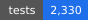
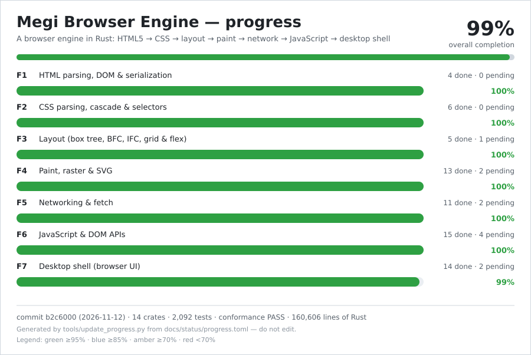
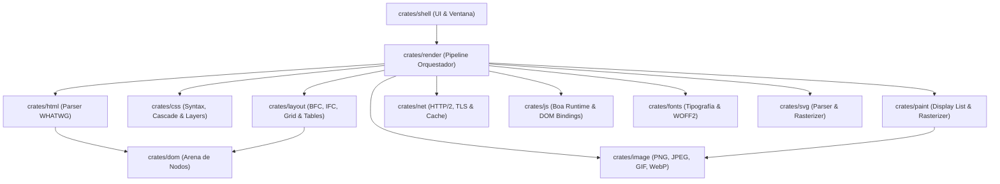

# Megi Web Engine 🌐

[-orange.svg?logo=rust)](https://www.rust-lang.org/)
[](https://github.com/juanpimg/Megi/actions/workflows/ci.yml)
[](LICENSE)
[](PROGRESS.md)
[](https://github.com/juanpimg/Megi/actions/workflows/fuzz-nightly.yml)
[]()
[](PROGRESS.md)

> **Megi** es un motor de navegación web moderno, open source e independiente desarrollado desde cero en **Rust** (Edición 2024), sin bifurcar (*fork*) Blink, WebKit ni Gecko. Su diseño se rige estrictamente por las especificaciones formales vivas de **WHATWG** y **W3C**, con verificación continua en bucle cerrado (*closed-loop testing*) contra **Web Platform Tests (WPT)** y **`html5lib-tests`**.

---

## 🖼️ Megi Browser Shell


*Navegador interactivo Megi (`crates/shell`): chrome nativo con barra de navegación, pestañas, motor tipográfico y renderizado determinista de HTML/CSS de extremo a extremo. Para más ejemplos y capturas de renderizado, consulta la [Galería de Renders](docs/SHOWCASE.md).*

---

## 📈 Estado del Proyecto

[](PROGRESS.md) [](PROGRESS.md) [](PROGRESS.md) [](PROGRESS.md)

[](PROGRESS.md)

**Overall 99 %** · **2.243 tests** (0 fallos) · conformidad **PASS** (100 %) · **14 crates** · **168.585 líneas de Rust** · **12/14** crates con `#![forbid(unsafe_code)]`.

> Las métricas se actualizan automáticamente en **[`PROGRESS.md`](PROGRESS.md)** mediante herramientas de medición continua. Para consultar el historial de optimizaciones y micro-hitos, revisa el **[`CHANGELOG.md`](CHANGELOG.md)**.

---

## ✨ Características Principales

- 🎯 **Conformidad Estricta con Estándares**:
  - **HTML5 100 %**: Tokenizador (7.050/7.050), árbol DOM (3.904/3.904) y serializador (230/230) verificados contra `html5lib-tests`.
  - **CSS Syntax & Selectors**: CSS Syntax WPT (30/30), Selectors L4 con poda por filtros Bloom de ancestros, Cascade Layers (`@layer`) y Container Queries (`@container`).
- ⚡ **Rendimiento y Ligereza**:
  - Arena DOM contigua con identificadores `NodeId` generacionales (4 bytes) y resolución de ciclo seguro.
  - Motor de rasterizado CPU optimizado y codificador/decodificador PNG propio con compresión adaptativa.
  - Pipeline de render determinista de bajo consumo de memoria.
- 🌐 **Red y Protocolos Modernos (`crates/net`)**:
  - Soporte completo HTTP/1.1 y HTTP/2 multiplexado con control de flujo por ventana y priorización de push.
  - Cifrado seguro con TLS 1.2/1.3 en Rust puro (`rustls` + `webpki-roots`).
  - Caché HTTP (RFC 9111), gestión de Cookies (RFC 6265) y soporte para proxies HTTP/HTTPS.
- 🧠 **Ejecución de JavaScript (`crates/js`)**:
  - Integración nativa con el motor ECMAScript **Boa 0.21.x**.
  - Bindings completos para manipulación del DOM, eventos, temporizadores y Web Workers cooperativos.
- 🖥️ **Shell de Escritorio Usable (`crates/shell`)**:
  - Ventana interactiva nativa (X11/Wayland vía `winit`), soporte para múltiples pestañas, zoom dinámico, historial navegable y modo screenshot *headless* para CI.

---

## 🚀 Inicio Rápido

> Guía detallada: [docs/GETTING-STARTED.md](docs/GETTING-STARTED.md)

### Requisitos

- **Rust**: Edición 2024 (MSRV 1.88 o superior).
- *(Opcional para ventana gráfica)*: Servidor gráfico X11 o Wayland en Linux (ver dependencias en la guía).

### 1. Compilar y Ejecutar el Navegador

```bash
# Abrir una URL o archivo HTML en el navegador gráfico
cargo run --release -p shell -- https://example.com

# Modo headless: generar captura PNG de una página sin levantar servidor gráfico
cargo run --release -p shell -- https://example.com --screenshot output.png --width 1024 --height 768
```

### 2. Ejecutar la Suite de Conformidad y Tests

```bash
# Ejecutar los tests del workspace
cargo test --workspace

# Ejecutar el gate oficial de conformidad (HTML5 + CSS)
cargo run --release -p test_harness -- --summary

# Modo estricto de conformidad
cargo run --release -p test_harness -- --summary --strict
```

### 3. Pipeline de Render a Imagen

```bash
# Renderizar un documento HTML local a PNG mediante el pipeline de Fase 5
cargo run --release -p render -- tests/fixtures/render/basic.html /tmp/render.png --width 800 --height 600
```

---

## 🏗️ Arquitectura del Workspace

El proyecto está diseñado como un Grafo Acíclico Dirigido (DAG) desacoplado en 14 crates especializados:



| Crate | Responsabilidad | Concurrencia / Seguridad |
|---|---|:---:|
| [`crates/dom`](crates/dom) | Arena de nodos DOM contigua con `NodeId` generacional libre de ciclos. | `#![forbid(unsafe_code)]` |
| [`crates/html`](crates/html) | Tokenizador y árbol WHATWG HTML5 con conformidad 100%. | `#![forbid(unsafe_code)]` |
| [`crates/css`](crates/css) | Parser CSS Syntax L3, Cascade Layers, Selectors L4 y Bloom pruning. | `#![forbid(unsafe_code)]` |
| [`crates/layout`](crates/layout) | Árbol de cajas, BFC, IFC, CSS Grid, Flexbox y Container Queries. | `#![forbid(unsafe_code)]` |
| [`crates/paint`](crates/paint) | Generación de DisplayList, renderizado por capas y rasterizado 2D AA. | `#![forbid(unsafe_code)]` |
| [`crates/image`](crates/image) | Decodificadores y codificador PNG, JPEG, GIF y WebP deterministas. | `#![forbid(unsafe_code)]` |
| [`crates/fonts`](crates/fonts) | Shaping de texto, integración de fuentes del sistema y WOFF2. | `#![forbid(unsafe_code)]` |
| [`crates/svg`](crates/svg) | Parser XML de SVG y rasterizador vectorial analítico scanline. | `#![forbid(unsafe_code)]` |
| [`crates/net`](crates/net) | Stack de red: URL WHATWG, HTTP/1.1, HTTP/2 multiplexado y TLS puro. | `#![forbid(unsafe_code)]` |
| [`crates/js`](crates/js) | Motor JS ECMAScript basado en Boa, bindings DOM y Web Workers. | `#![forbid(unsafe_code)]` |
| [`crates/render`](crates/render) | Orquestador del pipeline completo de renderizado web de extremo a extremo. | `#![forbid(unsafe_code)]` |
| [`crates/shell`](crates/shell) | Aplicación de escritorio nativa con pestañas, address bar y hotkeys. | `#![forbid(unsafe_code)]` |
| [`crates/bench`](crates/bench) | Arnés de benchmarks reproducibles para medir latencias del pipeline. | `#![forbid(unsafe_code)]` |
| [`crates/test_harness`](crates/test_harness) | Runner de verificación oficial frente a suites de conformidad WPT. | `#![forbid(unsafe_code)]` |

---

## 📖 Documentación

- 🏛️ [`docs/ARCHITECTURE.md`](docs/ARCHITECTURE.md): Arquitectura detallada, modelo de memoria del DOM y política de dependencias.
- 🖼️ [`docs/SHOWCASE.md`](docs/SHOWCASE.md): Galería de capturas, fixtures y pruebas visuales de render.
- 🗺️ [`docs/ROADMAP.md`](docs/ROADMAP.md): Plan de fases (`WP-*`) y estado del desarrollo a largo plazo.
- 📈 [`docs/PERFORMANCE.md`](docs/PERFORMANCE.md): Metodología de benchmarks y mediciones de rendimiento.
- 🛡️ [`docs/FUZZING.md`](docs/FUZZING.md): Targets de fuzzing continuo y política de triaje de fallos.
- 🔐 [`SECURITY.md`](SECURITY.md): Modelo de seguridad de memoria, límites anti-DoS y políticas de reporte.
- 🤝 [`CONTRIBUTING.md`](CONTRIBUTING.md): Guía de contribución, convenciones de código y workflows de CI.
- 📝 [`CHANGELOG.md`](CHANGELOG.md): Registro histórico de versiones, hitos y optimizaciones por ronda.
- 🏆 [`docs/MILESTONES.md`](docs/MILESTONES.md): Histórico exhaustivo de micro-hitos, benchmarks y optimizaciones (rondas 1–32).

---

## 🔒 Seguridad

Para reportar vulnerabilidades, **no abras un issue público**. Usa un aviso de seguridad privado en GitHub o contacta al mantenedor:

- **GitHub Security Advisories**: [Abrir aviso privado](https://github.com/juanpimg/Megi/security/advisories/new)
- **Política, severidad (CVSS 3.1) y plazos de divulgación**: consulta [`SECURITY.md`](SECURITY.md)

---

## 📄 Licencia

Megi se distribuye bajo doble licencia, a tu elección:

- **Licencia MIT** ([`LICENSE-MIT`](LICENSE-MIT))
- **Licencia Apache 2.0** ([`LICENSE-APACHE`](LICENSE-APACHE))

*(La fuente DejaVu Sans incluida en los recursos de pruebas conserva su propia licencia en `crates/fonts/tests/fixtures/LICENSE-DejaVu.txt`).*
