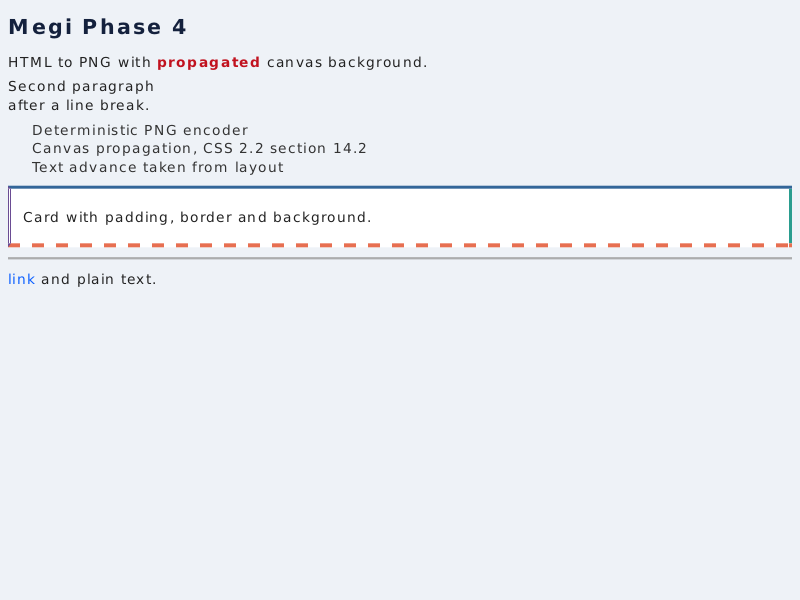
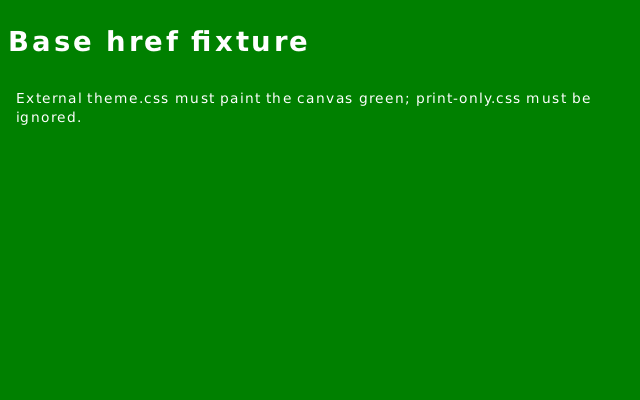
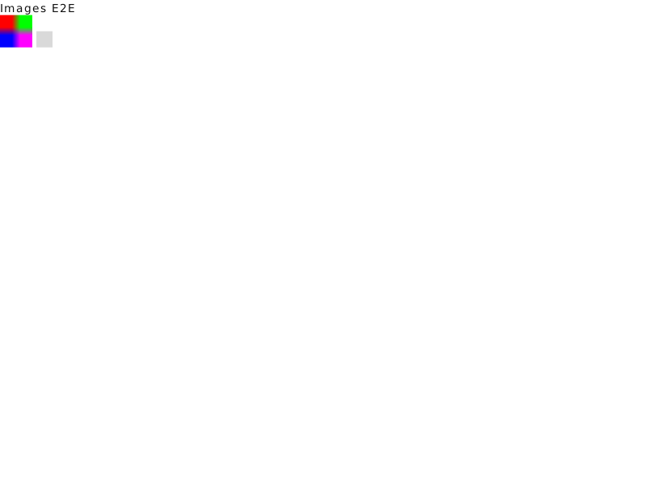
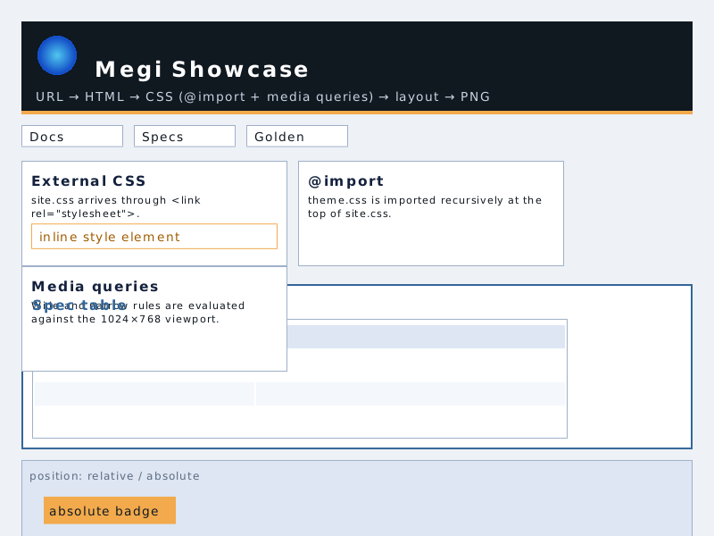
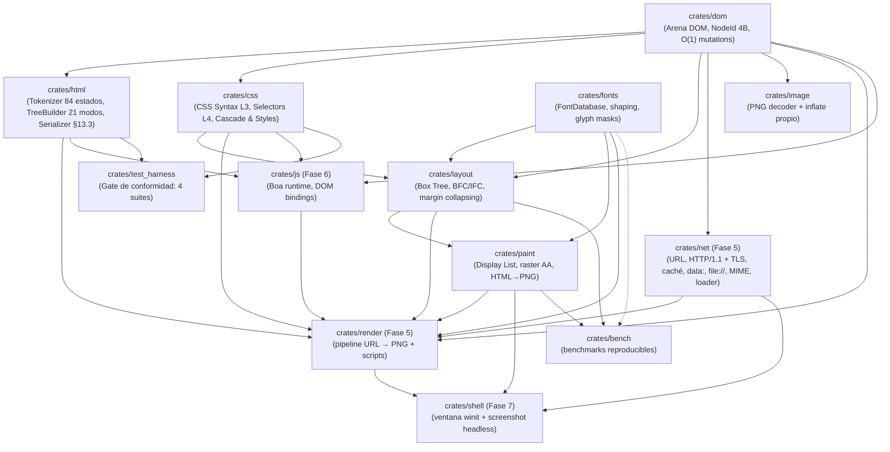

# Megi Web Engine 🌐🦀

[-orange.svg?logo=rust)](https://www.rust-lang.org/)
[](https://github.com/juanpimg/Megi/actions/workflows/ci.yml)
[](LICENSE)
[]()
[](https://github.com/juanpimg/Megi/actions/workflows/fuzz-nightly.yml)
[-brightgreen.svg)]()
[%20·%20serializer%20230%2F230-success.svg)]()

> **Megi** es un motor de navegación web moderno, open source e independiente desarrollado desde cero en **Rust** (Edición 2024), sin bifurcar (*fork*) Blink, WebKit ni Gecko. Todo su diseño se rige estrictamente por las especificaciones formales vivas de **WHATWG** y **W3C**, con verificación continua en bucle cerrado (*closed-loop testing*) contra **Web Platform Tests (WPT)** y **`html5lib-tests`**.

---

## 📊 Estado del Proyecto y Barra de Progreso por Módulos

🎉 **HITOS ronda 13**: **fuentes web `@font-face` + WOFF2 de punta a punta** (CSS → `fonts` → `render` → layout/paint, con DB por render, stats/timing no fatales), **crate `svg` nuevo** (parser XML+modelo SVG+rasterizador AA desde cero, 41 tests; **cableado E2E en ``/background-image HECHO** en `render`, con cap 16 Mpx y stat `svgs_rendered`) y **shell con zoom/auto-refresh/estado** (`--zoom 0.5–3.0`, `--refresh-ms` opt-in). Se mantiene el **HITO de conformidad HTML5: árbol 3.904/3.904 (100 %)** con gate sin allowlist de tree. Fases 0–3 completadas. La **Fase 4 (layout/paint/tipografía/imágenes/backgrounds/SVG)** está **prácticamente completa en motor**: tablas avanzadas, **background-* geometry** (`repeat`/`size`/`position`, ronda 15), hit-testing, PNG propio −30,5 % byte-idéntico, **fuentes web E2E** y **SVG E2E** (``/background-image **e inline `<svg>`** vía pre-proceso a `` sintético, caps 16 Mpx y 256/1 MiB/8 MiB, warnings no fatales); pendientes block-in-inline, colores de `border-collapse`, `background-origin/clip` y múltiples capas. La **Fase 5 (red/render)** sigue al **~95 %** (pendientes HTTP/2, streaming y SameSite/PSL). La **Fase 6 (JS)** sube al **~90 %**: WP-A/B/6.4 y eventos avanzados, más **APIs de navegador reales** (`getComputedStyle` pre-script, `matchMedia`, viewport/DPR, `requestAnimationFrame` determinista, `document.onerror`/consola, `readyState`) cableadas en `render`; pendientes módulos ES, memoria real y eventos `resize`/`scroll`/`change`. La **Fase 7 (shell)** sube al **~70 %** con **zoom**, **auto-refresh** opt-in para animaciones con timers y título de estado enriquecido; pendientes formularios, pestañas, event loop vivo y verificación real de ventana. **Rendimiento (ronda 15)**: **layout/realistic-1mb 50,5 → 36,3 ms (−28 %)** e **IFC** con tokenización por pool/ids, breaking incremental y fast path en `format_line`; **pipeline 132,9 → 120,5 ms (−9,3 %)**; se mantiene el encoder PNG −30,5 % invariante y `html/massive-end-p` ~19 ms. Suite **determinista**: el event loop usa sólo reloj virtual (fix `b808d7b`, cazado por CI) y los goldens son reproducibles byte a byte (showcase `c95c7eff…`, `basic.rgba` `60f8984e…`). El detalle está en [`docs/PHASE4-SUPPORT.md`](docs/PHASE4-SUPPORT.md), [`docs/ROADMAP.md`](docs/ROADMAP.md) y [`docs/JAVASCRIPT-STRATEGY.md`](docs/JAVASCRIPT-STRATEGY.md).

| Módulo / Crate | Barra de Progreso | Estado | Tests | Capacidades Implementadas |
|---|:---:|:---:|---|---|
| [`crates/dom`](crates/dom) | `[██████████] 100%` | **COMPLETO** | 28 | Arena contigua con `NodeId` de 4 bytes (**20 bits slot + 12 bits generación**), free list LIFO con reutilización de slots, `remove_node`/`remove_subtree`, detección de handles stale/foráneos (`owns`, `try_node`), `descendants`/`ancestors` iterativos con guardas de ciclo, `validate_invariants()`, `estimate_bytes()/allocated()/free_slots()`; **API de navegador**: `document_element/head/body`, `get_element_by_id`, `get_elements_by_tag_name/class_name`, factorías de nodos, atributos, `text_content`, `remove_child`/`insert_before_child`/`replace_all_children`, `clone_node_into` y `DomError`. |
| [`crates/html`](crates/html) | `[██████████] 100%` | **COMPLETO** | 60 (14 unit + 7 scripting + 6 rendimiento + 13 robustez + 20 browser API) | Tokenizador de 84 estados (**7.050/7.050** en el gate), 21 modos de árbol (**3.904/3.904 — 100 %**, allowlist vacía), 2.231 entidades, AAA y *foster parenting*, `innerHTML`, **serializador público WHATWG HTML §13.3** (`serialize_html`, `serialize_fragment`, `serialize_outer_html`, `*_with_options`) con **230/230** casos de `html5lib-tests/serializer/`; límites anti-DoS `ParseOptions`, serializador iterativo y **DOM de navegador**: `parse_fragment_into`, `set_inner_html`/`set_outer_html`, `document_write` (contextos table/select/template/rawtext, sin fugas de slots). **WP-6.4**: hook `html::scripting::{ScriptExecutor, ScriptExecution}` + `TreeBuilder::with_script_executor` y `parse_document_with_options_and_executor`; los scripts parser-inserted se ejecutan al `</script>`/EOF y el `document.write` se **re-tokeniza en la posición actual** con `Tokenizer::insert_input` (scripts anidados incluidos); externos `src` los ejecuta el host y errores son no fatales (`ParseOutcome::script_errors`); camino sin scripting zero-cost. Incluye el fix de la regresión `tag-40k-attrs` (~12,4 ms). |
| [`crates/css`](crates/css) | `[██████████] 100%` | **COMPLETO (Fase 2+)** | 76 + 30 WPT | CSS Syntax L3, **Selectores L4 funcionales** (`:is/:where/:not/:has`) y estructurales (`:nth-of-type`, `:first/last/only-of-type`, `:nth-last-*`), especificidad correcta, expansión de shorthands antes de la cascada, `font` shorthand, `@media` básico (`resolve_document_styles_with_media`), índice de reglas (**2,1×** en resolve-styles con 10k nodos) y bases de Fase 4 (bordes por lado, `border-style: none`, `float`/`clear`/`overflow`/`visibility`/`text-decoration`/`list-style-type`), **tablas CSS 2.1** (`display: table-*`/`inline-table`/caption, `border-spacing`, `border-collapse`, `table-layout`, `caption-side`, `empty-cells`) y hoja UA §15 con reglas de tabla; **`@import`** (`Stylesheet.imports`) y **Media Queries** completas (`parse_media_query_list`, `media::evaluate`: and/or/not/only, listas, all/screen/print, width/height/min/max en px/em/rem/pt/pc/in/cm/mm, orientation). El `render` ya consume `@import` y media (ronda 7). Añade **query API** `css::query::{query_selector, query_selector_all, matches}` (+ variantes `try_*`) y parseo de `background-image`/`list-style-image` (`url(...)`, `none`, shorthand color+imagen; gradientes → `None`; se pintan desde ronda 8). **Ronda 15**: `background-repeat` (repeat/repeat-x/repeat-y/no-repeat/space/round y pares), `background-size` (`auto`/`cover`/`contain`/longitudes/%) y `background-position` (keywords/%/px, 1-2 valores) + shorthand `background:` con position/size; `background_geometry_explicit` en paint mantiene el modo legado para goldens.  **`@font-face` (ronda 13)**: `Stylesheet.font_faces` + `FontFaceRule { family, sources, weight, style }` parseados por el crate y consumidos por `fonts`/`render` para las fuentes web. |
| [`crates/layout`](crates/layout) | `[██████████] 100%` | **Fase 4 completa** | 135 | Box Tree con campos usados de posicionamiento (`position`, `z_index`, `opacity`, stacking context, `clip`, `is_float`); BFC con colapso de márgenes (§8.3.1) e ICB; **IFC** con saltos UAX #14, soft hyphen de ancho cero, `line-height` como factor, `vertical-align` §10.8.1 y `justify`; **`position: relative/absolute/fixed`** (containing blocks, posición estática, shrink-to-fit; `sticky` documentado como relative), **floats/`clear`** §9.5 (BFC contiene floats §10.6.7) y **`overflow`** con BFC y clip rect. **Tablas CSS 2.1 §17** (auto layout min/max-content, `border-spacing`, `colspan`, fixups anónimos, `vertical-align` de celdas, caption y row-groups), **`inline-block`** (shrink-to-fit, baseline, `vertical-align`) y **cajas reemplazadas** (`BoxType::Replaced`, tamaños intrínsecos `img` 300×150 / `input` 20×20 / `textarea` 160×40, API `layout_document_with_replaced_sizes`). **`LayoutBox::Drop` iterativo** (50.000 niveles, pila de 256 KiB) y **−43 %** en `layout/realistic-1mb` (100,6→57,2 ms) por `Arc<ComputedStyle>`, line breaking en streaming y una sola pasada de `format_line`. **Tablas avanzadas**: `rowspan`, `table-layout: fixed`, `inline-table` atómico y `border-collapse` con resolución de conflictos, con fast path para separate/auto/sin rowspan (`layout/realistic-1mb` ~59 ms). Modelo de celdas fijado por tests (`table > rowgroup > row > TableCell > LineBox > TextNode`). **Ronda 12**: `LayoutBox.style: Option<Arc<ComputedStyle>>` (+ `style()`/`with_shared_style`), estilo anónimo derivado una vez por padre y compartido, tokens `Space` con `char`; **LayoutBox 496→176 B** y **−14,6 %** en `layout/realistic-1mb` (51-53 ms). Pendiente: `background-repeat/size/position`, block-in-inline y colores de `border-collapse`. |
| [`crates/fonts`](crates/fonts) | `[██████████] 100%` | **COMPLETO (LTR + fuentes web)** | 17 + 1 doctest | Motor tipográfico real (`fontdb` + `ttf-parser` + `rustybuzz` + `ab_glyph`): descubrimiento/fallback, métricas OpenType, shaping LTR (kern/ligaduras), rasterización de glifos a máscaras alfa y fuente DejaVu determinista; **integrado en layout y paint** (texto real en el PNG). **Fuentes web (ronda 13)**: `@font-face` de CSS resuelto de punta a punta — `fonts::decode_web_font`/`is_woff2` convierten **WOFF2→sfnt** (dep `woff2-patched 0.4`, Apache-2.0, pure Rust sin C/FFI, **solo en este crate**), `FontDatabase::load_font_data_family` registra el alias CSS y `render` construye una **DB por render** usada por layout y paint (fetch con `ResourceLoader` respetando `--no-network`, dedupe, caps **8 fuentes / 8 MiB / 32 MiB**, warnings no fatales, stats `fonts_loaded/failed/bytes` y `timings.fonts`). Fixture Open Sans OFL (18.640 B): md5 con webfont `f38aed032b8d160075097f1e4ad83b49` vs fallback `e2d76dee98f7c4ef2896c5d003be74f2`. Límites: sin WOFF1, primer `src` soportado, weight/style no eligen cara, sin unicode-range/font-display (bloqueante), sin subsetting/color fonts, DB no cacheada. Bidi/scripts complejos/fuentes variables fuera de alcance. |
| [`crates/paint`](crates/paint) | `[██████████] 100%` | **Fase 4 completa + backgrounds multicapa** | 130 | Display lists con **orden completo del Apéndice E** (stacking contexts y `z-index`), `OpacityGroup` (grupo offscreen compuesto una vez), `PushClip`/`PopClip` desde `overflow`, `text-decoration` (underline/overline/line-through), `visibility: hidden` y marcadores `disc`/`circle`/`square`/`decimal`; rasterizador con AA exacto, alfa straight, **culling** y cachés por pasada; bordes por lado y fondo bajo el *border box*; pipeline HTML → PNG con codificador PNG propio y golden determinista (`basic.rgba` `md5 60f8984e…`, PNG `md5 9e957177…`). **Compresión PNG propia**: DEFLATE con LZ77 (hash-chains 32 KiB + Huffman fijo) y zlib/Adler, filtros PNG adaptativos; PNG del fixture **1.920.813 → 42.853 B (44,8×)** con `basic.rgba` idéntico. **Ronda 12**: encoder **−30,5 %** (render-to-PNG 13,30→9,24 ms; showcase 34,1→29,5 ms) con **bitstream byte a byte idéntico** (filtros fusionados en una pasada, LZ77 con hashes precalculados/match a 8 B, `encode_pixels` sin buffer RGBA intermedio, Adler-32 vectorizable). `build_display_list` es **totalmente iterativo** (pila explícita; caps stacking 256/floats 64/items 5M). **Hit-testing aditivo** (`hit_test`/`hit_test_all`, `HitRegion` en orden de pintado con clip, `HitLink`/`find_link_at` y builders `build_display_list_with_hit_regions`; PNG/golden byte-idénticos, coste opt-in). **Imágenes E2E**: `ImageStore = HashMap<NodeId, Arc<image::RgbaImage>>`, `DisplayItem::Image` y `build_display_list_with_images`; raster **bilineal clamp-to-edge** con AA/alfa/clip y placeholder gris; **fix de underflow** de cobertura parcial en `fill_rect`; **background-image** (`BackgroundImages`, estirada al padding box, color debajo), **list-style-image** como marcador (~1em) y **fix del texto de celdas de tabla**; **ronda 15**: **`background-repeat/size/position`** reales (`background_tile_size`/`background_tiles`: cover/contain centrado, tiling con clip al padding box, cap 4096; space/round pintan como repeat), con legacy `background_geometry_explicit` para no alterar los goldens; `paint_inline_content` ya desciende en cajas de tabla; 9 tests nuevos. |
| [`crates/js`](crates/js) | `[█████████░] 90%` | **Fase 6 (WP-6.1/6.2/6.4 + WP-A/WP-B + eventos avanzados + APIs navegador)** | 71 | **Boa 0.21.1** embebido (`crates/js`, `#![forbid(unsafe_code)]`, feature `js` **ON por defecto** con stub `--no-default-features`): `JsRuntime`/`JsRuntime::with_document` (eval persistente, console capture, `Budget`/`RuntimeLimits` anti-bucle, `JsError`), bindings DOM (`document.write`, búsquedas, `querySelector(All)`, creación/mutación de nodos, `innerHTML`/`outerHTML`, atributos, `style`/`classList`, wrappers con handle lateral y **NodeId stale ⇒ TypeError**), **eventos (WP-A)**: `EventTarget` (`addEventListener`/`removeEventListener`/`dispatchEvent`) en nodos/document/window con captura window→document→ancestros→target y burbuja de vuelta, `Event`/`CustomEvent` (`bubbles`/`cancelable`/`detail`/`defaultPrevented`, prevent/stop/stopImmediate) y **timers con reloj inyectable** (`setTimeout`/`setInterval`/clear, orden por `(due, id)`, `advance`, `run_until`, `now_ms`, `pending_timers`; `run_tasks` ejecuta vencidos por reloj real). **WP-A**: `document` como `EventTarget`. **WP-B**: `CSSStyleDeclaration` completa (`cssText`/`length`/`item`/`getPropertyValue`/`setProperty`/`removeProperty`), `getComputedStyle` con provider inyectable, `NodeList` snapshot, `matches`/`closest`, `insertAdjacentHTML`/`Text` y **caché de identidad wrapper↔nodo**. **APIs Rust**: `eval_on_document`, `dispatch_simple_event`, `take_document`. **Eventos avanzados (ronda 12)**: `currentTarget` real y `eventPhase` 1/2/3 (capture en el target), `once`/`passive`, `removeEventListener` por identidad, handlers inline `onclick`/`onload`/`onerror` en elemento/document/window, `document.close()` no-op, `estimated_heap_bytes()` aproximado, dispatch no-`Event` ⇒ `TypeError`, excepciones de listeners capturadas (`last_event_error()`) sin abortar el resto. **Ya ejecutado desde `render` y desde el parser** (WP-6.4). **APIs de navegador (ronda 16)**: `matchMedia` (provider), `set_viewport_provider`/`ViewportInfo` (innerWidth/Height/DPR/scroll), `requestAnimationFrame`/`cancelAnimationFrame` a 16 ms virtuales (`pending_animation_frames`), `document.onerror`/`window.onerror` y consola (`debug/assert/table/dir`), `document.readyState` y provider de `getComputedStyle` (24 props); cableadas en `render` (estilos pre-script, matchMedia/viewport reales, rAF con epoch fijo determinista, errores/console ⇒ warnings no fatales). Pendientes: módulos ES, memoria real y eventos `resize`/`scroll`/`change`. |
| [`crates/net`](crates/net) | `[████████░░] 90%` | **Fase 5** | 180 | URL WHATWG (subset `http`/`https`/`file` + `join`), HTTP/1.1 `GET` (timeouts, `Content-Length`, *chunked*, redirects con límite, caps), **TLS 1.2/1.3 con `rustls` 0.23 (ring) + `webpki-roots`** (feature `tls` por defecto, SNI y validación de certificado/host; `rcgen` solo en tests), **caché HTTP RFC 9111 subset** (`max-age`/`Expires`/`ETag`/`Last-Modified`/`304`/`no-store`/`Vary`), **`data:` URLs** con Base64 propio, `file://`, MIME sniffing y `ResourceLoader` con caché. `#![forbid(unsafe_code)]`; tests 100 % offline. El pipeline de navegador lo consume `crates/render`. **Añade**: cookies RFC 6265 subset (`CookieJar` con dominio/path/secure/httpOnly/expiry e integración en cada hop), **CORS básico** (Origin, ACAO exacto/*, credentials, preflight OPTIONS, `FetchError::Cors`) y **gzip/deflate** (`Accept-Encoding: gzip`, gzip wrapper RFC 1952 con CRC32/ISIZE, inflate compartido de `crates/image`, caps anti-bomba 64 MiB/ratio 1000:1). Pendientes: HTTP/2, CORS completo (SameSite/PSL no), streaming. |
| [`crates/render`](crates/render) | `[██████████] 100%` | **Fase 5 (pipeline de navegador)** | 123 | Pipeline **URL → PNG** de extremo a extremo: carga con `net` (`file`/`data`/HTTP/HTTPS con TLS y caché), decodifica charset (UTF-8/Windows-1252), respeta `<base>`, recolecta `<style>` + `<link rel=stylesheet>` externos (dedup y caps), resuelve la cascada UA+autor, hace layout con fuentes bundled, display list y **PNG determinista**; CLI `render <entrada> <salida.png> [--width/--height/--base/--no-network/--json]` y stats por etapa; **imágenes ``**: carga por `net` (respeta `--no-network`), decodifica PNG (`crates/image`; otros formatos ⇒ warning + placeholder no fatal), inyecta tamaños intrínsecos y pinta (caps 64 imágenes/8 MiB/32 MiB). Fixture `images.html` 800×600 → 15.625 B `md5 1de31699…`. **`@import` recursivo** (resolución relativa, dedup/ciclos, profundidad 8 y caps) y **media real** en `<link>`/`<style>`/`@import`; **backgrounds E2E** (resolución relativa al documento, dedupe, caps 32/8 MiB/16 MiB, stats y warnings no fatales) y showcase 1024×768 → **80.220 B `md5 c95c7eff…`** con 80 display items y texto de tabla/background/list-style ya pintados. **Ejecución de JavaScript (WP-6.2 host)**: `ScriptingMode`/`RenderOptions.scripting` (default Enabled con feature `js`; `--no-scripting`), descubre `<script>` clásicos en orden (inline/`src`, módulos avisados y saltados, `nomodule` ignorado), carga externos con caps (8 MiB/script, 32 MiB total, 64 scripts) y `--no-network`, ejecuta con `JsRuntime::with_document` con budget por script+total, drena microtasks y hasta 10.000 timers, captura console y stats (`scripts_*`, `timings.scripting`), y **recalcula estilos→layout→paint sobre el DOM mutado** (mutaciones visibles en el PNG). 7 fixtures `js_*` y 12 tests. Límite: ejecución **solo post-parseo** (sin re-tokenización de `document.write` ⇒ WP-6.4). **Red avanzada E2E (ronda 10)**: `RenderOptions.cookies` (jar por render) o `cookie_jar` compartido de sesión propagando `Set-Cookie` entre documento/redirects/subrecursos/renders, `RenderOptions.origin`/`--origin` (o derivado del document URL) con validación CORS y credentials cuando hay jar, denegaciones CORS como warning no fatal, y gzip/deflate E2E (HTML y CSS gzip aplican estilos). `RenderStats` gana `hit_regions`/`cookies_stored`/`content_encoding`; CLI `--cookies`/`--origin`. **`RenderOutput.hit_regions`** se construye con `paint::build_display_list_with_hit_regions` (píxeles sin cambios, coste +0,6 µs). **Event loop presupuestado (ronda 11)**: reloj virtual, `DOMContentLoaded`/`load` despachados por el `EventTarget` del documento, timers con delay (`max_tasks` 10.000, `max_virtual_time` 1000 ms), un solo re-render tras drenar la cola y stats `script_*`/`timings.event_loop`; 6 fixtures `js_event_*` y 11 tests.  **Fuentes web E2E (ronda 13)**: recoge `@font-face` de todas las hojas (incl. `@import`), deduplica y descarga con `ResourceLoader` (`--no-network`, caps), construye la DB por render y la pasa a layout/paint; `RenderStats` añade `fonts_loaded`/`fonts_failed`/`font_bytes` y `timings.fonts`; fallos ⇒ warning no fatal y fallback a fuentes del sistema/bundled. **SVG E2E (cierre ronda 13)**: `` y `background-image` SVG se renderizan con el crate propio (detección por `Content-Type`/sniffing, tamaño intrínseco width/height/viewBox con 300×150 por defecto, cap **16 Mpx/64 MiB RGBA**, corrupto ⇒ warning no fatal y navegación directa envuelta en página sintética); `RenderStats` añade `svgs_rendered`; 5 fixtures `svg_*` y 11 tests. **Ronda 16**: pasada de estilos **pre-script** con provider real de `getComputedStyle` (24 props, `styles_pre_script`), `matchMedia`/viewport/DPR reales, `readyState` loading→interactive→complete, **rAF determinista** (16 ms virtuales, epoch fijo ⇒ 48 ms; PNG idéntico), `document.onerror`/`console.warn|error`/`last_event_error` ⇒ warnings no fatales (`console_errors`) y multi-capa backgrounds E2E (`background_layers.html`, md5 `c357cc2c…`). **SVG inline (ronda 15)**: pre-proceso tras los scripts y antes de styles/layout que serializa cada `<svg>…</svg>` (reparando `xmlns`), lo pasa a `data:` URL base64 y lo sustituye por un `` sintético copiando `class/id/style/width/height/alt/aria/data-*`; caps **256 SVG/documento, 1 MiB/SVG, 8 MiB total, profundidad 256** (warning no fatal) y stat **`inline_svgs`**; 7 fixtures `svg_inline_*` y 10 tests. Límites del crate: `<pattern>`/texto/filtros/animación y refs externas no soportados; selectores CSS sobre el `svg` interno no alcanzan al `` sintético (CSS/gradientes internos ya soportados). |
| [`crates/image`](crates/image) | `[██████████] 100%` | **Soporte de imágenes (Fase 4/5)** | 45 + 1 doctest | Decodificador **PNG propio** (std puro, `#![forbid(unsafe_code)]`): inflate zlib/DEFLATE completo (stored/fixed/dynamic, ventana 32 KiB, Adler-32), `IHDR/PLTE/tRNS/IDAT/IEND` con CRC, color types 0/2/3/4/6, bit depth 1–16, filtros 0–4, Adam7 y límites (`PngLimits`); decodifica el PNG del pipeline y lo compara byte a byte con `basic.rgba`. GIF/JPEG/WebP solo detectados. |
| [`crates/svg`](crates/svg) | `[██████████] 100%` | **COMPLETO + E2E en render** | 60 | Parser **XML subset propio** + modelo SVG (`svg/g/defs/use/rect` con rx/ry, circle/ellipse/line/polyline/polygon/path, nested svg, style inline, transforms, viewBox/preserveAspectRatio, colores hex/rgb/named/transparent/currentColor, fill nonzero/evenodd, stroke width/linecap/linejoin/miterlimit y opacidad) + path `M/L/H/V/C/S/Q/T/A/Z` con arcos→cúbicas + **rasterizador scanline AA determinista** (4 subfilas + cobertura analítica; strokes con 4×4), RGBA straight-alpha, `#![forbid(unsafe_code)]`, límites anti-DoS (8 MiB/256 profundidad/100k elementos/1M segmentos/16k lado/64 Mpx/use 16), API `render_svg`/`intrinsic_size`/`SvgImage`/`SvgOptions`/`Limits`/`SvgError` y `examples/svg_to_png` con PNG propio. NO soportado: `pattern`, text, dasharray, markers, filtros/máscaras/clips, script/animación y refs externas. **Ronda 16**: **CSS interno** (`<style>`/class/id/descendientes, cascada e herencia, CDATA) y **gradientes lineales/radiales completos** (stops/offset/opacity, units, spreadMethod, gradientTransform, herencia href; usable por fill/stroke con evaluación determinista y ciclos sin panic). **Cableado HECHO (cierre ronda 13)**: `render` detecta `image/svg+xml`/sniffing, usa el tamaño intrínseco (width/height/viewBox con 300×150 por defecto), cap 16 Mpx/64 MiB RGBA, corrupto ⇒ warning no fatal, navegación directa SVG envuelta en página sintética y stat `svgs_rendered`; 5 fixtures y 11 tests. |
| [`crates/bench`](crates/bench) | `[██████████] 100%` | **COMPLETO (tooling)** | 8 | Arnés de benchmarks reproducible sin dependencias (`std`), cargas sintéticas deterministas, grupos de parseo/estilos/layout/paint/PNG y baseline publicada en [`docs/PERFORMANCE.md`](docs/PERFORMANCE.md). |
| [`crates/test_harness`](crates/test_harness) | `[██████████] 100%` | **COMPLETO** | 11 | Gate de conformidad con **4 suites**: tokenizer (**7.050/7.050**), árbol (**3.904/3.904 — 100 %**, `scripted_*` incluidos y **sin allowlist de tree**), **serializador HTML (230/230)** y CSS Syntax WPT vendorizado (30/30); `--summary` exit 0 y `--strict` exit 1 solo por las diferencias de parse-error documentadas. **WP-6.4**: `js_executor::JsScriptExecutor` sobre `JsRuntime::eval_on_document` con preludio/polyfills para ejecutar los scripts parser-inserted del corpus (3 tests unit + test de las 4 suites en `closed_loop`). |
| [`crates/shell`](crates/shell) | `[███████░░░] 70%` | **Fase 7 (en curso)** | 100 | Ventana **usable** con **`winit` 0.30 + `softbuffer` 0.4** (X11/Wayland dlopen, sin GPU): **scroll vertical** (rueda/teclado/paginación, cap 8192 CSS px con marca `[recortado]`), **entrada** (ratón/teclado, clic izquierdo sigue enlaces con `Url::join`, Alt+Left/Backspace/b atrás, Alt+Right/n adelante, r recarga, q/Esc cierra), **HiDPI** (viewport CSS = physical/scale, nearest-neighbour), **render en worker** con generación/cancelación/coalescing (debounce 120 ms, `EventLoopProxy`), **navegación con historial** (`NavigationState` puro: back/forward/replace/reload, cap 256, truncado forward; fallos conservan la entrada) y **título dinámico** (`<title>` + URL corta + % scroll + `[recortado]`, errores «Megi — error: …») usando **`RenderOutput.hit_regions` + `paint::find_link_at`** (fallback layout+DOM documentado) y título del mismo render; fixture `file://` con enlaces relativos/absolutos; CLI `--cookies`/`--origin`; **`--screenshot` headless** determinista (640×400 `md5 7324e851…`) y `tools/megi.sh`. **Ronda 13**: **zoom** (`Ctrl+=/-/0`, `--zoom` 0.5–3.0, escalones 50–300 %, viewport CSS = físico/(scale·zoom)), **`Ctrl+L`** imprime la URL, **auto-refresh opt-in** `--refresh-ms [MS]` (250 ms por defecto; solo con `scripts_executed>0 && script_timers_pending>0`, worker generacional, scroll conservado y sin bucles) y título con zoom/scroll/warnings/errores; screenshot basic `md5 7324e851…` intacto y `--zoom 2` (640×400→320×200) `md5 c11903cfe0c4f7095289052d25750bd3`. Pendientes: formularios, pestañas, event loop vivo en el host y verificación real de ventana. |

**Total del workspace: 1046 tests, 0 fallos.** Reparto: `bench` 8, `css` 76, `dom` 28, `fonts` 17 + 1 doctest, `html` 60, `image` 45 + 1 doctest, `js` 71, `layout` 135, `net` 180, `paint` 130, `render` 123, `shell` 100, `svg` 60, `test_harness` 11. Todos los crates están marcados `#![forbid(unsafe_code)]`.

---

## 🖼️ Resultado actual: HTML → PNG



*Render determinista 800×600 (26 display items) de [`tests/fixtures/phase4/basic.html`](tests/fixtures/phase4/basic.html), generado por `cargo run --release -p paint --example html_to_png`: tipografía real (DejaVu), fondo de canvas propagado (CSS 2.2 §14.2), **bordes por lado** (sólido + discontinuo), viñetas de lista, enlace subrayado y un *stage* con `position: relative`, `#under` (`z-index: 1`) y `#badge` (`z-index: 3`, `opacity: 0.7`) solapados. El PNG del pipeline es **comprimido por el codificador propio** (42.853 B tras DEFLATE, `md5 9e957177…`) y se valida con `tools/png_check.py`; la captura vive en [`docs/images/phase4-basic.png`](docs/images/phase4-basic.png).*

**Pipeline de navegador real (`crates/render`, Fase 5):**



*`cargo run -p render -- tests/fixtures/render/basic.html docs/images/render-fixture.png --width 640 --height 400`: el documento carga `sub/theme.css` como hoja externa a través de `<base href="sub/">` (canvas verde), ignora la hoja `media="print"` y aplica el `<style>` inline. 640×400, 15.498 B (`md5 7324e851…`), 4 display items, 1 hoja externa + 1 inline.*

**Imágenes `` de extremo a extremo (`crates/paint` + `crates/image` + `crates/render`):**



*`cargo run -p render -- tests/fixtures/render/images.html docs/images/images-e2e.png`: un PNG de 4×4 (`assets/px.png`) escalado a 40×40 con **muestreo bilineal clamp-to-edge** y una imagen ausente que se sustituye por un **placeholder gris** con warning no fatal (stats `images_loaded: 1`, `images_failed: 1`). 800×600, 15.625 B, `md5 1de316995f56f7c72eefeb7e38a4e184`.*

**Showcase de navegador real (`crates/render`, 1024×768):**



*`cargo run -p render -- tests/fixtures/render/showcase/index.html docs/images/showcase.png --width 1024 --height 768`: página real sin JS que ejercita `file://`/HTTP, hoja externa + `@import` recursivo + media queries (la hoja `media="print"` se omite), dos PNG decodificados, tabla, elementos posicionados y listas. Render determinista **80.220 B**, `md5 c95c7eff83e7bd08f815631aa42afdb0`, **80 display items**; incluye texto de celdas de tabla, `background-image` en hero/stage y `list-style-image`. La captura versionada es el PNG del pipeline (80 KB).*

---

## 🏆 Hitos Principales Logrados

- [x] **🎉 HITO: conformidad HTML5 completa — árbol 3.904/3.904 (100 %)**: el corpus `html5lib-tests/tree-construction` pasa al 100 %, incluidas las 4 suites `scripted_*` (adoption01 1/1, ark 1/1, foster01 2/2, webkit01 2/2), y el gate queda **sin allowlist de tree** (`KNOWN_TREE_FAILURES=[]`, `TREE_EXPECTED_PASSED=3904`). Tokenizador **7.050/7.050**, **serializador HTML 230/230** (5 suites upstream) y CSS Syntax WPT **30/30**; `cargo run -p test_harness -- --summary` → **PASS, exit 0**; `--strict` → exit 1 solo por las diferencias de parse-error documentadas (order-only y `xmlViolation`).
- [x] **WP-6.4 — scripts parser-inserted y `document.write` re-tokenizado (ronda 11)**: `html::scripting::{ScriptExecutor, ScriptExecution}` + `TreeBuilder::with_script_executor`/`parse_document_with_options_and_executor`; el script se ejecuta al `</script>` (o EOF) con el DOM parcial visible, `document.write` se inserta en el flujo del tokenizer en la posición actual (scripts anidados incluidos, `line_starts`/UTF-16 ajustados), externos `src` los ejecuta el host y los errores son no fatales; sin scripting el parser es **zero-cost**. El harness implementa `js_executor::JsScriptExecutor` sobre `JsRuntime::eval_on_document` (preludio/polyfills, sin tocar `crates/js`) y el gate alcanza 3.904/3.904.
- [x] **Pipeline HTML → PNG con tipografía real y determinismo**: `crates/fonts` integrado en layout/paint (shaping + máscaras de glifo), bordes por lado (`solid`/`dashed`/`dotted`/`double`), antialiasing exacto, fondo bajo el *border box* y golden byte a byte regenerado (`basic.rgba` `md5 60f8984e…`; PNG `md5 9e957177…`, 26 display items).
- [x] **Tablas CSS 2.1, `inline-block` y cajas reemplazadas**: layout de tablas §17 (auto min/max-content, `border-spacing`, `colspan`, celdas/caption/row-groups), `inline-block` con shrink-to-fit y baseline, y `BoxType::Replaced` con tamaños intrínsecos (API `layout_document_with_replaced_sizes`).
- [x] **Compresión PNG propia (44,8×)**: DEFLATE LZ77+Huffman fijo con zlib/Adler, filtros adaptativos y **1.920.813 → 42.853 B** manteniendo `basic.rgba` bit a bit; `build_display_list` totalmente iterativo (20.000 niveles, caps documentados).
- [x] **Rendimiento de layout y PNG (ronda 12)**: `LayoutBox.style` → `Arc<ComputedStyle>` compartido (`style()`/`with_shared_style`, estilo anónimo derivado una vez por padre, tokens `Space` sin `String`) ⇒ **LayoutBox 496→176 B**, `layout/realistic-1mb` **−14,6 %** (51-53 ms) y pipeline **134-137 ms**; encoder PNG **−30,5 %** con **bitstream byte a byte idéntico** (goldens sin regenerar).
- [x] **Fuentes web @font-face + WOFF2 de punta a punta (ronda 13)**: `crates/css` parsea `@font-face` (`Stylesheet.font_faces`/`FontFaceRule`), `crates/fonts` decodifica WOFF2→sfnt con la dep **`woff2-patched 0.4`** (Apache-2.0, pure Rust sin C/FFI, **solo en `fonts`**) y registra el alias CSS, y `render` recoge las reglas de todas las hojas (incl. `@import`), deduplica, descarga con `ResourceLoader` (`--no-network`, caps **8 fuentes/8 MiB/32 MiB**) y pasa una **DB por render** a layout y paint, con stats `fonts_*`/`timings.fonts` y warnings no fatales. Evidencia: fixture Open Sans OFL (18.640 B), webfont `md5 f38aed032b8d160075097f1e4ad83b49` vs fallback `e2d76dee98f7c4ef2896c5d003be74f2`.
- [x] **Crate `svg` desde cero (ronda 13)**: parser XML subset propio + modelo SVG (`svg/g/defs/use/rect/circle/ellipse/line/polyline/polygon/path`, nested svg, transforms, viewBox/preserveAspectRatio, estilos inline, colores, fill nonzero/evenodd, stroke caps/joins, opacidad) + path `M/L/H/V/C/S/Q/T/A/Z` con arcos→cúbicas + **rasterizador scanline AA determinista** (4 subfilas y cobertura analítica; strokes 4×4), RGBA straight-alpha, límites anti-DoS, `#![forbid(unsafe_code)]`, API `render_svg`/`intrinsic_size` y `examples/svg_to_png`; **41 tests**. **Cableado E2E en `render` HECHO (cierre ronda 13)**: `` y `background-image` SVG con detección por Content-Type/sniffing, tamaño intrínseco, cap 16 Mpx/64 MiB RGBA, corrupto ⇒ warning no fatal y stat `svgs_rendered`; 5 fixtures y 11 tests.
- [x] **Shell: zoom, auto-refresh y estado enriquecido (ronda 13)**: `Ctrl+=/-/0` y `--zoom` 0.5–3.0 (escalones 50–300 %, viewport CSS = físico/(scale·zoom)), `Ctrl+L` imprime la URL, `--refresh-ms` opt-in (250 ms; solo con scripts+timers pendientes, worker generacional, scroll conservado, sin bucles) y título con zoom/scroll/warnings/errores; **100 tests**; screenshot basic `md5 7324e851…` intacto y `--zoom 2` (320×200) `md5 c11903cfe0c4f7095289052d25750bd3`.
- [x] **SVG inline (ronda 15)**: `<svg>…</svg>` dentro del HTML se renderiza mediante pre-proceso (tras scripts, antes de styles/layout) que serializa el SVG con `xmlns` reparado, lo pasa a `data:` URL base64 y lo sustituye por un `` sintético copiando `class/id/style/width/height/alt/aria/data-*`; límites **256 SVG/documento, 1 MiB/SVG, 8 MiB total, profundidad 256** (warning no fatal), stat **`inline_svgs`**, 7 fixtures `svg_inline_*` y 10 tests (render 114).
- [x] **Background geometry (ronda 15)**: `background-repeat` (incl. pares, space/round documentados como repeat), `background-size` (`auto`/`cover`/`contain`/longitudes/%) y `background-position` (keywords/%/px) + shorthand; pintado con tiling/clip al padding box y **cap 4096**; `background_geometry_explicit` preserva el modo legado y los goldens (`c95c7eff…`, `60f8984e…`, `9e957177…`).
- [x] **IFC −28 % y pipeline ~120 ms (ronda 15)**: pool de texto con rangos, tabla de estilos con ids, métricas por nodo, breaking incremental y fast path de `format_line`, con memoización en `FontTextMeasurer` (tope 4 MiB); **layout 50,5 → 36,3 ms** y **pipeline 132,9 → 120,5 ms**, geometría byte-idéntica.
- [x] **Determinismo del event loop (ronda 15, fix `b808d7b`)**: el loop usa **solo reloj virtual** (`run_until` con pasos de 1 ms; sin `run_tasks` de reloj de pared), `virtual_time_ms` por conteo y fixture `js_event_timeout` determinista (tasks=1, 10 iteraciones, 10 ms; md5 `0768208824102e94a6f32574991b7692`). El fallo (10 vs 13 tasks en CI lenta) queda corregido.
- [x] **SVG real: CSS interno y gradientes (ronda 16)**: `<style>`/class/id/descendientes con cascada, especificidad e herencia (CDATA incluido) y gradientes lineales/radiales completos (stops/offset/opacity, `gradientUnits` objectBoundingBox/userSpaceOnUse, `spreadMethod` pad/reflect/repeat, `gradientTransform`, herencia href), usables por `fill`/`stroke`; evaluación determinista por píxel, ciclos ⇒ sin pintura; límites 1 MiB/4096 reglas/256 stops/32 saltos. `<pattern>` pendiente (documentado). **60 tests**.
- [x] **Backgrounds multicapa + origin/clip/attachment (ronda 16)**: `background-origin`/`clip`/`attachment`, `ComputedStyle.background_layers` top-first (shorthand multicapa, color solo en la última capa, espejo legacy para goldens), `space`/`round` reales y multi-capa E2E (`background_layers.html`, md5 `c357cc2c43039ce03545be3b4221a814`); css 76/paint 130 tests con goldens intactos.
- [x] **APIs de navegador en JS y cableado real en render (ronda 16)**: `matchMedia` (provider), viewport/DPR/scroll (`set_viewport_provider`/`ViewportInfo`), `requestAnimationFrame` a 16 ms virtuales (`pending_animation_frames`), `document.onerror`/`window.onerror` y consola ampliada, `document.readyState`, provider de `getComputedStyle` (24 props); en `render`: pasada de estilos **pre-script** (`RenderTimings::styles_pre_script`), matchMedia/viewport reales, **rAF con epoch virtual fijo** (48 ms exactos, sin flake), errores/console ⇒ warnings no fatales (`RenderStats.console_errors`) y `readyState` loading→interactive→complete. **js 71 / render 123 tests**; F6 ≈90 %.


- [x] **Fix de regresión del parser `fast_hash` (cierre ronda 13)**: restaurado el bucle de hashing por chunks de bytes para claves cortas (solo `crates/html/src/fast_hash.rs`) ⇒ **`html/massive-end-p` ~19 ms** (18,7-19,3 ms; antes 21,4 ms, r10 18,2 ms) y **pipeline ~127-134 ms**, con el gate intacto (árbol 3.904/3.904).

- [x] **Fase 6: JS en el pipeline, el parser y el event loop (WP-6.1/6.2/6.4 + WP-A/WP-B HECHOS)**: Boa 0.21.1 con feature `js` ON por defecto (stub `--no-default-features`), bindings DOM con handles laterales/generaciones y `Budget`/`RuntimeLimits` anti-DoS. `render` descubre y ejecuta los `<script>` (inline/`src`) con budgets y caps, y **recalcula estilos→layout→paint sobre el DOM mutado** (mutaciones visibles en el PNG; `--no-scripting`). **WP-B**: `CSSStyleDeclaration` completa, `getComputedStyle` con provider, `NodeList` snapshot, `matches`/`closest`, `insertAdjacentHTML`/`Text` e **identidad de wrappers**; **`document` como `EventTarget`** y APIs Rust `eval_on_document`/`dispatch_simple_event`/`take_document`. **Event loop en `render`**: reloj virtual, `DOMContentLoaded`/`load`, timers con delay (`max_tasks` 10.000, `max_virtual_time` 1000) y un solo re-render (6 fixtures `js_event_*`, 11 tests). **Eventos avanzados (ronda 12)**: `currentTarget`/`eventPhase`, `once`/`passive`, handlers inline `onclick`/`onload`/`onerror`, `document.close()`, `estimated_heap_bytes()`, excepciones de listeners capturadas. **58 tests js y 88 render**; pendientes `document.onerror`, módulos ES, contabilidad de memoria real y cablear el provider de estilos/event loop vivo al shell.
- [x] **Red avanzada (Fase 5, E2E en la ronda 10)**: cookies RFC 6265 (jar por render o sesión, `--cookies`), CORS con `Origin`/credentials (`--origin`, denegación no fatal) y gzip/deflate con **anti-bomba** (64 MiB, ratio 1000:1) usando el inflate propio de `crates/image`; verificado en loopback con HTML/CSS gzip aplicando estilos.
- [x] **Rendimiento de parseo+layout (ronda 10)**: pipeline 800×600 **167,6 → 131,2 ms (−21,7 %)** y `html/realistic-1mb` **55,0 → 19,2 ms (−65 %)** por batching de caracteres in-body (`consume_data_run`, una inserción por run, preprocesado en una pasada, hasher interno, buffer de tokens reutilizado); layout 56,1→54,5 ms sin clones calientes; gate y golden intactos.
- [x] **Fix de la regresión del parser (ronda 11)**: `html/tag-40k-attrs` vuelve a **~12,4 ms** (dedupe de atributos con `std::HashSet`, `FastHasher` word-at-a-time solo en bookkeeping y guard de batching con `state == Data` primero), **A/B siempre por debajo del baseline pre-r10** y conservando las ganancias de la ronda 10 (pipeline intercalado ~154-158 ms). Perf suite de `html` verde.
- [x] **Backgrounds y tablas en paint**: `background-image`/`list-style-image` E2E (paint+render) y fix del **texto de celdas de tabla**, con golden nuevo del showcase.
- [x] **Showcase de navegador real (`render`, Fase 5/7)**: `tests/fixtures/render/showcase/` con CSS externo + `@import` recursivo + media queries + 2 PNG decodificados + tabla + stage posicionado → **1024×768, 80.220 B `md5 c95c7eff…`**, 80 display items, determinista (file:// y HTTP); captura en `docs/images/showcase.png`.
- [x] **Shell navegable (Fase 7, WP-7.5)**: scroll vertical (cap 8192 CSS px), entrada ratón/teclado, HiDPI y render off-thread; **clic en enlaces** (`Url::join`) con **historial** (`NavigationState`: back/forward/replace/reload, cap 256), Alt+←/Backspace/b y Alt+→/n, `r` recarga y **título dinámico** (`<title>` + URL + % scroll/[recortado]); `--screenshot` headless intacto; **hit regions nativos** (`RenderOutput.hit_regions` + `paint::find_link_at`) y CLI `--cookies`/`--origin`; **ronda 13**: zoom (`--zoom` 0.5–3.0, `Ctrl+=/-/0`), auto-refresh opt-in (`--refresh-ms`) y título enriquecido. 100 tests.
- [x] **Tablas CSS 2.1 avanzadas**: `rowspan`, `table-layout: fixed`, `inline-table`, `border-collapse` con resolución de conflictos y fast path (layout/realistic-1mb ~59 ms).
- [x] **CSS query API + `background-image` parsing**: `css::query::{query_selector, query_selector_all, matches}` y campos `background_image`/`list_style_image` en `ComputedStyle` (pintado pendiente).
- [x] **Hit-testing en paint (ronda 9)**: módulo `hit_test` con `HitKind`, `HitRegion { rect, node_id, kind }` en orden de pintado con clip aplicado, `hit_test`/`hit_test_all` (topmost gana), `HitLink`/`find_link_at` (sube a `<a href>` HTML) y builders aditivos `build_display_list_with_hit_regions`/`build_display_list_and_hit_regions` (entradas clásicas byte-idénticas; coste opt-in). 11 tests nuevos (108); en la ronda 10 `render` los construye en `RenderOutput.hit_regions` (+0,6 µs) y el shell los usa con `find_link_at`.
- [x] **ADR-001 de JavaScript (Fase 6) ACEPTADO (2026-11-10)**: motor **Boa 0.21.x**, feature `js` **ON por defecto** con job CI mínimo `--no-default-features` y alcance completo; **WP-6.1, WP-6.2 (lado host), WP-A, WP-B, WP-6.4 y eventos avanzados HECHOS** (58 tests js). Detalle en [`docs/JAVASCRIPT-STRATEGY.md`](docs/JAVASCRIPT-STRATEGY.md).
- [x] **Imágenes `` de extremo a extremo**: `paint` con `ImageStore`/`DisplayItem::Image` y rasterización bilineal clamp-to-edge con AA/alfa/clip, `render` cargando/decodificando PNG con caps y placeholders no fatales; fixture determinista 800×600 15.625 B (`md5 1de31699…`).
- [x] **Fase 7 arrancada (`crates/shell`)**: ventana winit+softbuffer y **modo headless `--screenshot`** determinista (640×400 `md5 7324e851…`), CLI `megi` + `tools/megi.sh`.
- [x] **CSS `@import` + Media Queries completas** y **DOM de navegador**: `innerHTML`/`outerHTML`/`document.write`, búsquedas por id/tag/clase, manipulación de hijos/atributos (`DomError`).
- [x] **Layout −43 %** (`layout/realistic-1mb` 100,6→57,2 ms) con `Arc<ComputedStyle>`, line breaking en streaming y `format_line` de una pasada; `LayoutBox::Drop` iterativo a 50.000 niveles.
- [x] **Pipeline de navegador real (`crates/render` + `crates/image`) con ejecución de scripts**: `URL → net → HTML → CSS externo → layout → PNG` con CLI y stats por etapa; decodificador PNG/inflate propio (`crates/image`) que valida el PNG del motor contra el golden RGBA; el render ejecuta los `<script>` del documento y re-renderiza el DOM mutado (ver hito de Fase 6). **DOM generacional** (slot+generación, free list, handles stale/foráneos rechazados, `validate_invariants`).
- [x] **Pintado CSS 2.2 Apéndice E completo (caso in-flow)**: stacking contexts y `z-index` (positivo/negativo/auto), `opacity` compuesta como grupo offscreen, `PushClip`/`PopClip` desde `overflow`, `visibility: hidden`, `text-decoration` y marcadores de lista; posicionamiento `relative`/`absolute`/`fixed`, floats/`clear` y BFC que contiene floats en layout.
- [x] **Serializador HTML público (WHATWG HTML §13.3)**: `html::serialize_html`, `serialize_fragment` (`innerHTML`), `serialize_outer_html` y variantes `*_with_options(HtmlSerializeOptions { scripting_enabled })`, con las 5 suites oficiales de serialización en el gate.
- [x] **Rendimiento medido y regresiones detectables**: tree builder de complejidad **lineal** (eliminada la CPU cuadrática), índice de reglas CSS (**2,1×** en resolve-styles), rasterizador con **culling** y cachés por pasada → raster 800×600 **1598,8 → 0,9 ms**, render-to-PNG **1628 → 7,7 ms** y pipeline completo **1842 → 170,7 ms** (**10,8×**). Metodología y baseline en [`docs/PERFORMANCE.md`](docs/PERFORMANCE.md).
- [x] **Núcleo CSS/IFC de Fase 4**: Selectores L4 funcionales y estructurales, `@media` básico, `font` shorthand, `line-height` numérico heredado como factor, soft hyphen invisible de ancho cero (guion sólo al romper), `vertical-align: top/bottom` conforme a §10.8.1 y `text-align: justify`.
- [x] **Robustez anti-DoS**: parsear 100.000/200.000 `<div>` anidados ya **no aborta** (límite de profundidad 4.096 reportado en `LimitViolations`), 40.000 atributos en un start-tag bajan de ~1.276 ms a ~10 ms; serializador iterativo y DOM con `try_node`/validación de ciclos.
- [x] **Fase 5 en marcha (`crates/net`)**: **TLS 1.2/1.3 con `rustls` 0.23 (ring) + `webpki-roots`** (SNI y validación; `rcgen` solo en tests), **caché HTTP RFC 9111 subset**, **`data:` URLs** con Base64 propio, URL/HTTP1.1/`file://`/MIME/`ResourceLoader` y **180 tests offline**; pendientes HTTP/2, CORS completo (SameSite/PSL) y streaming.
- [x] **Fuzzing continuo**: `fuzz/` (workspace aparte con `cargo-fuzz`, 4 targets y corpus semilla versionado) + `.github/workflows/fuzz-nightly.yml` (cron diario); campaña local documentada de ~1,06 M de ejecuciones ASan con **0 crashes**. Ver [`docs/FUZZING.md`](docs/FUZZING.md).
- [x] **Infraestructura de proyecto y CI en verde (ronda 12)**: CI (`.github/workflows/ci.yml`: fmt, clippy `-D warnings`, tests, doc, gate de conformidad y job MSRV) con los **paquetes de sistema Wayland/X11/xcb** que necesitan `winit`/`softbuffer` instalados en el runner (`libwayland-dev`, `libxkbcommon*`, `libx11*`, `libxcb*`); los 3 jobs pasan **en verde** y `main` + `sprint/robustez-fase4` están sincronizadas (81+ commits). Además **fuzz nocturno** (`fuzz-nightly.yml`), licencias MIT/Apache, `rust-version = "1.88"` verificado, `#![forbid(unsafe_code)]` en todos los crates y `./tools/dev.sh all` como puerta única de calidad.

---

## 🏗️ Arquitectura del Espacio de Trabajo (DAG)

Megi está diseñado como un **Grafo Acíclico Dirigido (DAG)** sin dependencias circulares ni cajas negras:



`crates/net` no depende de crates internos; sus únicas dependencias externas son `rustls` + `webpki-roots` (§3.1). `crates/render` es el punto de integración (URL → PNG, con ejecución opcional de los `<script>` del documento vía `crates/js`), `crates/image` (std puro) decodifica PNG, `crates/js` embebe Boa para la Fase 6 (feature `js` ON por defecto) y `crates/shell` presenta el `Pixmap` en ventana o screenshot headless (winit/softbuffer, §3.1). `fuzz/` es un workspace **aparte** (herramienta de fuzzing, no forma parte del motor).

---

## 🚀 Inicio Rápido y Flujo de Trabajo

### Requisitos
- **Rust 1.88+ (Edition 2024)**; MSRV declarada en `Cargo.toml` y verificada en CI (`rustup toolchain install 1.88`).
- **Git** y **Python 3** (scripts de tooling: especificaciones, inspección de tests y `png_check.py`).

### Compilar y Verificar Todo el Workspace

```bash
./tools/dev.sh all
```

Ejecuta, en orden: `cargo fmt --check` → `cargo clippy --workspace --all-targets -- -D warnings` → `cargo test --workspace` (**1046 tests**) → `cargo doc --workspace --no-deps` → **gate de conformidad** (`test_harness --summary`). Ruta de comprobación equivalente, paso a paso:

```bash
cargo +1.88 check --workspace --all-targets   # MSRV
cargo test --workspace                         # 1046 tests (con JS por defecto)
cargo run -p test_harness -- --summary         # gate: PASS, exit 0
```

### Gate de Conformidad (4 suites)

```bash
# Tokenizer + árbol DOM + serializador HTML + CSS Syntax
# Esperado: 7050/7050 tokenizer, 3904/3904 árbol (100 %), 230/230 serializer, 30/30 CSS; exit 0
cargo run -p test_harness -- --summary

# Modo estricto: cualquier fallo (incluidos los de la allowlist) hace exit 1
cargo run -p test_harness -- --summary --strict

# Ejecutar una suite concreta
cargo run -p test_harness -- template.dat
cargo run -p test_harness -- test3.test
```

### Navegar de URL a PNG (pipeline de Fase 5)

```bash
# Documento + CSS externo resuelto por <base> (fixture offline)
cargo run -p render -- tests/fixtures/render/basic.html /tmp/render-fixture.png --width 640 --height 400 --json
python3 tools/png_check.py /tmp/render-fixture.png

# Equivalente con URL (requiere red/TLS para http(s); --no-network para offline)
cargo run -p render -- https://example.com/ /tmp/example.png
bash tools/render_fixture.sh /tmp/megi-render-fixture.png    # fixture + validación + md5

# Ejecución de JavaScript del documento (feature `js` ON por defecto; --no-scripting para desactivar)
cargo run -p render -- tests/fixtures/render/js_text.html /tmp/js_on.png
cargo run -p render -- tests/fixtures/render/js_text.html /tmp/js_off.png --no-scripting
md5sum /tmp/js_on.png /tmp/js_off.png    # e1da51d4… (15.876 B) vs 53f67e77… (15.499 B)
# Otros fixtures: js_console.html, js_create.html, js_document_write.html, js_external.html, js_loop.html, js_throw.html

# Red avanzada en el pipeline: cookies y CORS (flag --cookies / --origin)
cargo run -p render -- https://example.com/ /tmp/page.png --cookies --origin https://example.com --json

# Eventos/timers y event loop presupuestado (WP-A/WP-B; reloj virtual en tests)
cargo test -p js                                   # 58 tests (WP-A/WP-B/eventos avanzados)
cargo run -p render -- tests/fixtures/render/js_event_timeout.html /tmp/timer.png --json
cargo run -p render -- tests/fixtures/render/js_event_domcontentloaded.html /tmp/dcl.png
cargo test -p render --test scripting_tests
cargo test -p render --test event_loop_tests

# Fuentes web E2E (ronda 13): WOFF2 Open Sans vs fallback
cargo run -p render -- tests/fixtures/render/webfont.html /tmp/webfont.png --json   # md5 f38aed03…
cargo run -p render -- tests/fixtures/render/webfont-fallback.html /tmp/fallback.png  # md5 e2d76dee…

# Crate SVG propio + SVG E2E en render (ronda 13)
cargo test -p svg
cargo run -p svg --example svg_to_png -- tests/fixtures/simple.svg /tmp/simple.png
cargo run -p svg --example svg_to_png -- crates/svg/tests/fixtures/gradient.svg /tmp/gradient.png  # CSS+gradientes
cargo run -p render -- tests/fixtures/render/background_layers.html /tmp/layers.png --width 240 --height 260  # md5 c357cc2c…
cargo run -p render -- tests/fixtures/render/browser_api.html /tmp/api.png --json   # getComputedStyle/matchMedia/rAF
cargo run -p render -- tests/fixtures/render/raf_animation.html /tmp/raf.png --json  # script_virtual_time_ms=48
cargo run -p render -- tests/fixtures/render/svg_img.html /tmp/svg_img.png --json   # svgs_rendered=1
cargo run -p render -- tests/fixtures/render/svg_inline_simple.html /tmp/inline.png --json  # inline_svgs>0
cargo run -p render -- tests/fixtures/render/backgrounds.html /tmp/bg.png
cargo run --release -p bench -- --filter layout --iterations 5   # ~36 ms
cargo run --release -p bench -- --filter pipeline --iterations 3 # ~120 ms
```

`crates/render` encadena `net` (file/data/HTTP/HTTPS con TLS y caché), `html`, `css` (cascada UA+autor), `layout` (fuentes bundled), `paint` y el codificador PNG. `crates/image` decodifica PNG con un inflate propio. Ver [`docs/PHASE4-SUPPORT.md`](docs/PHASE4-SUPPORT.md) y [`docs/TOOLING.md`](docs/TOOLING.md).

### Abrir una ventana usable o capturar un screenshot (Fase 7, `crates/shell`)

```bash
# Screenshot headless (CI-friendly, no necesita display)
cargo run -p shell -- tests/fixtures/render/basic.html --screenshot /tmp/megi-shot.png --width 640 --height 400
bash tools/megi.sh tests/fixtures/render/basic.html --screenshot /tmp/megi-shot.png

# Ventana nativa usable (requiere X11 o Wayland)
tools/megi.sh tests/fixtures/render/showcase/index.html --cookies --origin https://localhost
# controles: clic izq = seguir enlace (historial); Alt+←/Backspace/b = atrás; Alt+→/n = adelante;
#            rueda/↑↓/PageUp/PageDown/Home/End = scroll; r = recargar; q/Esc = salir
# Ctrl+= / Ctrl+- / Ctrl+0 = zoom; Ctrl+L = imprimir URL; --refresh-ms = auto-refresh opt-in
# título de ventana = <title> + URL + % scroll + zoom + warnings/errores (+ [recortado] si >8192 CSS px)

# Showcase de navegador real (CSS externo + @import + media + imágenes)
cargo run -p render -- tests/fixtures/render/showcase/index.html docs/images/showcase.png --width 1024 --height 768
```

El binario `megi` presenta el `Pixmap` del pipeline como framebuffer `0RGB` con `softbuffer`; `--screenshot` usa el mismo pipeline sin `EventLoop`. La ventana no se ha verificado visualmente en este host (sin servidor gráfico); compila y el modo headless está testeado. Ver [`docs/TOOLING.md`](docs/TOOLING.md).

### Renderizar HTML a PNG (pipeline de Fase 4)

```bash
cargo run --release -p paint --example html_to_png -- tests/fixtures/phase4/basic.html /tmp/basic.png
python3 tools/png_check.py /tmp/basic.png
cargo test -p paint --test end_to_end_html
```

El ejemplo acepta `[width] [height]` (por defecto 800×600) y `--rgba <ruta>` para volcar la imagen RGBA canónica usada por los golden tests. Ver [`tests/fixtures/phase4/README.md`](tests/fixtures/phase4/README.md). El codificador PNG propio ya comprime (DEFLATE) y el decoder vive en `crates/image`; ver [`docs/PHASE4-SUPPORT.md`](docs/PHASE4-SUPPORT.md) y [`docs/ARCHITECTURE.md`](docs/ARCHITECTURE.md) §3.2.

### Rendimiento (benchmarks reproducibles)

```bash
./tools/bench.sh                    # suite completa en release -> target/bench-latest.txt
./tools/bench.sh --scale 0.25       # smoke test rápido
./tools/bench.sh --filter html      # un solo grupo
./tools/bench.sh --filter layout    # layout (ronda 12: ~51-53 ms, LayoutBox 176 B)
./tools/bench.sh --filter paint     # raster/PNG (ronda 12: encoder −30,5 % byte-idéntico)
./tools/bench.sh --filter pipeline  # pipeline completo (ronda 12: ~134 ms)
```

Metodología, cargas sintéticas, tabla de baseline y límites de medición en [`docs/PERFORMANCE.md`](docs/PERFORMANCE.md).

### Fuzzing (tooling separado, nightly)

```bash
rustup toolchain install nightly --profile minimal
cargo install cargo-fuzz --locked
cd fuzz && cargo +nightly fuzz run html_parse -- -max_total_time=30
# targets: html_parse, css_parse, selectors, net_url
```

Guía completa (targets, corpus, triaje de crashes y CI nocturna): [`docs/FUZZING.md`](docs/FUZZING.md). El fuzzing es *tooling*: `cargo-fuzz`/`libfuzzer-sys` no son dependencias de los crates del motor.

### Motor Tipográfico (crate `fonts`)

```bash
cargo run -p fonts --example report    # métricas, shaping y glifo con DejaVu Sans @16px
cargo test -p fonts
```

### Motor JavaScript (Fase 6, `crates/js`)

```bash
cargo test -p js                                   # 58 tests (Boa 0.21.1, eventos avanzados)
cargo test -p js --no-default-features             # stub sin motor (build mínimo)

# JS del documento ejecutado de extremo a extremo en el pipeline de render (WP-6.2 host)
cargo run -p render -- tests/fixtures/render/js_create.html /tmp/js_create.png
cargo run -p render -- tests/fixtures/render/js_console.html /tmp/js_console.png --json
```

`render` descubre los `<script>` clásicos en orden (inline/`src`; módulos avisados y saltados), los ejecuta con `JsRuntime::with_document` bajo `ScriptingLimits`/`ScriptBudget` (budget por script y total), drena microtasks y hasta 10.000 timers, captura `console` en `stats` y **recalcula estilos→layout→paint sobre el DOM mutado**, de modo que las mutaciones aparecen en el PNG (`--no-scripting` desactiva todo). Límite actual: ejecución **solo post-parseo** (sin re-tokenización de `document.write` durante el parsing ⇒ WP-6.4 para los `scripted_*`), sin `async`/`defer` real, módulos ES ni eventos/event-loop con reloj. ADR y plan en [`docs/JAVASCRIPT-STRATEGY.md`](docs/JAVASCRIPT-STRATEGY.md).

### Consultar las Especificaciones Oficiales desde Terminal

```bash
python3 tools/whatwg_spec.py html "#data-state"
python3 tools/whatwg_spec.py html "#the-after-after-body-insertion-mode"
```

---

## 📖 Documentación del Proyecto

- 🏛️ [`docs/ARCHITECTURE.md`](docs/ARCHITECTURE.md): modelo de crates y DAG, arena DOM, política de dependencias externas (§3) y decisión de codificador PNG propio (§3.2).
- 🗺️ [`docs/ROADMAP.md`](docs/ROADMAP.md): hoja de ruta por fases y micro-paquetes `WP-*`, con **Fase 4 (`WP-4.0`…`WP-4.13`)** y el arranque de la **Fase 5**.
- 🧭 [`docs/PHASE4-SUPPORT.md`](docs/PHASE4-SUPPORT.md): matriz de soporte CSS 2.2 de la Fase 4 (implementado / parcial / pendiente).
- 📈 [`docs/PERFORMANCE.md`](docs/PERFORMANCE.md): arnés `crates/bench`, metodología y baseline de rendimiento.
- 🛡️ [`docs/FUZZING.md`](docs/FUZZING.md): targets de fuzzing, corpus, workflow nocturno y política de triaje.
- 🔐 [`SECURITY.md`](SECURITY.md): modelo de seguridad, límites anti-DoS, TLS/trust roots y cómo reportar vulnerabilidades.
- 📦 [`docs/HANDOFF.md`](docs/HANDOFF.md): estado de la última ronda, comandos de verificación y deuda técnica priorizada.
- 🧠 [`docs/JAVASCRIPT-STRATEGY.md`](docs/JAVASCRIPT-STRATEGY.md): **ADR-001 de la Fase 6 (JS), ACEPTADO (2026-11-10)**: Boa 0.21.x, feature `js` ON por defecto, alcance completo, diseño de bindings DOM↔JS y plan WP-6.1–6.7 en implementación.
- 🛠️ [`docs/TOOLING.md`](docs/TOOLING.md): scripts CLI, fixtures vendorizadas, validación PNG, benchmarks y skills de agentes.
- 🤝 [`CONTRIBUTING.md`](CONTRIBUTING.md): filosofía, convenciones de código/commits, CI y flujo de PR.
- 📝 [`CHANGELOG.md`](CHANGELOG.md): historial de cambios por ronda/fase.

---

## 📄 Licencia

Megi se publica bajo doble licencia:

- **Licencia MIT** ([`LICENSE-MIT`](LICENSE-MIT))
- **Licencia Apache 2.0** ([`LICENSE-APACHE`](LICENSE-APACHE))

a tu elección. La fuente de test DejaVu Sans empaquetada en `crates/fonts/tests/fixtures/` conserva su propia licencia (ver `LICENSE-DejaVu.txt`).

---

> **Estado**: proyecto en desarrollo activo, sin releases publicadas. **Conformidad HTML5: árbol 3.904/3.904 (100 %)**; Fase 4 prácticamente completa en motor (fuentes web E2E, SVG E2E con **CSS interno y gradientes**, backgrounds multicapa), Fase 5 ≈95 % (red avanzada E2E), **Fase 6 ≈90 %** (WP-A/B/6.4, eventos avanzados y APIs de navegador cableadas) y Fase 7 ≈70 % (shell con zoom, auto-refresh y navegación); rendimiento: layout ~36,3 ms (−28 % en ronda 15), encoder PNG −30,5 % byte-idéntico y pipeline ~120,5 ms; consulta [`docs/PHASE4-SUPPORT.md`](docs/PHASE4-SUPPORT.md) y [`docs/ROADMAP.md`](docs/ROADMAP.md) antes de asumir soporte de una propiedad CSS o una capacidad de red.
