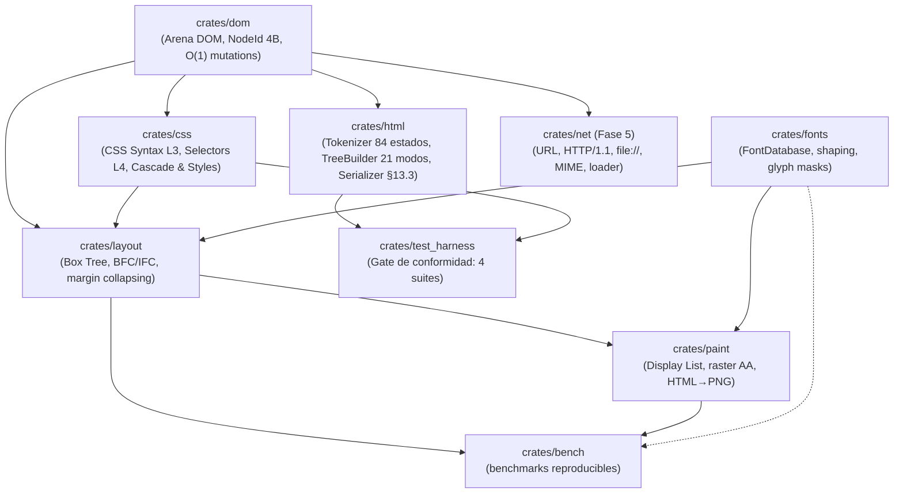

# Megi Web Engine 🌐🦀

[-orange.svg?logo=rust)](https://www.rust-lang.org/)
[](https://github.com/juanpimg/Megi/actions/workflows/ci.yml)
[](LICENSE)
[]()
[-brightgreen.svg)]()
[]()

> **Megi** es un motor de navegación web moderno, open source e independiente desarrollado desde cero en **Rust** (Edición 2024), sin bifurcar (*fork*) Blink, WebKit ni Gecko. Todo su diseño se rige estrictamente por las especificaciones formales vivas de **WHATWG** y **W3C**, con verificación continua en bucle cerrado (*closed-loop testing*) contra **Web Platform Tests (WPT)** y **`html5lib-tests`**.

---

## 📊 Estado del Proyecto y Barra de Progreso por Módulos

Fases 0–3 completadas (DOM, HTML, CSS, Layout). La **Fase 4 (paint + tipografía)** está **casi cerrada (~90 %)**: el pipeline `HTML → CSS → layout → display list → PNG` renderiza texto real, con bordes por lado, antialiasing y determinismo byte a byte. La **Fase 5 (red)** acaba de arrancar con el crate `net`. Las fases 6–7 están planificadas. El detalle exacto de qué falta está en [`docs/PHASE4-SUPPORT.md`](docs/PHASE4-SUPPORT.md) y [`docs/ROADMAP.md`](docs/ROADMAP.md).

| Módulo / Crate | Barra de Progreso | Estado | Tests | Capacidades Implementadas |
|---|:---:|:---:|---|---|
| [`crates/dom`](crates/dom) | `[██████████] 100%` | **COMPLETO** | 9 | Arena contigua indexada (`NodeId(NonZeroU32)` de 4 bytes), enlaces intrusivos de 20 bytes, mutaciones $O(1)$, coalescencia de texto, `<template>`, `try_node`; `append_child`/`insert_before` validan ciclos y devuelven `bool`. |
| [`crates/html`](crates/html) | `[██████████] 99.9%` | **COMPLETO (declarativo)** | 14 unit + 6 rendimiento + 13 robustez | Tokenizador de 84 estados (**7.050/7.050** en el gate), 21 modos de árbol (**3.898/3.904**), 2.231 entidades, AAA y *foster parenting*, `innerHTML`, **serializador público WHATWG HTML §13.3** (`serialize_html`, `serialize_fragment`, `serialize_outer_html`, `*_with_options`) con **230/230** casos de `html5lib-tests/serializer/`; límites anti-DoS `ParseOptions` y serializador iterativo. |
| [`crates/css`](crates/css) | `[██████████] 100%` | **COMPLETO (Fase 2)** | 41 + 30 WPT | CSS Syntax L3, **Selectores L4 funcionales** (`:is/:where/:not/:has`) y estructurales (`:nth-of-type`, `:first/last/only-of-type`, `:nth-last-*`), especificidad correcta, expansión de shorthands antes de la cascada, `font` shorthand, `@media` básico (`resolve_document_styles_with_media`), índice de reglas (**2,1×** en resolve-styles con 10k nodos) y bases de Fase 4 (bordes por lado, `border-style: none`, `float`/`clear`/`overflow`/`visibility`/`text-decoration`/`list-style-type`). |
| [`crates/layout`](crates/layout) | `[████████░░] 85%` | **BFC/IFC completos; faltan posicionados/floats/tablas** | 80 | Box Tree, cajas anónimas *inherit-only* (§9.2.1.1), BFC con colapso de márgenes (§8.3.1), ICB, `box-sizing`/min-max/%, sobre-restringido; **IFC**: saltos sólo en oportunidades reales (UAX #14), soft hyphen de ancho cero, `line-height` numérico heredado como factor, `vertical-align: top/bottom` (§10.8.1) y `text-align: justify`. Pendientes: `position`, floats, tablas e `inline-block`. |
| [`crates/fonts`](crates/fonts) | `[█████████░] 90%` | **COMPLETO (base LTR)** | 13 + 1 doctest | Motor tipográfico real (`fontdb` + `ttf-parser` + `rustybuzz` + `ab_glyph`): descubrimiento/fallback, métricas OpenType, shaping LTR (kern/ligaduras), rasterización de glifos a máscaras alfa y fuente DejaVu determinista. **Integrado en layout y paint** (texto real en el PNG). Limitaciones documentadas: bidi/scripts complejos/fuentes variables fuera de alcance. |
| [`crates/paint`](crates/paint) | `[█████████░] 90%` | **Fase 4 casi completa** | 52 | Display lists, rasterizador con **antialiasing exacto**, alfa straight, **culling** y cachés por pasada; **bordes por lado** (color/ancho/estilo `solid`/`dashed`/`dotted`/`double`/`none|hidden`, esquinas a inglete) y fondo bajo el *border box*; **pipeline HTML → PNG** con codificador PNG propio sin dependencias, canvas propagado (CSS 2.2 §14.2) y golden determinista (PNG `md5 d97c67dc…`). Pendientes: `position`/stacking/`opacity`, clip desde `overflow` y compresión PNG. |
| [`crates/net`](crates/net) | `[█░░░░░░░░░] 10%` | **Fase 5 (arrancada)** | 57 | Bootstrap de red **std-only** (`#![forbid(unsafe_code)]`): URL WHATWG (subset `http`/`https`/`file` + `join`), cliente HTTP/1.1 `GET` (timeouts, `Content-Length`, *chunked*, redirecciones 301/302/303/307/308 con límite, caps 16 MiB/64 KiB), `file://`, *sniffing* MIME WHATWG (subset) y `ResourceLoader` con caché. HTTPS devuelve `TlsUnsupported` (TLS es el siguiente WP). Tests 100 % offline con `TcpListener` local. |
| [`crates/bench`](crates/bench) | `[██████████] 100%` | **COMPLETO (tooling)** | 8 | Arnés de benchmarks reproducible sin dependencias (`std`), cargas sintéticas deterministas, grupos de parseo/estilos/layout/paint/PNG y baseline publicada en [`docs/PERFORMANCE.md`](docs/PERFORMANCE.md). |
| [`crates/test_harness`](crates/test_harness) | `[██████████] 100%` | **COMPLETO** | 7 | Gate de conformidad con **4 suites**: tokenizer (7.050/7.050), árbol (3.898/3.904), **serializador HTML (230/230)** y CSS Syntax WPT vendorizado (30/30); allowlist documentada, `--summary` exit 0 y `--strict` exit 1. |
| `crates/js` | `[░░░░░░░░░░] 0%` | *Planificado (Fase 6)* | — | Integración de ejecución de scripts JavaScript y DOM bindings. |
| `crates/shell` | `[░░░░░░░░░░] 0%` | *Planificado (Fase 7)* | — | Ventana del sistema operativo, eventos y bucle principal; reutilizará el `Pixmap` del pipeline de Fase 4. |

**Total del workspace: 301 tests, 0 fallos.** Reparto: `bench` 8, `css` 41, `dom` 9, `fonts` 13 + 1 doctest, `html` 14 + 6 + 13, `layout` 80, `net` 56 + 1 doctest, `paint` 52, `test_harness` 7.

---

## 🖼️ Resultado actual: HTML → PNG


*Render determinista 800×600 de [`tests/fixtures/phase4/basic.html`](tests/fixtures/phase4/basic.html) generado por `cargo run --release -p paint --example html_to_png`: tipografía real (DejaVu), fondo de canvas propagado desde `html` (CSS 2.2 §14.2), párrafos con `br`, enlace y una tarjeta con **bordes por lado** (sólido + discontinuo) y antialiasing. La captura comprimida vive en [`docs/images/phase4-basic.png`](docs/images/phase4-basic.png); el PNG crudo del pipeline (sin compresión, 1,92 MB) se valida con `tools/png_check.py`.*

---

## 🏆 Hitos Principales Logrados

- [x] **Conformidad ampliada y gate reproducible**: tokenizador **7.050/7.050** (100 %, allowlist vacía), árbol **3.898/3.904**, **serializador HTML 230/230** (5 suites upstream) y CSS Syntax WPT **30/30** (fixtures vendorizadas, sin red). `cargo run -p test_harness -- --summary` → **PASS, exit 0**; `--strict` → exit 1 por los fallos conocidos.
- [x] **Pipeline HTML → PNG con tipografía real y determinismo**: `crates/fonts` integrado en layout/paint (shaping + máscaras de glifo), bordes por lado con estilos `solid`/`dashed`/`dotted`/`double`, antialiasing exacto en rectángulos fraccionarios, fondo bajo el *border box* y golden byte a byte regenerado (`basic.rgba`, `md5 4139fdd8…`; PNG `md5 d97c67dc…`).
- [x] **Serializador HTML público (WHATWG HTML §13.3)**: `html::serialize_html`, `serialize_fragment` (`innerHTML`), `serialize_outer_html` y variantes `*_with_options(HtmlSerializeOptions { scripting_enabled })`, con las 5 suites oficiales de serialización en el gate.
- [x] **Rendimiento medido y regresiones detectables**: tree builder de complejidad **lineal** (eliminada la CPU cuadrática), índice de reglas CSS (**2,1×** en resolve-styles), rasterizador con **culling** y cachés por pasada → raster 800×600 **1598,8 → 0,9 ms**, render-to-PNG **1628 → 7,7 ms** y pipeline completo **1842 → 170,7 ms** (**10,8×**). Metodología y baseline en [`docs/PERFORMANCE.md`](docs/PERFORMANCE.md).
- [x] **Núcleo CSS/IFC de Fase 4**: Selectores L4 funcionales y estructurales, `@media` básico, `font` shorthand, `line-height` numérico heredado como factor, soft hyphen invisible de ancho cero (guion sólo al romper), `vertical-align: top/bottom` conforme a §10.8.1 y `text-align: justify`.
- [x] **Robustez anti-DoS**: parsear 100.000/200.000 `<div>` anidados ya **no aborta** (límite de profundidad 4.096 reportado en `LimitViolations`), 40.000 atributos en un start-tag bajan de ~1.276 ms a ~10 ms; serializador iterativo y DOM con `try_node`/validación de ciclos.
- [x] **Fase 5 arrancada (`crates/net`)**: URL/HTTP1.1/`file://`/MIME/`ResourceLoader` **sin dependencias externas** y con 57 tests offline; el siguiente paso es TLS con `rustls`.
- [x] **Infraestructura de proyecto**: CI (`.github/workflows/ci.yml`: fmt, clippy `-D warnings`, tests, doc, gate de conformidad y job MSRV), licencias MIT/Apache, `rust-version = "1.88"` verificado y `./tools/dev.sh all` como puerta única de calidad.

---

## 🏗️ Arquitectura del Espacio de Trabajo (DAG)

Megi está diseñado como un **Grafo Acíclico Dirigido (DAG)** sin dependencias circulares ni cajas negras:



`crates/net` no depende de ningún crate interno (std puro) y su integración con `html`/`paint` llegará al completar la Fase 5. Crates planificados: `crates/js` (Fase 6) y `crates/shell` (Fase 7).

---

## 🚀 Inicio Rápido y Flujo de Trabajo

### Requisitos
- **Rust 1.88+ (Edition 2024)**; MSRV declarada en `Cargo.toml` y verificada en CI (`rustup toolchain install 1.88`).
- **Git** y **Python 3** (scripts de tooling: especificaciones, inspección de tests y `png_check.py`).

### Compilar y Verificar Todo el Workspace

```bash
./tools/dev.sh all
```

Ejecuta, en orden: `cargo fmt --check` → `cargo clippy --workspace --all-targets -- -D warnings` → `cargo test --workspace` (**301 tests**) → `cargo doc --workspace --no-deps` → **gate de conformidad** (`test_harness --summary`). Ruta de comprobación equivalente, paso a paso:

```bash
cargo +1.88 check --workspace --all-targets   # MSRV
cargo test --workspace                         # 301 tests
cargo run -p test_harness -- --summary         # gate: PASS, exit 0
```

### Gate de Conformidad (4 suites)

```bash
# Tokenizer + árbol DOM + serializador HTML + CSS Syntax
cargo run -p test_harness -- --summary

# Modo estricto: cualquier fallo (incluidos los de la allowlist) hace exit 1
cargo run -p test_harness -- --summary --strict

# Ejecutar una suite concreta
cargo run -p test_harness -- template.dat
cargo run -p test_harness -- test3.test
```

### Renderizar HTML a PNG (pipeline de Fase 4)

```bash
cargo run --release -p paint --example html_to_png -- tests/fixtures/phase4/basic.html /tmp/basic.png
python3 tools/png_check.py /tmp/basic.png
cargo test -p paint --test end_to_end_html
```

El ejemplo acepta `[width] [height]` (por defecto 800×600) y `--rgba <ruta>` para volcar la imagen RGBA canónica usada por los golden tests. Ver [`tests/fixtures/phase4/README.md`](tests/fixtures/phase4/README.md). El código de ejemplo, las limitaciones y la decisión sobre el PNG sin compresión están documentados en [`docs/PHASE4-SUPPORT.md`](docs/PHASE4-SUPPORT.md) §5.

### Rendimiento (benchmarks reproducibles)

```bash
./tools/bench.sh                    # suite completa en release -> target/bench-latest.txt
./tools/bench.sh --scale 0.25       # smoke test rápido
./tools/bench.sh --filter html      # un solo grupo
```

Metodología, cargas sintéticas, tabla de baseline y límites de medición en [`docs/PERFORMANCE.md`](docs/PERFORMANCE.md).

### Motor Tipográfico (crate `fonts`)

```bash
cargo run -p fonts --example report    # métricas, shaping y glifo con DejaVu Sans @16px
cargo test -p fonts
```

### Consultar las Especificaciones Oficiales desde Terminal

```bash
python3 tools/whatwg_spec.py html "#data-state"
python3 tools/whatwg_spec.py html "#the-after-after-body-insertion-mode"
```

---

## 📖 Documentación del Proyecto

- 🏛️ [`docs/ARCHITECTURE.md`](docs/ARCHITECTURE.md): modelo de crates y DAG, arena DOM, política de dependencias externas (§3) y decisión de codificador PNG propio (§3.2).
- 🗺️ [`docs/ROADMAP.md`](docs/ROADMAP.md): hoja de ruta por fases y micro-paquetes `WP-*`, con **Fase 4 (`WP-4.0`…`WP-4.13`)** y el arranque de la **Fase 5**.
- 🧭 [`docs/PHASE4-SUPPORT.md`](docs/PHASE4-SUPPORT.md): matriz de soporte CSS 2.2 de la Fase 4 (implementado / parcial / pendiente).
- 📈 [`docs/PERFORMANCE.md`](docs/PERFORMANCE.md): arnés `crates/bench`, metodología y baseline de rendimiento.
- 📦 [`docs/HANDOFF.md`](docs/HANDOFF.md): estado de la última ronda, comandos de verificación y deuda técnica priorizada.
- 🛠️ [`docs/TOOLING.md`](docs/TOOLING.md): scripts CLI, fixtures vendorizadas, validación PNG, benchmarks y skills de agentes.
- 🤝 [`CONTRIBUTING.md`](CONTRIBUTING.md): filosofía, convenciones de código/commits, CI y flujo de PR.
- 📝 [`CHANGELOG.md`](CHANGELOG.md): historial de cambios por ronda/fase.

---

## 📄 Licencia

Megi se publica bajo doble licencia:

- **Licencia MIT** ([`LICENSE-MIT`](LICENSE-MIT))
- **Licencia Apache 2.0** ([`LICENSE-APACHE`](LICENSE-APACHE))

a tu elección. La fuente de test DejaVu Sans empaquetada en `crates/fonts/tests/fixtures/` conserva su propia licencia (ver `LICENSE-DejaVu.txt`).

---

> **Estado**: proyecto en desarrollo activo, sin releases publicadas. La Fase 4 está casi cerrada y la Fase 5 acaba de arrancar; consulta [`docs/PHASE4-SUPPORT.md`](docs/PHASE4-SUPPORT.md) y [`docs/ROADMAP.md`](docs/ROADMAP.md) antes de asumir soporte de una propiedad CSS o una capacidad de red.
