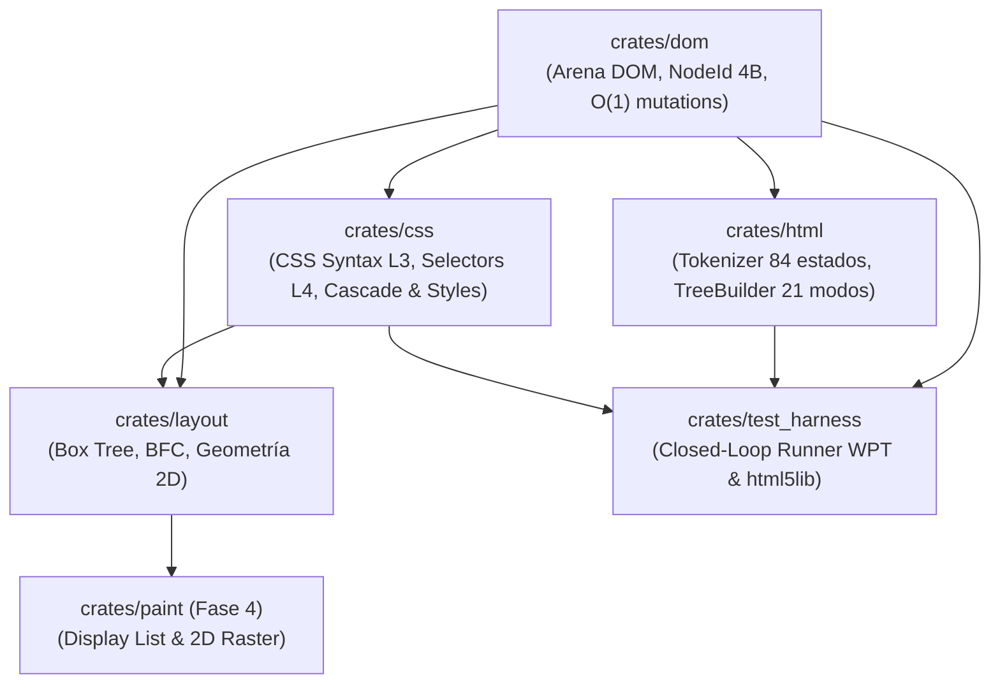

# Megi Web Engine 🌐🦀

[-orange.svg?logo=rust)](https://www.rust-lang.org/)
[](LICENSE)
[-brightgreen.svg)]()
[-success.svg)]()
[-success.svg)]()

> **Megi** es un motor de navegación web moderno, open source e independiente desarrollado desde cero en **Rust** (Edición 2024), sin bifurcar (*fork*) Blink, WebKit ni Gecko. Todo su diseño se rige estrictamente por las especificaciones formales vivas de **WHATWG** y **W3C**, con verificación continua en bucle cerrado (*closed-loop testing*) contra **Web Platform Tests (WPT)** y **`html5lib-tests`**.

---

## 📊 Estado del Proyecto y Barra de Progreso por Módulos

El desarrollo de Megi se estructura en paquetes de trabajo atómicos de máxima observabilidad. A continuación se presenta el estado de implementación detallado por subsistema:

| Módulo / Crate | Barra de Progreso | Estado | Conformidad y Tests | Capacidades Implementadas |
|---|:---:|:---:|---|---|
| [`crates/dom`](crates/dom) | `[██████████] 100%` | **COMPLETO** | 5/5 unit tests | Arena contigua indexada (`NodeId(NonZeroU32)` de 4 bytes), enlaces intrusivos de 20 bytes, mutaciones $O(1)$, coalescencia de texto y fragmentos inertes para `<template>`. |
| [`crates/html`](crates/html) | `[██████████] 99.9%` | **COMPLETO (Declarativo)** | 7/7 unit tests<br>`7.047 / 7.050` estados tokenizer<br>`3.898 / 3.904` modos árbol | Preprocesador de flujo (§13.2.3.5), 2.231 entidades nombradas (§13.5), máquina de 84 estados del tokenizador (§13.2.5), 21 modos de inserción del árbol DOM (§13.2.6), adopción de formato (AAA), foster parenting y fragmentos HTML (`innerHTML`). 58 de 62 suites oficiales al 100% verde. |
| [`crates/css`](crates/css) | `[██████████] 100%` | **COMPLETO** | 10/10 unit tests<br>30/30 tests WPT | Tokenizador y parser W3C CSS Syntax L3, Selectores L4 (atributos, combinadores, pseudoclases `:first-child`, `:nth-child(An+B)`), cálculo de especificidad $(A,B,C)$, cascada de 8 niveles, valores computados (`ComputedStyle`), herencia de propiedades y hoja User-Agent WHATWG HTML §15. |
| [`crates/layout`](crates/layout) | `[██████████] 100%` | **COMPLETO (BFC + IFC)** | 30/30 tests en layout (4 unitarios + 26 integración/adversariales) | Geometría 2D (`Rect`, `Dimensions`), árbol de cajas (`LayoutBox`), normalización de bloques anónimos (§9.2.1.1), BFC (márgenes automáticos, colapso vertical) e Inline Formatting Context (IFC) completo: división greedy, métricas de fuente y strut CSS 2.1 §10.8, alineación horizontal (`text-align`), alineación vertical exhaustiva (`vertical-align: baseline, middle, top, bottom, sub, super, text-top, text-bottom, length`), wrap en guiones (`-`) / soft hyphens (`\u{00AD}`) y fragmentación de cajas en línea. |
| [`crates/test_harness`](crates/test_harness) | `[██████████] 100%` | **COMPLETO** | 5/5 closed-loop tests | Ejecutor en bucle cerrado que valida de forma autónoma los 14 archivos JSON de tokenizer (6.824 casos), los 62 archivos `.dat`/`.json` de árbol DOM (1.973 casos) y suites WPT de sintaxis CSS. |
| `crates/paint` | `[░░░░░░░░░░] 0%` | *En Planificación (Fase 4)* | — | Próxima fase: Generación de Display Lists desacopladas (`DrawRect`, `DrawText`, `FillColor`) y rasterización 2D. |
| `crates/net` | `[░░░░░░░░░░] 0%` | *Planificado (Fase 5)* | — | Transporte HTTP/TLS y pipeline de recursos según WHATWG Fetch. |
| `crates/js` | `[░░░░░░░░░░] 0%` | *Planificado (Fase 6)* | — | Enlaces e integración de ejecución de scripts JavaScript (`document.write`, DOM bindings). |
| `crates/shell` | `[░░░░░░░░░░] 0%` | *Planificado (Fase 7)* | — | Creación de ventana en el sistema operativo, gestión de eventos y bucle principal de renderizado. |

---

## 🏆 Hitos Principales Logrados

- [x] **Arquitectura Zero-Overhead Arena DOM**: Eliminación total de conteo dinámico de referencias (`Rc<RefCell<Node>>`). Manejadores compactos `NodeId(NonZeroU32)` con mutaciones $O(1)$ y memoria contigua con máxima localidad de caché.
- [x] **Paridad del 99.85% en Construcción de Árbol HTML5**: 58 de las 62 suites oficiales de `html5lib-tests` pasan al 100% verde de forma ininterrumpida. El 100% del HTML5 declarativo es soportado fielmente a la especificación viva.
- [x] **Motor CSS Sintáctico y de Cascada Normativo**: Tokenizador y parser que pasan el 100% de las pruebas WPT de sintaxis, cálculo formal de especificidad de Selectores Nivel 4 y cascada con hoja de estilo por defecto según WHATWG HTML §15.
- [x] **Box Tree & Block Formatting Context (BFC)**: Creación del árbol de cajas de diseño desacoplado del DOM, normalización de bloques anónimos según CSS 2.2 §9.2.1.1 y cálculo automático de geometrías de bloque.
- [x] **Inline Formatting Context (IFC) y Renderizado Tipográfico Multilínea**: Motor de salto de línea voraz (*greedy line breaking*) con colapso de espacios, wrap opportunities en guiones (`-`) y soft-hyphens (`\u{00AD}`), cálculo del strut CSS 2.1 §10.8, alineación vertical completa (`middle`, `baseline`, `super`, `sub`, etc.) y fragmentación de cajas en línea con bordes/márgenes exteriores.
- [x] **Tooling Autónomo y Closed-Loop**: Scripts de consulta en vivo de especificaciones WHATWG (`tools/whatwg_spec.py`), inspector de casos de prueba (`tools/test_inspector.py`) y script de verificación estricta (`tools/dev.sh`).

---

## 🏗️ Arquitectura del Espacio de Trabajo (DAG)

Megi está diseñado como un **Grafo Acíclico Dirigido (DAG)** sin dependencias circulares ni cajas negras:



---

## 🚀 Inicio Rápido y Flujo de Trabajo

### Requisitos
- **Rust 1.85+ (Edition 2024)** (`rustup update stable`)
- **Git** y **Python 3** (para scripts auxiliares de tooling)

### Compilar y Verificar Todo el Workspace
Ejecuta el script unificado de control de calidad (formato, linter clippy estricto, tests unitarios, tests de bucle cerrado y documentación):

```bash
./tools/dev.sh all
```

### Ejecutar el Arnés de Pruebas de Conformidad (HTML5 & WPT)

```bash
# Reporte resumido de las 14 suites de tokenizador, 62 suites de árbol y WPT CSS
cargo run -p test_harness -- --summary

# Ejecutar una suite específica
cargo run -p test_harness -- template.dat
cargo run -p test_harness -- test3.test
```

### Consultar las Especificaciones Oficiales desde Terminal

```bash
# Consultar secciones normativas de WHATWG HTML
python3 tools/whatwg_spec.py html "#data-state"
python3 tools/whatwg_spec.py html "#the-after-after-body-insertion-mode"
```

---

## 📖 Documentación del Proyecto

- 🏛️ [**`docs/ARCHITECTURE.md`**](docs/ARCHITECTURE.md): Explicación exhaustiva del modelo de memoria del DOM en arena, diseño de crates, flujo de datos y dependencias autorizadas.
- 🗺️ [**`docs/ROADMAP.md`**](docs/ROADMAP.md): Desglose atómico de las fases de desarrollo con asignación exacta de especificaciones WHATWG/W3C, suites de prueba y criterios de aceptación.
- 🛠️ [**`docs/TOOLING.md`**](docs/TOOLING.md): Guía de herramientas CLI y servidores para inspección de especificaciones y tests.
- 🤝 [**`CONTRIBUTING.md`**](CONTRIBUTING.md): Guía de contribución, enfoque filosófico del proyecto, buenas prácticas y flujo de trabajo para colaborar.

---

## 📄 Licencia

Megi se publica bajo doble licencia:
- **Licencia MIT** ([LICENSE-MIT](LICENSE-MIT) o <http://opensource.org/licenses/MIT>)
- **Licencia Apache 2.0** ([LICENSE-APACHE](LICENSE-APACHE) o <http://www.apache.org/licenses/LICENSE-2.0>)

a tu elección.
