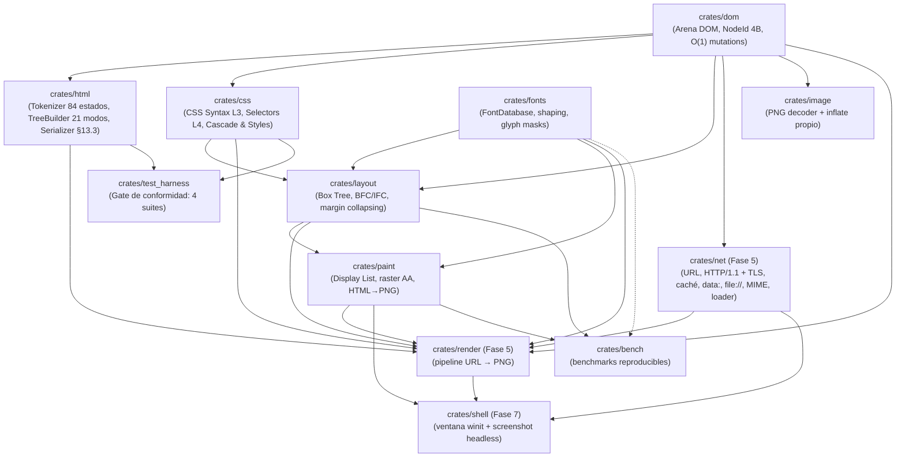

# Megi Web Engine 🌐🦀

[-orange.svg?logo=rust)](https://www.rust-lang.org/)
[](https://github.com/juanpimg/Megi/actions/workflows/ci.yml)
[](LICENSE)
[]()
[](https://github.com/juanpimg/Megi/actions/workflows/fuzz-nightly.yml)
[-brightgreen.svg)]()
[]()

> **Megi** es un motor de navegación web moderno, open source e independiente desarrollado desde cero en **Rust** (Edición 2024), sin bifurcar (*fork*) Blink, WebKit ni Gecko. Todo su diseño se rige estrictamente por las especificaciones formales vivas de **WHATWG** y **W3C**, con verificación continua en bucle cerrado (*closed-loop testing*) contra **Web Platform Tests (WPT)** y **`html5lib-tests`**.

---

## 📊 Estado del Proyecto y Barra de Progreso por Módulos

Fases 0–3 completadas. La **Fase 4 (paint + tipografía)** está **funcionalmente cerrada (~100 %)**: tablas avanzadas (`rowspan`, `table-layout: fixed`, `inline-table`, `border-collapse` con conflictos), imágenes ``, PNG comprimido, DOM generacional y painter iterativo; pendientes `background-image` pintado y el texto de celdas de tabla en paint. La **Fase 5 (red/render)** está al **~80 %**: pipeline URL→PNG, imágenes, TLS/caché/`data:`, **`@import` recursivo y media real**, y un showcase 1024×768 con golden determinista. La **Fase 6 (JS)** tiene **decisión ACEPTADA (ADR-001, 2026-11-10)**: **Boa 0.21.x**, feature `js` **encendida por defecto** y alcance completo (bindings/eventos/timers/CSSOM/`querySelector`); **implementación en curso (WP-6.1)**. La **Fase 7 (shell)** está al **~40 %**: ventana usable con scroll, entrada, HiDPI y render en worker. El detalle está en [`docs/PHASE4-SUPPORT.md`](docs/PHASE4-SUPPORT.md), [`docs/ROADMAP.md`](docs/ROADMAP.md) y [`docs/JAVASCRIPT-STRATEGY.md`](docs/JAVASCRIPT-STRATEGY.md).

| Módulo / Crate | Barra de Progreso | Estado | Tests | Capacidades Implementadas |
|---|:---:|:---:|---|---|
| [`crates/dom`](crates/dom) | `[██████████] 100%` | **COMPLETO** | 28 | Arena contigua con `NodeId` de 4 bytes (**20 bits slot + 12 bits generación**), free list LIFO con reutilización de slots, `remove_node`/`remove_subtree`, detección de handles stale/foráneos (`owns`, `try_node`), `descendants`/`ancestors` iterativos con guardas de ciclo, `validate_invariants()`, `estimate_bytes()/allocated()/free_slots()`; **API de navegador**: `document_element/head/body`, `get_element_by_id`, `get_elements_by_tag_name/class_name`, factorías de nodos, atributos, `text_content`, `remove_child`/`insert_before_child`/`replace_all_children`, `clone_node_into` y `DomError`. |
| [`crates/html`](crates/html) | `[██████████] 99.9%` | **COMPLETO** | 53 (14 unit + 6 rendimiento + 13 robustez + 20 browser API) | Tokenizador de 84 estados (**7.050/7.050** en el gate), 21 modos de árbol (**3.898/3.904**), 2.231 entidades, AAA y *foster parenting*, `innerHTML`, **serializador público WHATWG HTML §13.3** (`serialize_html`, `serialize_fragment`, `serialize_outer_html`, `*_with_options`) con **230/230** casos de `html5lib-tests/serializer/`; límites anti-DoS `ParseOptions`, serializador iterativo y **DOM de navegador**: `parse_fragment_into`, `set_inner_html`/`set_outer_html`, `document_write` (contextos table/select/template/rawtext, sin fugas de slots). Sin `querySelector`/eventos/CSSOM (Fase 6). |
| [`crates/css`](crates/css) | `[██████████] 100%` | **COMPLETO (Fase 2+)** | 57 + 30 WPT | CSS Syntax L3, **Selectores L4 funcionales** (`:is/:where/:not/:has`) y estructurales (`:nth-of-type`, `:first/last/only-of-type`, `:nth-last-*`), especificidad correcta, expansión de shorthands antes de la cascada, `font` shorthand, `@media` básico (`resolve_document_styles_with_media`), índice de reglas (**2,1×** en resolve-styles con 10k nodos) y bases de Fase 4 (bordes por lado, `border-style: none`, `float`/`clear`/`overflow`/`visibility`/`text-decoration`/`list-style-type`), **tablas CSS 2.1** (`display: table-*`/`inline-table`/caption, `border-spacing`, `border-collapse`, `table-layout`, `caption-side`, `empty-cells`) y hoja UA §15 con reglas de tabla; **`@import`** (`Stylesheet.imports`) y **Media Queries** completas (`parse_media_query_list`, `media::evaluate`: and/or/not/only, listas, all/screen/print, width/height/min/max en px/em/rem/pt/pc/in/cm/mm, orientation). El `render` ya consume `@import` y media (ronda 7). Añade **query API** `css::query::{query_selector, query_selector_all, matches}` (+ variantes `try_*`) y parseo de `background-image`/`list-style-image` (`url(...)`, `none`, shorthand color+imagen; gradientes → `None`; aún no se pintan). |
| [`crates/layout`](crates/layout) | `[██████████] 100%` | **Fase 4 completa** | 129 | Box Tree con campos usados de posicionamiento (`position`, `z_index`, `opacity`, stacking context, `clip`, `is_float`); BFC con colapso de márgenes (§8.3.1) e ICB; **IFC** con saltos UAX #14, soft hyphen de ancho cero, `line-height` como factor, `vertical-align` §10.8.1 y `justify`; **`position: relative/absolute/fixed`** (containing blocks, posición estática, shrink-to-fit; `sticky` documentado como relative), **floats/`clear`** §9.5 (BFC contiene floats §10.6.7) y **`overflow`** con BFC y clip rect. **Tablas CSS 2.1 §17** (auto layout min/max-content, `border-spacing`, `colspan`, fixups anónimos, `vertical-align` de celdas, caption y row-groups), **`inline-block`** (shrink-to-fit, baseline, `vertical-align`) y **cajas reemplazadas** (`BoxType::Replaced`, tamaños intrínsecos `img` 300×150 / `input` 20×20 / `textarea` 160×40, API `layout_document_with_replaced_sizes`). **`LayoutBox::Drop` iterativo** (50.000 niveles, pila de 256 KiB) y **−43 %** en `layout/realistic-1mb` (100,6→57,2 ms) por `Arc<ComputedStyle>`, line breaking en streaming y una sola pasada de `format_line`. **Tablas avanzadas**: `rowspan`, `table-layout: fixed`, `inline-table` atómico y `border-collapse` con resolución de conflictos, con fast path para separate/auto/sin rowspan (`layout/realistic-1mb` ~59 ms). Pendiente: `background-image` pintado, texto de celdas de tabla en paint y block-in-inline. |
| [`crates/fonts`](crates/fonts) | `[█████████░] 90%` | **COMPLETO (base LTR)** | 13 + 1 doctest | Motor tipográfico real (`fontdb` + `ttf-parser` + `rustybuzz` + `ab_glyph`): descubrimiento/fallback, métricas OpenType, shaping LTR (kern/ligaduras), rasterización de glifos a máscaras alfa y fuente DejaVu determinista. **Integrado en layout y paint** (texto real en el PNG). Limitaciones documentadas: bidi/scripts complejos/fuentes variables fuera de alcance. |
| [`crates/paint`](crates/paint) | `[██████████] 100%` | **Fase 4 completa** | 88 | Display lists con **orden completo del Apéndice E** (stacking contexts y `z-index`), `OpacityGroup` (grupo offscreen compuesto una vez), `PushClip`/`PopClip` desde `overflow`, `text-decoration` (underline/overline/line-through), `visibility: hidden` y marcadores `disc`/`circle`/`square`/`decimal`; rasterizador con AA exacto, alfa straight, **culling** y cachés por pasada; bordes por lado y fondo bajo el *border box*; pipeline HTML → PNG con codificador PNG propio y golden determinista (PNG `md5 34152025…`, `basic.rgba` `md5 60f8984e…`). **Compresión PNG propia**: DEFLATE con LZ77 (hash-chains 32 KiB + Huffman fijo) y zlib/Adler, filtros PNG adaptativos; PNG del fixture **1.920.813 → 42.853 B (44,8×)** con `basic.rgba` idéntico (`md5 60f8984e…`; PNG `md5 9e957177…`). `build_display_list` es **totalmente iterativo** (pila explícita; caps stacking 256/floats 64/items 5M). **Imágenes E2E**: `ImageStore = HashMap<NodeId, Arc<image::RgbaImage>>`, `DisplayItem::Image` y `build_display_list_with_images`; raster **bilineal clamp-to-edge** con AA/alfa/clip y placeholder gris; **fix de underflow** de cobertura parcial en `fill_rect` (rects <1 px/x fraccional, 4 tests de regresión). |
| [`crates/net`](crates/net) | `[██████░░░░] 60%` | **Fase 5** | 85 | URL WHATWG (subset `http`/`https`/`file` + `join`), HTTP/1.1 `GET` (timeouts, `Content-Length`, *chunked*, redirects con límite, caps), **TLS 1.2/1.3 con `rustls` 0.23 (ring) + `webpki-roots`** (feature `tls` por defecto, SNI y validación de certificado/host; `rcgen` solo en tests), **caché HTTP RFC 9111 subset** (`max-age`/`Expires`/`ETag`/`Last-Modified`/`304`/`no-store`/`Vary`), **`data:` URLs** con Base64 propio, `file://`, MIME sniffing y `ResourceLoader` con caché. `#![forbid(unsafe_code)]`; tests 100 % offline. El pipeline de navegador lo consume `crates/render`. Pendientes: CORS, cookies, HTTP/2 y compresión de red. |
| [`crates/render`](crates/render) | `[██████████] 100%` | **Fase 5 (pipeline de navegador)** | 40 | Pipeline **URL → PNG** de extremo a extremo: carga con `net` (`file`/`data`/HTTP/HTTPS con TLS y caché), decodifica charset (UTF-8/Windows-1252), respeta `<base>`, recolecta `<style>` + `<link rel=stylesheet>` externos (dedup y caps), resuelve la cascada UA+autor, hace layout con fuentes bundled, display list y **PNG determinista**; CLI `render <entrada> <salida.png> [--width/--height/--base/--no-network/--json]` y stats por etapa; **imágenes ``**: carga por `net` (respeta `--no-network`), decodifica PNG (`crates/image`; otros formatos ⇒ warning + placeholder no fatal), inyecta tamaños intrínsecos y pinta (caps 64 imágenes/8 MiB/32 MiB). Fixture `images.html` 800×600 → 15.625 B `md5 1de31699…`. **`@import` recursivo** (resolución relativa, dedup/ciclos, profundidad 8 y caps) y **media real** en `<link>`/`<style>`/`@import`; showcase 1024×768 → **65.151 B `md5 570aa554…`** determinista. Sin JS. |
| [`crates/image`](crates/image) | `[██████████] 100%` | **Soporte de imágenes (Fase 4/5)** | 45 + 1 doctest | Decodificador **PNG propio** (std puro, `#![forbid(unsafe_code)]`): inflate zlib/DEFLATE completo (stored/fixed/dynamic, ventana 32 KiB, Adler-32), `IHDR/PLTE/tRNS/IDAT/IEND` con CRC, color types 0/2/3/4/6, bit depth 1–16, filtros 0–4, Adam7 y límites (`PngLimits`); decodifica el PNG del pipeline y lo compara byte a byte con `basic.rgba`. GIF/JPEG/WebP solo detectados. |
| [`crates/bench`](crates/bench) | `[██████████] 100%` | **COMPLETO (tooling)** | 8 | Arnés de benchmarks reproducible sin dependencias (`std`), cargas sintéticas deterministas, grupos de parseo/estilos/layout/paint/PNG y baseline publicada en [`docs/PERFORMANCE.md`](docs/PERFORMANCE.md). |
| [`crates/test_harness`](crates/test_harness) | `[██████████] 100%` | **COMPLETO** | 7 | Gate de conformidad con **4 suites**: tokenizer (7.050/7.050), árbol (3.898/3.904), **serializador HTML (230/230)** y CSS Syntax WPT vendorizado (30/30); allowlist documentada, `--summary` exit 0 y `--strict` exit 1. |
| `crates/js` | `[█░░░░░░░░░] 5%` | **Fase 6 (en implementación — WP-6.1)** | — | ADR-001 **ACEPTADO (2026-11-10)**: motor **Boa 0.21.x** (pure Rust, Unlicense OR MIT), feature `js` **encendida por defecto** (job CI `--no-default-features` para el build mínimo) y alcance completo (`document.write` + bindings + eventos + timers + CSSOM + `querySelector`, plan WP-6.1–6.7). Bindings por tabla lateral `NodeId↔JsValue` por realm, generaciones y presupuestos anti-DoS. Aún sin crate ni tests en este HEAD. |
| [`crates/shell`](crates/shell) | `[████░░░░░░] 40%` | **Fase 7 (en curso)** | 46 | Ventana **usable** con **`winit` 0.30 + `softbuffer` 0.4** (X11/Wayland dlopen, sin GPU): **scroll vertical** (rueda/teclado/paginación, cap 8192 CSS px con marca `[recortado]`), **entrada** (ratón/teclado, clic imprime URL, r/q/Esc), **HiDPI** (viewport CSS = physical/scale, nearest-neighbour) y **render en worker** con generación/cancelación/coalescing (debounce 120 ms, `EventLoopProxy`); **`--screenshot` headless** determinista (640×400 `md5 7324e851…`) y `tools/megi.sh`. Pendientes: hit-testing, navegación/historial, eventos DOM, zoom y JS. |

**Total del workspace: 602 tests, 0 fallos.** Reparto: `bench` 8, `css` 57, `dom` 28, `fonts` 13 + 1 doctest, `html` 53, `image` 45 + 1 doctest, `layout` 129, `net` 85, `paint` 88, `render` 40, `shell` 46, `test_harness` 7. Todos los crates están marcados `#![forbid(unsafe_code)]`.

---

## 🖼️ Resultado actual: HTML → PNG


*Render determinista 800×600 (26 display items) de [`tests/fixtures/phase4/basic.html`](tests/fixtures/phase4/basic.html), generado por `cargo run --release -p paint --example html_to_png`: tipografía real (DejaVu), fondo de canvas propagado (CSS 2.2 §14.2), **bordes por lado** (sólido + discontinuo), viñetas de lista, enlace subrayado y un *stage* con `position: relative`, `#under` (`z-index: 1`) y `#badge` (`z-index: 3`, `opacity: 0.7`) solapados. El PNG del pipeline es **comprimido por el codificador propio** (42.853 B tras DEFLATE, `md5 9e957177…`) y se valida con `tools/png_check.py`; la captura vive en [`docs/images/phase4-basic.png`](docs/images/phase4-basic.png).*

**Pipeline de navegador real (`crates/render`, Fase 5):**


*`cargo run -p render -- tests/fixtures/render/basic.html docs/images/render-fixture.png --width 640 --height 400`: el documento carga `sub/theme.css` como hoja externa a través de `<base href="sub/">` (canvas verde), ignora la hoja `media="print"` y aplica el `<style>` inline. 640×400, 15.498 B (`md5 7324e851…`), 4 display items, 1 hoja externa + 1 inline.*

**Imágenes `` de extremo a extremo (`crates/paint` + `crates/image` + `crates/render`):**


*`cargo run -p render -- tests/fixtures/render/images.html docs/images/images-e2e.png`: un PNG de 4×4 (`assets/px.png`) escalado a 40×40 con **muestreo bilineal clamp-to-edge** y una imagen ausente que se sustituye por un **placeholder gris** con warning no fatal (stats `images_loaded: 1`, `images_failed: 1`). 800×600, 15.625 B, `md5 1de316995f56f7c72eefeb7e38a4e184`.*

**Showcase de navegador real (`crates/render`, 1024×768):**


*`cargo run -p render -- tests/fixtures/render/showcase/index.html docs/images/showcase.png --width 1024 --height 768`: página real sin JS que ejercita `file://`/HTTP, hoja externa + `@import` recursivo + media queries (la hoja `media="print"` se omite), dos PNG decodificados, tabla, elementos posicionados y listas. Render determinista **65.151 B**, `md5 570aa554c88c2fdf75481e8cd076bf61`; la captura comprimida versionada pesa 50 KB. Limitaciones visibles: el texto de celdas de tabla aún no se pinta y `background-image` no se aplica.*

---

## 🏆 Hitos Principales Logrados

- [x] **Conformidad ampliada y gate reproducible**: tokenizador **7.050/7.050** (100 %, allowlist vacía), árbol **3.898/3.904**, **serializador HTML 230/230** (5 suites upstream) y CSS Syntax WPT **30/30** (fixtures vendorizadas, sin red). `cargo run -p test_harness -- --summary` → **PASS, exit 0**; `--strict` → exit 1 por los fallos conocidos.
- [x] **Pipeline HTML → PNG con tipografía real y determinismo**: `crates/fonts` integrado en layout/paint (shaping + máscaras de glifo), bordes por lado (`solid`/`dashed`/`dotted`/`double`), antialiasing exacto, fondo bajo el *border box* y golden byte a byte regenerado (`basic.rgba` `md5 60f8984e…`; PNG `md5 34152025…`, 26 display items).
- [x] **Tablas CSS 2.1, `inline-block` y cajas reemplazadas**: layout de tablas §17 (auto min/max-content, `border-spacing`, `colspan`, celdas/caption/row-groups), `inline-block` con shrink-to-fit y baseline, y `BoxType::Replaced` con tamaños intrínsecos (API `layout_document_with_replaced_sizes`).
- [x] **Compresión PNG propia (44,8×)**: DEFLATE LZ77+Huffman fijo con zlib/Adler, filtros adaptativos y **1.920.813 → 42.853 B** manteniendo `basic.rgba` bit a bit; `build_display_list` totalmente iterativo (20.000 niveles, caps documentados).
- [x] **Showcase de navegador real (`render`, Fase 5/7)**: `tests/fixtures/render/showcase/` con CSS externo + `@import` recursivo + media queries + 2 PNG decodificados + tabla + stage posicionado → **1024×768, 65.151 B `md5 570aa554…`** determinista (file:// y HTTP); captura en `docs/images/showcase.png`.
- [x] **Shell usable (Fase 7)**: scroll vertical (cap 8192 CSS px), entrada ratón/teclado, HiDPI y render off-thread con cancelación/coalescing; `--screenshot` headless intacto.
- [x] **Tablas CSS 2.1 avanzadas**: `rowspan`, `table-layout: fixed`, `inline-table`, `border-collapse` con resolución de conflictos y fast path (layout/realistic-1mb ~59 ms).
- [x] **CSS query API + `background-image` parsing**: `css::query::{query_selector, query_selector_all, matches}` y campos `background_image`/`list_style_image` en `ComputedStyle` (pintado pendiente).
- [x] **ADR-001 de JavaScript (Fase 6) ACEPTADO (2026-11-10)**: motor **Boa 0.21.x**, feature `js` **ON por defecto** con job CI mínimo `--no-default-features` y alcance completo; implementación en curso por WP-6.1. Detalle en [`docs/JAVASCRIPT-STRATEGY.md`](docs/JAVASCRIPT-STRATEGY.md).
- [x] **Imágenes `` de extremo a extremo**: `paint` con `ImageStore`/`DisplayItem::Image` y rasterización bilineal clamp-to-edge con AA/alfa/clip, `render` cargando/decodificando PNG con caps y placeholders no fatales; fixture determinista 800×600 15.625 B (`md5 1de31699…`).
- [x] **Fase 7 arrancada (`crates/shell`)**: ventana winit+softbuffer y **modo headless `--screenshot`** determinista (640×400 `md5 7324e851…`), CLI `megi` + `tools/megi.sh`.
- [x] **CSS `@import` + Media Queries completas** y **DOM de navegador**: `innerHTML`/`outerHTML`/`document.write`, búsquedas por id/tag/clase, manipulación de hijos/atributos (`DomError`).
- [x] **Layout −43 %** (`layout/realistic-1mb` 100,6→57,2 ms) con `Arc<ComputedStyle>`, line breaking en streaming y `format_line` de una pasada; `LayoutBox::Drop` iterativo a 50.000 niveles.
- [x] **Pipeline de navegador real (`crates/render` + `crates/image`)**: `URL → net → HTML → CSS externo → layout → PNG` con CLI y stats por etapa; decodificador PNG/inflate propio (`crates/image`) que valida el PNG del motor contra el golden RGBA. **DOM generacional** (slot+generación, free list, handles stale/foráneos rechazados, `validate_invariants`).
- [x] **Pintado CSS 2.2 Apéndice E completo (caso in-flow)**: stacking contexts y `z-index` (positivo/negativo/auto), `opacity` compuesta como grupo offscreen, `PushClip`/`PopClip` desde `overflow`, `visibility: hidden`, `text-decoration` y marcadores de lista; posicionamiento `relative`/`absolute`/`fixed`, floats/`clear` y BFC que contiene floats en layout.
- [x] **Serializador HTML público (WHATWG HTML §13.3)**: `html::serialize_html`, `serialize_fragment` (`innerHTML`), `serialize_outer_html` y variantes `*_with_options(HtmlSerializeOptions { scripting_enabled })`, con las 5 suites oficiales de serialización en el gate.
- [x] **Rendimiento medido y regresiones detectables**: tree builder de complejidad **lineal** (eliminada la CPU cuadrática), índice de reglas CSS (**2,1×** en resolve-styles), rasterizador con **culling** y cachés por pasada → raster 800×600 **1598,8 → 0,9 ms**, render-to-PNG **1628 → 7,7 ms** y pipeline completo **1842 → 170,7 ms** (**10,8×**). Metodología y baseline en [`docs/PERFORMANCE.md`](docs/PERFORMANCE.md).
- [x] **Núcleo CSS/IFC de Fase 4**: Selectores L4 funcionales y estructurales, `@media` básico, `font` shorthand, `line-height` numérico heredado como factor, soft hyphen invisible de ancho cero (guion sólo al romper), `vertical-align: top/bottom` conforme a §10.8.1 y `text-align: justify`.
- [x] **Robustez anti-DoS**: parsear 100.000/200.000 `<div>` anidados ya **no aborta** (límite de profundidad 4.096 reportado en `LimitViolations`), 40.000 atributos en un start-tag bajan de ~1.276 ms a ~10 ms; serializador iterativo y DOM con `try_node`/validación de ciclos.
- [x] **Fase 5 en marcha (`crates/net`)**: **TLS 1.2/1.3 con `rustls` 0.23 (ring) + `webpki-roots`** (SNI y validación; `rcgen` solo en tests), **caché HTTP RFC 9111 subset**, **`data:` URLs** con Base64 propio, URL/HTTP1.1/`file://`/MIME/`ResourceLoader` y **85 tests offline**; pendientes Fetch/CORS y la integración de recursos en el pipeline.
- [x] **Fuzzing continuo**: `fuzz/` (workspace aparte con `cargo-fuzz`, 4 targets y corpus semilla versionado) + `.github/workflows/fuzz-nightly.yml` (cron diario); campaña local documentada de ~1,06 M de ejecuciones ASan con **0 crashes**. Ver [`docs/FUZZING.md`](docs/FUZZING.md).
- [x] **Infraestructura de proyecto**: CI (`.github/workflows/ci.yml`: fmt, clippy `-D warnings`, tests, doc, gate de conformidad y job MSRV) + **fuzz nocturno** (`fuzz-nightly.yml`), licencias MIT/Apache, `rust-version = "1.88"` verificado, `#![forbid(unsafe_code)]` en todos los crates y `./tools/dev.sh all` como puerta única de calidad.

---

## 🏗️ Arquitectura del Espacio de Trabajo (DAG)

Megi está diseñado como un **Grafo Acíclico Dirigido (DAG)** sin dependencias circulares ni cajas negras:



`crates/net` no depende de crates internos; sus únicas dependencias externas son `rustls` + `webpki-roots` (§3.1). `crates/render` es el punto de integración (URL → PNG), `crates/image` (std puro) decodifica PNG y `crates/shell` presenta el `Pixmap` en ventana o screenshot headless (winit/softbuffer, §3.1). `fuzz/` es un workspace **aparte** (herramienta de fuzzing, no forma parte del motor). Crates planificados: `crates/js` (Fase 6).

---

## 🚀 Inicio Rápido y Flujo de Trabajo

### Requisitos
- **Rust 1.88+ (Edition 2024)**; MSRV declarada en `Cargo.toml` y verificada en CI (`rustup toolchain install 1.88`).
- **Git** y **Python 3** (scripts de tooling: especificaciones, inspección de tests y `png_check.py`).

### Compilar y Verificar Todo el Workspace

```bash
./tools/dev.sh all
```

Ejecuta, en orden: `cargo fmt --check` → `cargo clippy --workspace --all-targets -- -D warnings` → `cargo test --workspace` (**602 tests**) → `cargo doc --workspace --no-deps` → **gate de conformidad** (`test_harness --summary`). Ruta de comprobación equivalente, paso a paso:

```bash
cargo +1.88 check --workspace --all-targets   # MSRV
cargo test --workspace                         # 602 tests (con JS por defecto)
cargo run -p test_harness -- --summary         # gate: PASS, exit 0
```

### Gate de Conformidad (4 suites)

```bash
# Tokenizer + árbol DOM + serializador HTML + CSS Syntax
cargo run -p test_harness -- --summary

# Modo estricto: cualquier fallo (incluidos los de la allowlist) hace exit 1
cargo run -p test_harness -- --summary --strict

# Ejecutar una suite concreta
cargo run -p test_harness -- template.dat
cargo run -p test_harness -- test3.test
```

### Navegar de URL a PNG (pipeline de Fase 5)

```bash
# Documento + CSS externo resuelto por <base> (fixture offline)
cargo run -p render -- tests/fixtures/render/basic.html /tmp/render-fixture.png --width 640 --height 400 --json
python3 tools/png_check.py /tmp/render-fixture.png

# Equivalente con URL (requiere red/TLS para http(s); --no-network para offline)
cargo run -p render -- https://example.com/ /tmp/example.png
bash tools/render_fixture.sh /tmp/megi-render-fixture.png    # fixture + validación + md5
```

`crates/render` encadena `net` (file/data/HTTP/HTTPS con TLS y caché), `html`, `css` (cascada UA+autor), `layout` (fuentes bundled), `paint` y el codificador PNG. `crates/image` decodifica PNG con un inflate propio. Ver [`docs/PHASE4-SUPPORT.md`](docs/PHASE4-SUPPORT.md) y [`docs/TOOLING.md`](docs/TOOLING.md).

### Abrir una ventana usable o capturar un screenshot (Fase 7, `crates/shell`)

```bash
# Screenshot headless (CI-friendly, no necesita display)
cargo run -p shell -- tests/fixtures/render/basic.html --screenshot /tmp/megi-shot.png --width 640 --height 400
bash tools/megi.sh tests/fixtures/render/basic.html --screenshot /tmp/megi-shot.png

# Ventana nativa usable (requiere X11 o Wayland)
tools/megi.sh tests/fixtures/render/showcase/index.html
# controles: rueda/↑↓/PageUp/PageDown/Home/End = scroll; r = re-render; q/Esc = salir; clic = imprime URL

# Showcase de navegador real (CSS externo + @import + media + imágenes)
cargo run -p render -- tests/fixtures/render/showcase/index.html docs/images/showcase.png --width 1024 --height 768
```

El binario `megi` presenta el `Pixmap` del pipeline como framebuffer `0RGB` con `softbuffer`; `--screenshot` usa el mismo pipeline sin `EventLoop`. La ventana no se ha verificado visualmente en este host (sin servidor gráfico); compila y el modo headless está testeado. Ver [`docs/TOOLING.md`](docs/TOOLING.md).

### Renderizar HTML a PNG (pipeline de Fase 4)

```bash
cargo run --release -p paint --example html_to_png -- tests/fixtures/phase4/basic.html /tmp/basic.png
python3 tools/png_check.py /tmp/basic.png
cargo test -p paint --test end_to_end_html
```

El ejemplo acepta `[width] [height]` (por defecto 800×600) y `--rgba <ruta>` para volcar la imagen RGBA canónica usada por los golden tests. Ver [`tests/fixtures/phase4/README.md`](tests/fixtures/phase4/README.md). El codificador PNG propio ya comprime (DEFLATE) y el decoder vive en `crates/image`; ver [`docs/PHASE4-SUPPORT.md`](docs/PHASE4-SUPPORT.md) y [`docs/ARCHITECTURE.md`](docs/ARCHITECTURE.md) §3.2.

### Rendimiento (benchmarks reproducibles)

```bash
./tools/bench.sh                    # suite completa en release -> target/bench-latest.txt
./tools/bench.sh --scale 0.25       # smoke test rápido
./tools/bench.sh --filter html      # un solo grupo
```

Metodología, cargas sintéticas, tabla de baseline y límites de medición en [`docs/PERFORMANCE.md`](docs/PERFORMANCE.md).

### Fuzzing (tooling separado, nightly)

```bash
rustup toolchain install nightly --profile minimal
cargo install cargo-fuzz --locked
cd fuzz && cargo +nightly fuzz run html_parse -- -max_total_time=30
# targets: html_parse, css_parse, selectors, net_url
```

Guía completa (targets, corpus, triaje de crashes y CI nocturna): [`docs/FUZZING.md`](docs/FUZZING.md). El fuzzing es *tooling*: `cargo-fuzz`/`libfuzzer-sys` no son dependencias de los crates del motor.

### Motor Tipográfico (crate `fonts`)

```bash
cargo run -p fonts --example report    # métricas, shaping y glifo con DejaVu Sans @16px
cargo test -p fonts
```

### Consultar las Especificaciones Oficiales desde Terminal

```bash
python3 tools/whatwg_spec.py html "#data-state"
python3 tools/whatwg_spec.py html "#the-after-after-body-insertion-mode"
```

---

## 📖 Documentación del Proyecto

- 🏛️ [`docs/ARCHITECTURE.md`](docs/ARCHITECTURE.md): modelo de crates y DAG, arena DOM, política de dependencias externas (§3) y decisión de codificador PNG propio (§3.2).
- 🗺️ [`docs/ROADMAP.md`](docs/ROADMAP.md): hoja de ruta por fases y micro-paquetes `WP-*`, con **Fase 4 (`WP-4.0`…`WP-4.13`)** y el arranque de la **Fase 5**.
- 🧭 [`docs/PHASE4-SUPPORT.md`](docs/PHASE4-SUPPORT.md): matriz de soporte CSS 2.2 de la Fase 4 (implementado / parcial / pendiente).
- 📈 [`docs/PERFORMANCE.md`](docs/PERFORMANCE.md): arnés `crates/bench`, metodología y baseline de rendimiento.
- 🛡️ [`docs/FUZZING.md`](docs/FUZZING.md): targets de fuzzing, corpus, workflow nocturno y política de triaje.
- 🔐 [`SECURITY.md`](SECURITY.md): modelo de seguridad, límites anti-DoS, TLS/trust roots y cómo reportar vulnerabilidades.
- 📦 [`docs/HANDOFF.md`](docs/HANDOFF.md): estado de la última ronda, comandos de verificación y deuda técnica priorizada.
- 🧠 [`docs/JAVASCRIPT-STRATEGY.md`](docs/JAVASCRIPT-STRATEGY.md): **ADR-001 de la Fase 6 (JS), ACEPTADO (2026-11-10)**: Boa 0.21.x, feature `js` ON por defecto, alcance completo, diseño de bindings DOM↔JS y plan WP-6.1–6.7 en implementación.
- 🛠️ [`docs/TOOLING.md`](docs/TOOLING.md): scripts CLI, fixtures vendorizadas, validación PNG, benchmarks y skills de agentes.
- 🤝 [`CONTRIBUTING.md`](CONTRIBUTING.md): filosofía, convenciones de código/commits, CI y flujo de PR.
- 📝 [`CHANGELOG.md`](CHANGELOG.md): historial de cambios por ronda/fase.

---

## 📄 Licencia

Megi se publica bajo doble licencia:

- **Licencia MIT** ([`LICENSE-MIT`](LICENSE-MIT))
- **Licencia Apache 2.0** ([`LICENSE-APACHE`](LICENSE-APACHE))

a tu elección. La fuente de test DejaVu Sans empaquetada en `crates/fonts/tests/fixtures/` conserva su propia licencia (ver `LICENSE-DejaVu.txt`).

---

> **Estado**: proyecto en desarrollo activo, sin releases publicadas. La Fase 4 está casi cerrada (~97 %) y la Fase 5 avanza (~35 %); consulta [`docs/PHASE4-SUPPORT.md`](docs/PHASE4-SUPPORT.md) y [`docs/ROADMAP.md`](docs/ROADMAP.md) antes de asumir soporte de una propiedad CSS o una capacidad de red.
