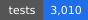
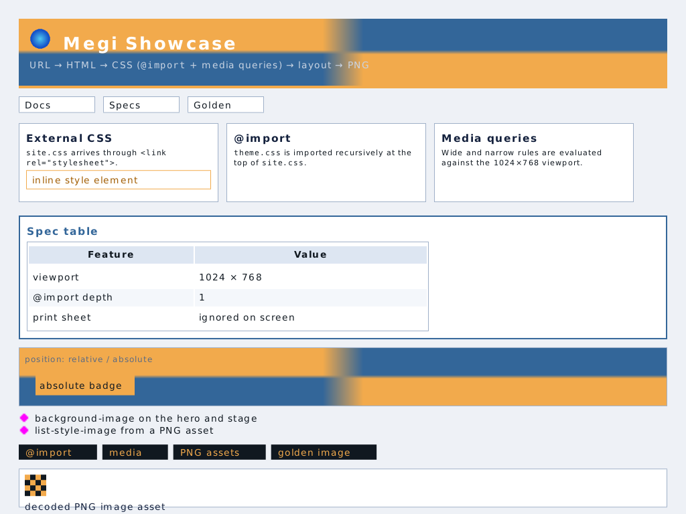
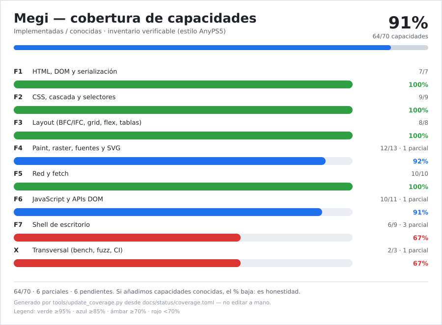
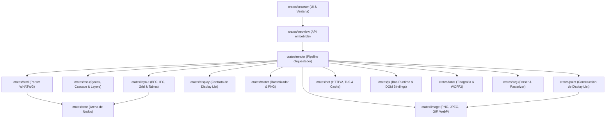

# Megi Web Engine 🌐

[-orange.svg?logo=rust)](https://www.rust-lang.org/)
[](https://github.com/juanpimg/Megi/actions/workflows/ci.yml)
[](LICENSE)
[](PROGRESS.md)
[](https://github.com/juanpimg/Megi/actions/workflows/fuzz-nightly.yml)
[]()
[-success.svg)](PROGRESS.md)

> **Megi** es un motor de navegación web moderno, open source e independiente desarrollado desde cero en **Rust** (Edición 2024), sin bifurcar (*fork*) Blink, WebKit ni Gecko. Su diseño se rige estrictamente por las especificaciones formales vivas de **WHATWG** y **W3C**, con verificación continua en bucle cerrado (*closed-loop testing*) contra **Web Platform Tests (WPT)** y **`html5lib-tests`**.

---

## Megi Browser Shell


*Navegador interactivo Megi (`crates/browser`): chrome nativo con barra de navegación, pestañas, motor tipográfico y renderizado determinista de HTML/CSS de extremo a extremo. Para más ejemplos y capturas de renderizado, consulta la [Galería de Renders](docs/SHOWCASE.md).*

---

## 🧭 Hoja de ruta vigente (aprobada)

Megi avanza hacia un **navegador 100 % utilizable en producción** con conformidad WPT verificable. La estrategia es la hoja de ruta **M0–M12** (dependencias lógicas, sin fechas) del PR #2290:

- [Estrategia y barra de producción](docs/superpowers/specs/2026-11-24-megi-ambition-design.md)
- [Master plan — índice de hitos y planes](docs/superpowers/plans/2026-11-24-megi-ambition-master-plan.md)
- [Índice operativo para agentes](docs/AGENT-INDEX.md) y [tablero de work packages](docs/work-packages/BOARD.md)

Afirmaciones antiguas (Q1–Q4, «anti-objetivos», «12 meses», topes de subtests) **no son válidas**. Todo número publicado es conseguido y verificable; el estado vivo está en [`PROGRESS.md`](PROGRESS.md).

## 📈 Estado del Proyecto

[](PROGRESS.md) [](PROGRESS.md) [](docs/status/coverage.html) [](PROGRESS.md) [](PROGRESS.md)

[](docs/status/coverage.html) · [Progress map (checklist histórico)](docs/status/progress.svg)

**Pre-Alpha `v0.1.0`** · cobertura de capacidades verificable: ver **[`PROGRESS.md`](PROGRESS.md)** y **[`coverage.html`](docs/status/coverage.html)** · tests y líneas de Rust **actualizados en [`PROGRESS.md`](PROGRESS.md)** (badges superiores) · gate de conformidad **PASS** (4 suites) · **17 crates** · **17/17** crates con `#![forbid(unsafe_code)]`.

> **Estado Pre-Alpha (`v0.1.0`)**: Megi ya es compilable y ejecutable como navegador de escritorio (`megi`) y pipeline CLI (`render`), con HTML5, CSS3 (Flexbox/Grid/Container Queries/Layers/bidi), JS (Boa 0.22 + ES modules + `fetch`), SVG/SMIL e imágenes (PNG/JPEG/GIF/WebP). Ya están implementados las animaciones CSS `@keyframes`/`transition` en runtime y el aislamiento multiproceso por pestaña; siguen pendientes el shaping de scripts complejos (árabe/hebreo/tailandés/CJK) y la accesibilidad nativa completa (ver `docs/status/coverage.html`).
> El porcentaje del antiguo mapa de fases era un promedio de estimaciones y **no** indicaba si el navegador es usable. Ahora el titular es `capacidades implementadas / conocidas`, con evidencia verificable y la lista de pendientes en **[`coverage.html`](docs/status/coverage.html)** (reglas en [`COVERAGE.md`](docs/status/COVERAGE.md)). El aspecto real en webs se comprueba con [`real_site_check.py`](tools/real_site_check.py) y se publica en **[`real-sites.html`](docs/status/real-sites.html)** (capturas y avisos reales de `render`).
> Las métricas exactas se actualizan automáticamente en **[`PROGRESS.md`](PROGRESS.md)**. Para consultar el historial de versiones, revisa el **[`CHANGELOG.md`](CHANGELOG.md)**.

## 🤝 Contribuciones

Megi es pre-alpha y hay trabajo acotado para empezar hoy mismo:

- [Issues `good first issue`](https://github.com/juanpimg/Megi/labels/good%20first%20issue) — cambios pequeños y verificables con un comando local.
- [Issues `help wanted`](https://github.com/juanpimg/Megi/labels/help%20wanted) — alcance algo mayor, con evidencia y repro incluidos.
- [Guía de contribución](CONTRIBUTING.md) — convenciones, DCO, TDD y gates obligatorios.
- [Prompt para agentes de IA](docs/AI-QUICKSTART.md) — arranque rápido para Claude Code, Codex, OpenCode u otro harness.
- [Web del proyecto](https://juanpimg.github.io/Megi-web/) — arquitectura, estado y hoja de ruta.

Si vas a trabajar en una issue, comenta en ella primero para evitar duplicados. Los cambios de seguridad se reportan en privado según [`SECURITY.md`](SECURITY.md).

---

##  Características Principales

-  **Conformidad Estricta con Estándares**:
  - **HTML5 100 %**: Tokenizador (7.050/7.050), árbol DOM (3.904/3.904) y serializador (230/230) verificados contra `html5lib-tests`.
  - **CSS Syntax & Selectors**: CSS Syntax WPT (30/30), Selectors L4 con poda por filtros Bloom de ancestros, Cascade Layers (`@layer`) y Container Queries (`@container`).
-  **Rendimiento y Ligereza**:
  - Arena DOM contigua con identificadores `NodeId` generacionales (4 bytes) y resolución de ciclo seguro.
  - Motor de rasterizado CPU optimizado y codificador/decodificador PNG propio con compresión adaptativa.
  - Pipeline de render determinista de bajo consumo de memoria.
-  **Red y Protocolos Modernos (`crates/net`)**:
  - Soporte completo HTTP/1.0/1.1 y HTTP/2 multiplexado con control de flujo por ventana y priorización de push.
  - Cifrado seguro con TLS 1.2/1.3 en Rust puro (`rustls` + `webpki-roots`).
  - Caché HTTP (RFC 9111), gestión de Cookies (RFC 6265), CORS, Referrer-Policy, Range y proxies HTTP/HTTPS/SOCKS5. PAC/WPAD es **opt-in** (feature `pac` de `net`, sin habilitar en los binarios publicados): sin ella se usan proxies directos/estáticos.
-  **Ejecución de JavaScript (`crates/js`)**:
  - Integración nativa con el motor ECMAScript **Boa 0.22**.
  - Bindings completos para manipulación del DOM, eventos, temporizadores y Web Workers cooperativos.
-  **Shell de Escritorio Usable (`crates/browser`)**:
  - Ventana interactiva nativa (X11/Wayland vía `winit`), soporte para múltiples pestañas, zoom dinámico, historial navegable y modo screenshot *headless* para CI. Chrome oscuro con acento, pestañas redondeadas y barra tipo pill; el mismo binario sirve para X11 y Wayland.

---

## 🚀 Inicio Rápido

> Guía detallada: [docs/GETTING-STARTED.md](docs/GETTING-STARTED.md)

### Requisitos

- **Rust**: Edición 2024 (MSRV 1.91 o superior; lo exige `boa_engine` 0.22).
- *(Opcional para ventana gráfica)*: Servidor gráfico X11 o Wayland en Linux (ver dependencias en la guía).

### 1. Compilar y Ejecutar el Navegador

```bash
# Abrir una URL o archivo HTML en el navegador gráfico
cargo run --release -p megi-browser -- https://example.com

# Modo headless: generar captura PNG de una página sin levantar servidor gráfico
cargo run --release -p megi-browser -- https://example.com --screenshot output.png --width 1024 --height 768
```

### 2. Ejecutar la Suite de Conformidad y Tests

```bash
# Ejecutar los tests del workspace
cargo test --workspace

# Ejecutar el gate oficial de conformidad (HTML5 + CSS)
cargo run --release -p megi-test-harness -- --summary

# Modo estricto de conformidad
cargo run --release -p megi-test-harness -- --summary --strict
```

### 3. Pipeline de Render a Imagen

```bash
# Renderizar un documento HTML local a PNG mediante el pipeline de Fase 5
cargo run --release -p megi-render -- tests/fixtures/render/basic.html /tmp/render.png --width 800 --height 600
```

---

##  Arquitectura del Workspace

El proyecto está diseñado como un Grafo Acíclico Dirigido (DAG) desacoplado en 17 crates especializados:



| Crate | Responsabilidad | Concurrencia / Seguridad |
|---|---|:---:|
| [`crates/core`](crates/core) | Arena de nodos DOM contigua con `NodeId` generacional libre de ciclos. | `#![forbid(unsafe_code)]` |
| [`crates/html`](crates/html) | Tokenizador y árbol WHATWG HTML5 con conformidad 100%. | `#![forbid(unsafe_code)]` |
| [`crates/css`](crates/css) | Parser CSS Syntax L3, Cascade Layers, Selectors L4 y Bloom pruning. | `#![forbid(unsafe_code)]` |
| [`crates/layout`](crates/layout) | Árbol de cajas, BFC, IFC, CSS Grid, Flexbox y Container Queries. | `#![forbid(unsafe_code)]` |
| [`crates/display`](crates/display) | Contrato puro de DisplayList compartido por paint y raster. | `#![forbid(unsafe_code)]` |
| [`crates/paint`](crates/paint) | Construcción de DisplayList y orden de pintado CSS 2.2. | `#![forbid(unsafe_code)]` |
| [`crates/raster`](crates/raster) | Rasterizado 2D AA y codificación PNG determinista. | `#![forbid(unsafe_code)]` |
| [`crates/webview`](crates/webview) | API embebible sin ventana: load/frame/eventos/hit-test. | `#![forbid(unsafe_code)]` |
| [`crates/image`](crates/image) | Decodificadores y codificador PNG, JPEG, GIF y WebP deterministas. | `#![forbid(unsafe_code)]` |
| [`crates/fonts`](crates/fonts) | Shaping de texto, integración de fuentes del sistema y WOFF2. | `#![forbid(unsafe_code)]` |
| [`crates/svg`](crates/svg) | Parser XML de SVG y rasterizador vectorial analítico scanline. | `#![forbid(unsafe_code)]` |
| [`crates/net`](crates/net) | Stack de red: URL WHATWG, HTTP/1.1, HTTP/2 multiplexado y TLS puro. | `#![forbid(unsafe_code)]` |
| [`crates/js`](crates/js) | Motor JS ECMAScript basado en Boa, bindings DOM y Web Workers. | `#![forbid(unsafe_code)]` |
| [`crates/render`](crates/render) | Orquestador del pipeline completo de renderizado web de extremo a extremo. | `#![forbid(unsafe_code)]` |
| [`crates/browser`](crates/browser) | Aplicación de escritorio nativa con pestañas, address bar y hotkeys. | `#![forbid(unsafe_code)]` |
| [`crates/bench`](crates/bench) | Arnés de benchmarks reproducibles para medir latencias del pipeline. | `#![forbid(unsafe_code)]` |
| [`crates/test_harness`](crates/test_harness) | Runner de verificación oficial frente a suites de conformidad WPT. | `#![forbid(unsafe_code)]` |

---

## 📖 Documentación

-  [`docs/ARCHITECTURE.md`](docs/ARCHITECTURE.md): Arquitectura detallada, modelo de memoria del DOM y política de dependencias.
-  [`docs/SHOWCASE.md`](docs/SHOWCASE.md): Galería de capturas, fixtures y pruebas visuales de render.
-  [`docs/ROADMAP.md`](docs/ROADMAP.md): Plan de fases (`WP-*`) y estado del desarrollo a largo plazo.
-  [`docs/PERFORMANCE.md`](docs/PERFORMANCE.md): Metodología de benchmarks y mediciones de rendimiento.
-  [`docs/FUZZING.md`](docs/FUZZING.md): Targets de fuzzing continuo y política de triaje de fallos.
-  [`SECURITY.md`](SECURITY.md): Modelo de seguridad de memoria, límites anti-DoS y políticas de reporte.
-  [`CONTRIBUTING.md`](CONTRIBUTING.md): Guía de contribución, convenciones de código y workflows de CI.
-  [`docs/AI-QUICKSTART.md`](docs/AI-QUICKSTART.md): Prompt pegable para empezar a trabajar en el repo con Claude Code, Codex, OpenCode u otro harness de IA.
-  [`CHANGELOG.md`](CHANGELOG.md): Registro histórico de versiones, hitos y optimizaciones por ronda.
-  [`docs/AGENT-INDEX.md`](docs/AGENT-INDEX.md): Índice operativo para agentes, hitos M0–M12 y plans ejecutables.

---

## 🔒 Seguridad

Para reportar vulnerabilidades, **no abras un issue público**. Usa un aviso de seguridad privado en GitHub o contacta al mantenedor:

- **GitHub Security Advisories**: [Abrir aviso privado](https://github.com/juanpimg/Megi/security/advisories/new)
- **Política, severidad (CVSS 3.1) y plazos de divulgación**: consulta [`SECURITY.md`](SECURITY.md)

---

## 📄 Licencia

Megi se distribuye bajo doble licencia, a tu elección:

- **Licencia MIT** ([`LICENSE-MIT`](LICENSE-MIT))
- **Licencia Apache 2.0** ([`LICENSE-APACHE`](LICENSE-APACHE))

*(La fuente DejaVu Sans incluida en los recursos de pruebas conserva su propia licencia en `crates/fonts/tests/fixtures/LICENSE-DejaVu.txt`).*
