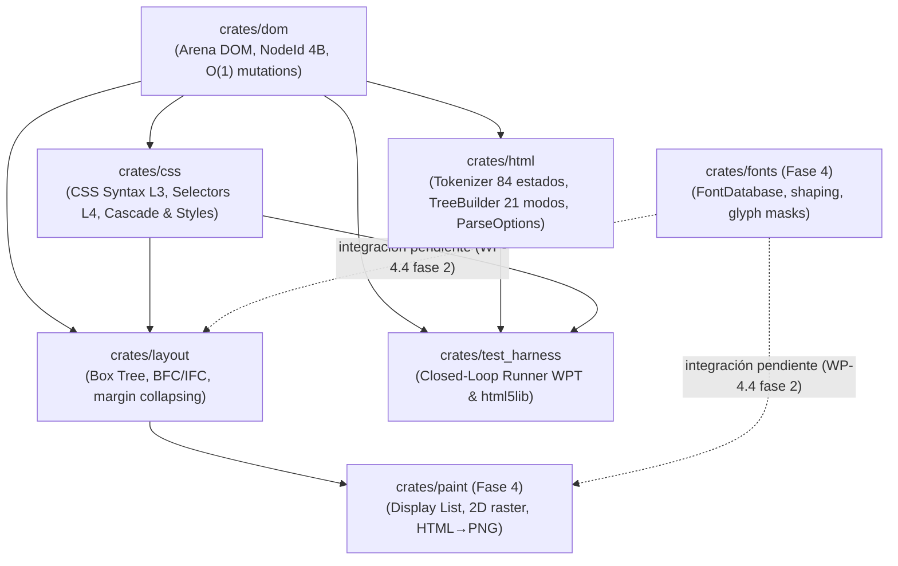

# Megi Web Engine 🌐🦀

[-orange.svg?logo=rust)](https://www.rust-lang.org/)
[](https://github.com/juanpimg/Megi/actions/workflows/ci.yml)
[](LICENSE)
[-brightgreen.svg)]()
[-success.svg)]()
[-success.svg)]()

> **Megi** es un motor de navegación web moderno, open source e independiente desarrollado desde cero en **Rust** (Edición 2024), sin bifurcar (*fork*) Blink, WebKit ni Gecko. Todo su diseño se rige estrictamente por las especificaciones formales vivas de **WHATWG** y **W3C**, con verificación continua en bucle cerrado (*closed-loop testing*) contra **Web Platform Tests (WPT)** y **`html5lib-tests`**.

---

## 📊 Estado del Proyecto y Barra de Progreso por Módulos

Fases 0–3 completadas (DOM, HTML, CSS, Layout). La **Fase 4 (paint + tipografía)** está **en curso**: el pipeline `HTML → CSS → layout → display list → PNG` ya funciona de extremo a extremo y el motor tipográfico existe como crate independiente, pero aún no está integrado en layout/paint. Las fases 5–7 están planificadas. El detalle de qué falta exactamente está en [`docs/PHASE4-SUPPORT.md`](docs/PHASE4-SUPPORT.md).

| Módulo / Crate | Barra de Progreso | Estado | Tests | Capacidades Implementadas |
|---|:---:|:---:|---|---|
| [`crates/dom`](crates/dom) | `[██████████] 100%` | **COMPLETO** | 9/9 unit | Arena contigua indexada (`NodeId(NonZeroU32)` de 4 bytes), enlaces intrusivos de 20 bytes, mutaciones $O(1)$, coalescencia de texto, `<template>` y `try_node`; `append_child`/`insert_before` validan ciclos y devuelven `bool`. |
| [`crates/html`](crates/html) | `[██████████] 99.9%` | **COMPLETO (declarativo)** | 7/7 unit + 13 robustez | Tokenizador de 84 estados (§13.2.5), 21 modos de construcción del árbol (§13.2.6), 2.231 entidades (§13.5), AAA y *foster parenting*, `innerHTML`; **límites anti-DoS** mediante `ParseOptions` (profundidad 4.096, 1 M nodos, 4.096 atributos, 16 MiB de entrada) y serializador iterativo. |
| [`crates/css`](crates/css) | `[██████████] 100%` | **COMPLETO (Fase 2)** | 23/23 unit + 30/30 WPT | Tokenizador/parser CSS Syntax L3, Selectores L4, cascada y especificidad, `ComputedStyle` y hoja UA WHATWG HTML §15; en Fase 4 amplía bordes por lado/shorthands, `border-style: none` ⇒ ancho 0, `float`/`clear`/`overflow`/`visibility`/`text-decoration`/`list-style-type` y correcciones de selectores. |
| [`crates/layout`](crates/layout) | `[█████████░] 90%` | **Fase 3 completa + correcciones Fase 4** | 61 tests | Box Tree, cajas anónimas *inherit-only* (§9.2.1.1), BFC con **colapso de márgenes** (§8.3.1), ICB con altura de viewport, `box-sizing`/`min-max`/alturas porcentuales, sobre-restringido; IFC con `<br>` forzado. Tablas, floats, `position` e `inline-block` siguen planificados en Fase 4. |
| [`crates/fonts`](crates/fonts) | `[█████░░░░░] 50%` | **Fase 4 (nuevo, en curso)** | 13 + 1 doctest | Motor tipográfico real: `fontdb` + `ttf-parser` + `rustybuzz` + `ab_glyph`; descubrimiento/fallback de fuentes, `FontMetrics`, `measure_text`, shaping LTR (kern/ligaduras), rasterización de glifos a máscaras alfa; fuente DejaVu determinista empaquetada con licencia. **Aún no integrado en `layout`/`paint`.** |
| [`crates/paint`](crates/paint) | `[█████░░░░░] 55%` | **Fase 4 (en curso)** | 33 tests | Display lists desacopladas, rasterizador 2D con blending, **pipeline HTML → PNG de extremo a extremo** (ejemplo `html_to_png`), codificador PNG propio sin dependencias, canvas blanco con propagación de fondo raíz/`body` (CSS 2.2 §14.2), `RenderConfig`, extracción de `<style>` y golden determinista. Pendientes: integración de fuentes reales, bordes por lado en el raster, stacking contexts, `opacity`, clip y antialiasing. |
| [`crates/test_harness`](crates/test_harness) | `[██████████] 100%` | **COMPLETO** | 5/5 closed-loop | Runner de `html5lib-tests` (14 suites de tokenizador, 62 suites de árbol) y de las fixtures WPT de CSS Syntax **vendorizadas**; **gate de conformidad** con allowlist documentada (`--summary` exit 0, `--strict` exit 1). |
| `crates/net` | `[░░░░░░░░░░] 0%` | *Planificado (Fase 5)* | — | Transporte HTTP/TLS y pipeline de recursos según WHATWG Fetch. |
| `crates/js` | `[░░░░░░░░░░] 0%` | *Planificado (Fase 6)* | — | Integración de ejecución de scripts JavaScript y DOM bindings. |
| `crates/shell` | `[░░░░░░░░░░] 0%` | *Planificado (Fase 7)* | — | Ventana del sistema operativo, eventos y bucle principal de renderizado. |

**Total del workspace: 165 tests, 0 fallos.** Reparto: `css` 23, `dom` 9, `fonts` 13 + 1 doctest, `html` 7 unit + 13 robustez, `layout` 61, `paint` 33, `test_harness` 5.

---

## 🏆 Hitos Principales Logrados

- [x] **Arquitectura Zero-Overhead Arena DOM**: arena contigua de nodos con `NodeId(NonZeroU32)` de 4 bytes, mutaciones $O(1)$ y cero `Rc<RefCell<Node>>`.
- [x] **Conformidad HTML5 declarativa verificada y gate reproducible**: tokenizador **7.047/7.050** (allowlist `xmlViolation.test`: 3), construcción de árbol **3.898/3.904** (allowlist: 4 suites `scripted_*`: 6 mode-runs). `cargo run -p test_harness -- --summary` devuelve **PASS con exit 0**; las fixtures WPT de CSS Syntax están vendorizadas (30/30 comprobaciones, sin red).
- [x] **Robustez anti-DoS del núcleo**: parsear 100.000/200.000 `<div>` anidados ya **no aborta el proceso** (~70 ms; antes SIGABRT por recursión) y 40.000 atributos en un start-tag bajan de ~1.276 ms a ~10 ms; límites duros en `ParseOptions` reportados vía `LimitViolations`, serializador iterativo y DOM con `try_node`/`clone_node` de `<template>`.
- [x] **Motor CSS con cascada normativa**: 23 tests y 30/30 comprobaciones WPT, con bases de Fase 4 (bordes por lado, `border-style: none`, `float`/`clear`/`overflow`/`visibility`/`text-decoration`/`list-style-type`) y selectores corregidos (pseudo-clases desconocidas invalidadas, SVG/MathML, comas en atributos).
- [x] **BFC/IFC con correcciones de Fase 4**: cajas anónimas *inherit-only* (fin de márgenes y fondos fantasma), `<br>`, colapso de márgenes §8.3.1, altura del bloque contenedor inicial, `box-sizing`/`min-max`/porcentajes y sobre-restringido; 61 tests.
- [x] **Pipeline HTML → PNG real**: primer render de extremo a extremo con codificador PNG propio (DEFLATE *stored*, sin dependencias), canvas blanco (0 % de píxeles transparentes frente al 88,7 % anterior), propagación del fondo raíz/`body` y golden determinista de 800×600.
- [x] **Motor tipográfico real (`crates/fonts`)**: métricas OpenType, shaping LTR con kern/ligaduras, fallback de fuentes y rasterización de glifos a máscaras alfa, con dependencias de bajo nivel autorizadas por `docs/ARCHITECTURE.md` §3.1.
- [x] **Infraestructura de proyecto**: CI (`.github/workflows/ci.yml`: fmt, clippy `-D warnings`, tests, doc, gate de conformidad y job MSRV), licencias MIT/Apache, `rust-version = "1.88"` verificado con `rustup` (el código usa `let-chains`, estabilizadas en Rust 1.88) y `./tools/dev.sh all` como puerta única de calidad.

---

## 🏗️ Arquitectura del Espacio de Trabajo (DAG)

Megi está diseñado como un **Grafo Acíclico Dirigido (DAG)** sin dependencias circulares ni cajas negras:



Crates planificados: `crates/net` (Fase 5), `crates/js` (Fase 6) y `crates/shell` (Fase 7).

---

## 🚀 Inicio Rápido y Flujo de Trabajo

### Requisitos
- **Rust 1.88+ (Edition 2024)**; MSRV declarada en `Cargo.toml` y verificada en CI (`rustup toolchain install 1.88`).
- **Git** y **Python 3** (scripts de tooling: especificaciones, inspección de tests y `png_check.py`).

### Compilar y Verificar Todo el Workspace

```bash
./tools/dev.sh all
```

Ejecuta, en orden: `cargo fmt --check` → `cargo clippy --workspace --all-targets -- -D warnings` → `cargo test --workspace` → `cargo doc --workspace --no-deps` → **gate de conformidad** (`test_harness --summary`). Ruta de comprobación equivalente, paso a paso:

```bash
cargo +1.88 check --workspace --all-targets   # MSRV
cargo test --workspace                         # 165 tests
cargo run -p test_harness -- --summary         # gate: PASS, exit 0
```

### Gate de Conformidad (HTML5 + WPT vendorizado)

```bash
# Resumen completo: tokenizador, árbol DOM y CSS Syntax
cargo run -p test_harness -- --summary

# Modo estricto: cualquier fallo (incluidos los de la allowlist) hace exit 1
cargo run -p test_harness -- --summary --strict

# Ejecutar una suite concreta
cargo run -p test_harness -- template.dat
cargo run -p test_harness -- test3.test
```

### Renderizar HTML a PNG (pipeline de Fase 4)

```bash
cargo run -p paint --example html_to_png -- tests/fixtures/phase4/basic.html /tmp/basic.png
python3 tools/png_check.py /tmp/basic.png
```

El ejemplo acepta `[width] [height]` (por defecto 800×600) y `--rgba <ruta>` para volcar la imagen RGBA canónica usada por los golden tests. Ver [`tests/fixtures/phase4/README.md`](tests/fixtures/phase4/README.md).

### Motor Tipográfico (crate `fonts`)

```bash
cargo run -p fonts --example report    # métricas, shaping y glifo con DejaVu Sans @16px
cargo test -p fonts
```

### Consultar las Especificaciones Oficiales desde Terminal

```bash
python3 tools/whatwg_spec.py html "#data-state"
python3 tools/whatwg_spec.py html "#the-after-after-body-insertion-mode"
```

---

## 📖 Documentación del Proyecto

- 🏛️ [`docs/ARCHITECTURE.md`](docs/ARCHITECTURE.md): modelo de crates y DAG, arena DOM, política de dependencias externas (§3) y decisión de codificador PNG propio (§3.2).
- 🗺️ [`docs/ROADMAP.md`](docs/ROADMAP.md): hoja de ruta por fases y micro-paquetes `WP-*`, incluida la **Fase 4 (`WP-4.0`…`WP-4.13`)** con estado y criterios de aceptación.
- 🧭 [`docs/PHASE4-SUPPORT.md`](docs/PHASE4-SUPPORT.md): matriz de soporte CSS 2.2 de la Fase 4 (implementado / parcial / pendiente) y decisiones de alcance.
- 🤝 [`CONTRIBUTING.md`](CONTRIBUTING.md): filosofía, convenciones de código/commits, CI y flujo de PR.
- 🛠️ [`docs/TOOLING.md`](docs/TOOLING.md): scripts CLI, fixtures vendorizadas, validación PNG y skills de agentes.
- 📦 [`docs/HANDOFF.md`](docs/HANDOFF.md): estado de la última iteración, comandos de verificación y deuda técnica priorizada.

---

## 📄 Licencia

Megi se publica bajo doble licencia:

- **Licencia MIT** ([`LICENSE-MIT`](LICENSE-MIT))
- **Licencia Apache 2.0** ([`LICENSE-APACHE`](LICENSE-APACHE))

a tu elección. La fuente de test DejaVu Sans empaquetada en `crates/fonts/tests/fixtures/` conserva su propia licencia (ver `LICENSE-DejaVu.txt`).

---

> **Estado**: proyecto en desarrollo activo, sin releases publicadas. La Fase 4 no está cerrada; consulta [`docs/PHASE4-SUPPORT.md`](docs/PHASE4-SUPPORT.md) antes de asumir soporte de una propiedad CSS.
