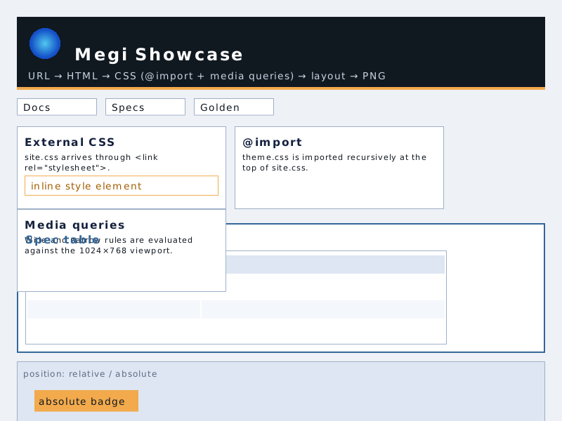
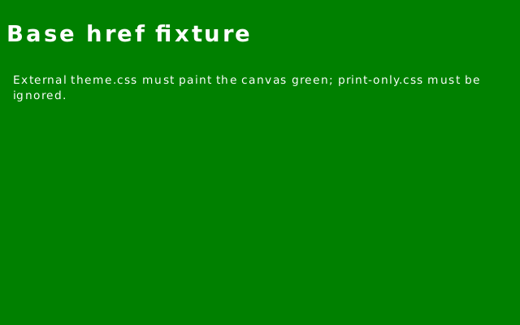
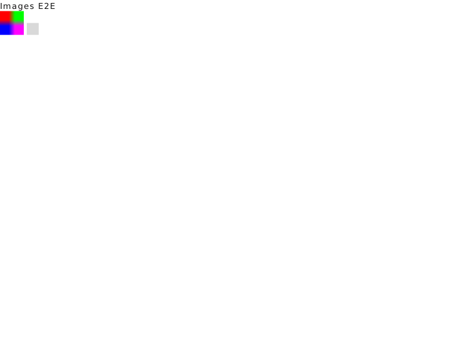
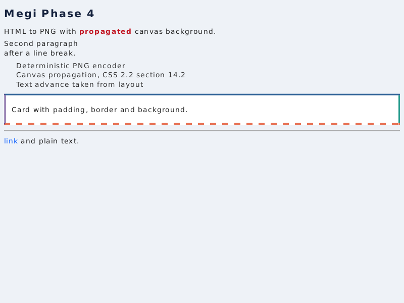

# 🖼️ Megi Visual Showcase & Gallery

Esta galería documenta los resultados visuales deterministas producidos por los diferentes componentes y fases del motor **Megi**.

---

## 1. Navegador de Escritorio Interactivo (`crates/shell`)



Render determinista (1024×768) de una página compleja de prueba que combina:
- Pestañas dinámicas y barra de navegación (`chrome`).
- Hojas de estilo externas con directivas `@import` y *media queries*.
- Muestreo bilineal de imágenes y tablas CSS.
- Elementos posicionados y listas con viñetas personalizadas.

```bash
# Abrir interactivamente:
cargo run --release -p shell -- tests/fixtures/render/showcase/index.html

# Generar captura headless:
cargo run --release -p shell -- tests/fixtures/render/showcase/index.html --screenshot docs/images/showcase.png --width 1024 --height 768
```

---

## 2. Pipeline de Navegación con Resolución Externa (`crates/render`)



Prueba del pipeline completo de Fase 5 resolviendo `<base href="...">` y hojas de estilo externas:
- Hoja externa cargada y aplicada deterministamente sobre el canvas.
- Filtrado estricto de hojas `media="print"`.
- Aplicación simultánea de `<style>` inline.

```bash
cargo run --release -p render -- tests/fixtures/render/basic.html docs/images/render-fixture.png --width 640 --height 400
```

---

## 3. Decodificación y Escalado de Imágenes Multiformato (`crates/image`)



Demostración del subsistema gráfico multiformato:
- Escalado bilineal con técnica *clamp-to-edge* desde un PNG de 4×4 a 40×40.
- Gestión segura de recursos no disponibles mediante *placeholders* visuales y advertencias no fatales.
- Soporte integrado y puro en Rust para **PNG, JPEG (con miniaturas EXIF), GIF y WebP (lossless y lossy VP8)**.

```bash
cargo run --release -p render -- tests/fixtures/render/images.html docs/images/images-e2e.png
```

---

## 4. Tipografía Real y Rasterizado 2D (`crates/paint` + `crates/fonts`)



Render determinista a 800×600 validando las capacidades fundamentales de rasterizado:
- Tipografía real con *shaping* y máscaras analíticas de glifos (fuente DejaVu Sans y soporte WOFF2).
- Bordes independientes por lado (`solid`, `dashed`, `dotted`, `double`).
- Antialiasing subpíxel y propagación de color de fondo del canvas (CSS 2.2 §14.2).
- Contextos de apilamiento (*stacking contexts*) con `z-index`, `position: relative` y compositing con `opacity`.
- Compresión final generada directamente con el codificador PNG propio de Megi.

```bash
cargo run --release -p paint --example html_to_png
```
