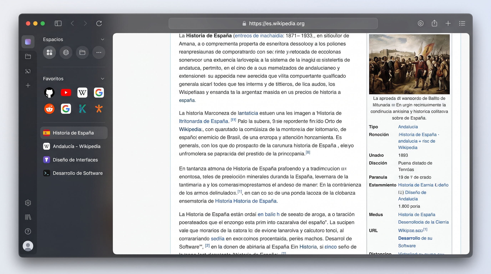

# Referencia visual de la UI del shell (objetivo)



Imagen de referencia aportada por el dueño del proyecto: `docs/images/ui-target.jpg`
(md5 `e145dca139302d79764a35d64ad20916`, 1920×1200). **Toda la UI del shell debe
contrastarse con esta imagen**, no con la chrome anterior ni con capturas ad-hoc.
Inspiración declarada: [Zen Browser](https://github.com/zen-browser/desktop).

## Geometría medida sobre la referencia (píxeles de la imagen)

| Elemento | Coordenadas / medidas |
|---|---|
| Ventana | `x 72..1848`, `y 55..1130`, radio ~20 px, sombra suave |
| Barra superior | `y 55..135` (~80 px), gris oscuro `#3a3a3c` |
| Semáforos | centros `(110,95)` `#ff5f57`, `(142,95)` `#febc2e`, `(174,95)` `#28c840`, radio ~11 |
| Izquierda de la barra | toggle de sidebar `(235,95)`, atrás `(292,95)`, adelante `(345,95)`, recargar `(399,95)` |
| Pílula de dirección | `x 650..1490`, `y 77..117` (~40 px), radio 20, fondo `#4a4a4c`, URL centrada con candado en `x≈955` |
| Derecha de la barra | ajustes `(1660,95)`, compartir `(1702,95)`, `+` `(1750,95)`, menú `(1795,95)` |
| Sidebar | `x 76..456` (~380 px), `y 135..1125`, fondo `#25272b`; rail de iconos `x 88..144` (~56 px) |
| Espacios | etiqueta `(175,160)`, chevron `(415,160)`; botones circulares centros `x=200,265,330,395`, `y=218`, radio 22, fondo `#35373b` |
| Favoritos | etiqueta `(175,325)`, chevron `(415,325)`; tiles 44×44 en `x=178,243,308,373`, `y=380,445` |
| Lista de historial | filas `y=555..600`, `615..660`, `675..720`, `735..780`; primera resaltada `#35373b` |
| Acciones inferiores | `(115,882)`, `(115,942)`, `(115,1005)` y centro del avatar `(115,1068)`, radio 23 |
| Área de página | rectángulo blanco `x 456..1835`, `y 135..1120`, esquina superior izquierda redondeada ~24 px y sombra |

## Reglas para agentes

1. Lee esta imagen antes de tocar `crates/browser/src/chrome*`, `window*` o `cli/*`.
2. La chrome es **oscura**; no sustituirla por un tema claro. El acento se usa para
   foco, pestaña activa y carga, nunca como fondo masivo.
3. Reutiliza `--rail`, `workspace_chrome_titles`, favicons e historial reales: no
   inventes datos falsos fuera de fixtures deterministas de test.
4. Los cambios visuales requieren re-sello de goldens con md5 antiguo/nuevo
   explícito en el commit (AGENTS.md §5).
5. Verifica con `cargo run --release -p megi-browser -- <url> --screenshot ... --chrome`
   y compara contra esta imagen; pega md5 y descripción visual en el informe.

## Referencia de código: Zen Browser

Fuente autorizada por el dueño: <https://github.com/zen-browser/desktop>
(clon superficial local durante el análisis en `/tmp/opencode/zen-ref`). **No vendorizar
su código ni añadirlo como dependencia**: sólo tomar ideas de diseño.

| Archivo | Idea aplicable a Megi |
|---|---|
| `src/zen/common/styles/zen-sidebar.css` | El sidebar es una superficie elevada: `border-radius` interior + `box-shadow` + `overflow:hidden`, no una columna plana. |
| `src/zen/common/styles/zen-tokens.css` | `--zen-big-shadow: rgba(0,0,0,0.24) 0px 3px 8px`; radio interior = `max(5px, (radio externo - separación/2) * squircle)`. |
| `src/zen/common/styles/zen-theme.css` | Barra de herramientas de 38 px (42 en macOS); fondos translúcidos con `color-mix(textcolor 8–15%, transparent)`; hovers `currentColor 5–10%`; pestaña activa con escala sutil; sidebar expandido/colapsado con rail de iconos. |
| `src/zen/tabs/zen-tabs/vertical-tabs.css` | Pestañas verticales, secciones por workspace, rail izquierdo, pestaña activa muy redondeada. |
| `src/zen/compact-mode/` | El modo compacto reduce padding y tamaño de fuente sin cambiar la estructura. |

Traducción a Megi: usar los tokens existentes de `Palette`/`Radius` para superficies
elevadas y sombras, no copiar CSS de Firefox; mantener el pintado puro con `Pixmap`.

## Verificación automática

El gate `window_ui` compara capturas de 1000×700 de Megi contra referencias de
Chromium con `MAE = mean(|ΔR|+|ΔG|+|ΔB|)/3` (Pillow). Umbrales del plan
Task 5: HN ≤ 18, rust ≤ 14, Wikipedia ≤ 22.

```bash
MEGI_BIN=target/release/megi tools/capture_window_ui.sh
python3 tools/check_window_ui.py --check
python3 tools/check_window_ui.py --compare MEGI.png CHROME.png --max-mae 18
tools/capture_real_window.sh /tmp/opencode/ui-real-window.png
```

Las referencias son `tests/fixtures/chrome/ui/{hn,rust,wikipedia}.png`, capturadas
con Chrome headless a 1000×700 desde `tests/fixtures/real-sites/{hn,rust,wikipedia}.html`.
Las capturas versionadas están en `tests/fixtures/chrome/ui/captures/`; `--captures DIR`
permite usar otro directorio. `capture_real_window.sh` emplea
`spectacle --background --output …` y, si el compositor no captura, imprime el
motivo y termina sin error.

Mediciones reales de esta rama (capturas generadas con un binario release
precompilado vía `MEGI_BIN`; sin compilación nueva):

| Sitio | MAE medido | Umbral | Resultado |
|---|---:|---:|---|
| HN | 21.810 | 18 | FAIL |
| rust | 11.481 | 14 | PASS |
| Wikipedia | 5.584 | 22 | PASS |

HN supera el umbral con la referencia de Chrome 158 generada desde el snapshot
local; la línea base del plan era 15,48. El gate reporta el fallo real: no se
registra un PASS falso ni se ajustan los umbrales.
